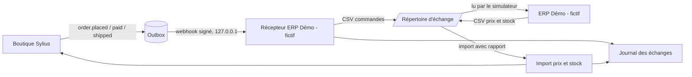

# ADR-0017 — Connecteur ERP de référence

- **Statut** : Accepté (2026-10-24) : story A au sprint 26 ([US-185](../../project-management/backlog/user-stories/US-185.md)), stories B et C au backlog ([US-187](../../project-management/backlog/user-stories/US-187.md), [US-188](../../project-management/backlog/user-stories/US-188.md))
- **Contexte projet** : sylius-b2b-demo, sprint 24, spike US-130 (3 points, borné à 4 h). Les stories de découpage d'origine (US-136, US-137) ont été abandonnées le 2026-10-23 ; ce document en propose de nouvelles.

## Contexte

Un acheteur B2B attend que la boutique échange avec son ERP : les commandes y descendent, les prix et les stocks en remontent. La démo ne dispose d'aucun ERP réel. Le plugin `tmonier/sylius-webhook-outbox-plugin` fournit déjà le côté « sortie » : événements écrits dans la transaction métier, signature Standard Webhooks, reprises, journal des livraisons et rejeu dans l'administration (voir [webhooks-demo.md](../webhooks-demo.md)). Il n'existe en revanche ni export en fichier plat, ni import de prix ou de stock.

Ce spike répond à : quel format, quels contrats, quel périmètre, et comment le démontrer sans ERP réel.

## ERP cibles et capacités

Règle du spike : une capacité n'est citée comme acquise que si la documentation publique de l'éditeur a été lue. Sinon elle est **à vérifier**. Date de consultation de toutes les sources : 2026-10-23. Le spike est borné à 4 h : le relevé est volontairement partiel.

| ERP | Capacité relevée | Statut |
|-----|------------------|--------|
| Microsoft Dynamics 365 Business Central | API v2.0 : ressource [`item`](https://learn.microsoft.com/en-us/dynamics365/business-central/dev-itpro/api-reference/v2.0/resources/dynamics_item) lisible, créable et modifiable (GET, POST, PATCH), avec `unitPrice` (modifiable) et `inventory` (lecture seule) ; ressource [`salesOrders`](https://learn.microsoft.com/en-us/dynamics365/business-central/dev-itpro/api-reference/v2.0/resources/dynamics_salesorder) avec création par POST (consultées le 2026-10-23). | Sourcé. Conséquence : le stock ne s'importe pas par `item` (lecture seule) ; le mécanisme d'écriture du stock est **à vérifier** |
| Odoo | [API externe](https://www.odoo.com/documentation/17.0/developer/reference/external_api.html) (doc 17.0, consultée le 2026-10-23) : XML-RPC, points d'entrée `xmlrpc/2/common` et `xmlrpc/2/object`, méthodes `search`, `read` et `execute_kw` ; authentification par identifiant et mot de passe ou clé d'API. La page indique que l'accès est réservé aux offres « Custom ». Création et mise à jour de `sale.order`, `product.template` et du stock : section non lue (page tronquée). | Transport sourcé ; modèles et champs **à vérifier** |
| SAP Business One | [Service Layer API Reference](https://help.sap.com/doc/056f69366b5345a386bb8149f1700c19/10.0/en-US/Service%20Layer%20API%20Reference.html) (OData v4, consultée le 2026-10-23) : la page existe et se présente comme la référence de toutes les API du Service Layer. Les entités `Orders`, `Items` et `PriceLists` n'ont pas été retrouvées dans la partie lue. | Existence de l'API sourcée ; entités, authentification et écriture des prix et du stock **à vérifier** |
| Sage X3 | Le portail [developer.sage.com/x3](https://developer.sage.com/x3/) annoncerait un guide d'import et d'export de fichiers, des services web SOAP, une API GraphQL et une API d'intégration de données (résultat de recherche du 2026-10-23, page non lue : accès refusé, HTTP 403). | **À vérifier** |
| Sage 100 | Aucune documentation éditeur trouvée ; seules des sources tierces évoquent des interfaces .NET/COM. | **À vérifier** |
| Divalto | Le site public ([divalto.com](https://www.divalto.com/), consulté le 2026-10-23) cite l'« interopérabilité » et l'« EDI » sans décrire d'API ni d'import. Aucune documentation technique publique trouvée. | **À vérifier** (probablement réservée aux partenaires) |

**Lecture.** Seuls Business Central et, partiellement, Odoo et SAP Business One ont une API publique confirmée. Pour les autres, rien n'est affirmé. D'où le choix d'un contrat neutre (ci-dessous), que chaque ERP lit à sa manière, plutôt qu'un adaptateur par éditeur.

## Contrats

### Export de commandes

1. **Par événements** : `order.placed` (envoi à l'ERP), `order.paid`, `order.shipped`, `order.cancelled`, déjà fournis par l'outbox. Enveloppe `{id, type, version, timestamp, channel, data}`, `data` au format `order` v1 (montants en entiers, unité mineure ; `items[].variant_code`, `quantity`, `unit_price`, adresses, `customer`, `payments`, `shipments`). Les événements `customer.created` et `customer.updated` couvrent les tiers.
2. **Par fichier plat** : un consommateur interne du même contrat écrit un CSV par lot (une ligne par ligne de commande), déposé dans un répertoire d'échange. Colonnes proposées : `order_number`, `webhook_id`, `placed_at`, `currency`, `customer_email`, `variant_code`, `quantity`, `unit_price_minor`, `line_total_minor`, `ship_country`. Encodage UTF-8, séparateur `;`, point décimal absent (entiers). Le fichier est écrit sous un nom provisoire puis renommé, pour qu'aucun lecteur ne voie un fichier partiel.

Le fichier plat est dérivé des événements, pas d'une seconde lecture de la base : une seule source de vérité.

### Import de prix et de stock

- **Fichier plat d'abord** : `variant_code;price_minor;currency;channel` pour les prix, `variant_code;on_hand` pour le stock. Un lot est identifié par un nom de fichier unique et un total de contrôle ; un lot déjà traité est ignoré.
- **API ensuite** (hors périmètre retenu, voir la décision) : point d'entrée authentifié recevant le même contenu en JSON.
- Règles communes : validation avant écriture (code de variante connu, montant entier positif, devise du canal), rapport de rejet ligne par ligne, aucune écriture partielle d'un lot invalide pour le prix ; pour le stock, les lignes valides s'appliquent et les autres sont rejetées (à confirmer avec Thibaut).

### Journal, reprise et idempotence

- **Sortie** : la livraison est au moins une fois ; `webhook-id` est identique à chaque reprise et rejeu. Le récepteur déduplique sur cet identifiant. Reprises, liste des livraisons et rejeu existent déjà dans l'outbox.
- **Entrée** : un journal des lots importés (nom, total de contrôle, date, lignes lues, appliquées, rejetées, rapport) est à créer ; la clé d'idempotence est le couple nom de fichier et total de contrôle.
- Les identifiants d'événement servent de références croisées entre le journal de sortie et celui d'entrée.

## Démonstration sans ERP réel

Aucun ERP réel n'est utilisé. La démonstration repose sur le plugin `webhook-outbox` existant et sur des fichiers plats, avec un **ERP fictif, nommé « ERP Démo (fictif) »** dans l'interface, la documentation et les fichiers : il ne représente aucun éditeur.

- Le récepteur reprend le garde-fou de [webhooks-demo.md](../webhooks-demo.md) : signature vérifiée, déduplication sur `webhook-id`, aucun appel sortant.
- Le « simulateur d'ERP » est un script qui lit le CSV de commandes et produit un CSV de prix et de stock modifiés ; il n'implémente aucun ERP réel.
- La page du back-office liste les lots (nom, sens, lignes, rejets), à la manière de « Webhooks reçus ».

## Décision proposée

Le périmètre complet (trois sens, API pour six ERP) est jugé **trop large** et non demandé. Proposition : **périmètre réduit**.

1. Retenu : export de commandes par événements puis CSV, import CSV de prix et de stock, journal des lots, démonstration avec l'ERP fictif. Contrat neutre, sans adaptateur par éditeur.
2. Reporté : API d'import, adaptateurs (Business Central, Odoo, SAP Business One), tout ERP dont la documentation reste « à vérifier ». À rouvrir sur demande d'un intégrateur, avec lecture de la documentation de l'éditeur.
3. Écarté : toute connexion à un ERP réel sans demande et sans accès.

## Découpage en stories (8 points au plus)

Les numéros sont provisoires, à attribuer par l'orchestrateur en cas de décision favorable.

| Story | Contenu | Points |
|-------|---------|--------|
| A | Contrat de fichier plat et export CSV des commandes depuis les événements, avec dépôt atomique | 5 |
| B | Import CSV de prix et de stock : validation, rapport de rejet, journal des lots, idempotence | 8 |
| C | Démonstration : ERP fictif, simulateur, page de journal au back-office, documentation | 5 |
| D (reportée) | API d'import authentifiée | 5 |
| E (reportée) | Premier adaptateur d'éditeur, après lecture de sa documentation | 8 |

Retenu : A, B, C = 18 points. Chaque story reste à 8 points ou moins.

## Questions ouvertes

1. Thibaut veut-il planifier A à C, seulement A, ou aucune ?
2. Le plugin d'outbox doit-il porter le consommateur CSV, ou la démo seule ? (nouveau paquet ou publication : GO de Thibaut requis)
3. Prix d'un import : par canal et par groupe de clients, ou prix unique par variante ? Le contrat ci-dessus suppose le canal.
4. Stock : valeur absolue (`on_hand`) ou delta ? Risque de conflit avec les réservations en cours (`on_hold`).
5. Les entrées « à vérifier » du tableau : lesquelles justifient une lecture complète, et par qui (accès partenaire éventuel pour Divalto) ?
6. Anonymisation : les CSV contiennent des données personnelles (e-mail, adresses) ; durée de rétention du répertoire d'échange à fixer.

## Conséquences

- Positives : périmètre tenable, aucun faux engagement sur un éditeur, preuve démontrable sans ERP, réutilisation de l'outbox.
- Négatives : pas de preuve d'intégration réelle ; le contrat neutre peut demander une adaptation par ERP.

## Décision (2026-10-23)

Thibaut ne planifie aucune réalisation au sprint 24. L'ADR reste proposé ; la décision sur le périmètre et les stories est reportée au planning du sprint 25.

## Décision (2026-10-24)

Thibaut accepte l'ADR et son périmètre réduit (contrat neutre, ERP fictif, aucun adaptateur d'éditeur). Réalisation :

- **Story A au sprint 26** : [US-185](../../project-management/backlog/user-stories/US-185.md), contrat de fichier plat et export CSV des commandes avec dépôt atomique, dérivé des événements de l'outbox. Un nouveau plugin y est proposé (nom provisoire `tmonier/sylius-erp-flatfile-plugin`, ADR 0006) ; la création du dépôt, le tag et la soumission à Packagist attendent le GO de Thibaut. Le plugin `webhook-outbox` n'est pas modifié.
- **Stories B et C au backlog**, numéros attribués : B = [US-187](../../project-management/backlog/user-stories/US-187.md) (import CSV de prix et de stock), C = [US-188](../../project-management/backlog/user-stories/US-188.md) (démonstration avec l'ERP fictif). D et E restent reportées et non créées.
- Réponses aux questions ouvertes 1 et 2 : seule la story A est planifiée ; le consommateur CSV vit dans un nouveau paquet plutôt que dans l'outbox ou la démo. Les questions 3 à 6 restent ouvertes pour les stories B et C.

## Décision (2026-10-24, sprint 27)

Thibaut planifie la story C ([US-188](../../project-management/backlog/user-stories/US-188.md), 5 points) au sprint 27, **sans la story B** ([US-187](../../project-management/backlog/user-stories/US-187.md), import CSV de prix et de stock, hors sprint). La démonstration est donc réduite à ce qui se montre avec l'export déjà livré : un simulateur d'« ERP Démo (fictif) » qui lit le dernier CSV de commandes et dépose un accusé de réception simulé, une page de journal au back-office (lots sortants et entrants, lignes lues, acceptées, rejetées), la documentation. L'import des prix et du stock, le CSV de prix et de stock du simulateur et le rapport de rejet d'import restent avec US-187. L'accusé de réception simulé est validé par Thibaut le 2026-10-24, dans la démo seulement : son format est propre à la démo et présenté comme simulé ; le plugin d'export n'est pas modifié. Les questions ouvertes 3 à 6 restent ouvertes pour US-187.

## Décision (2026-10-25, sprint 28)

Thibaut planifie la story B ([US-187](../../project-management/backlog/user-stories/US-187.md), import CSV de prix et de stock, 8 points) au sprint 28, découpée en **tranche A** (plugin `sylius-erp-flatfile-plugin`, 5 points : lecture, validation, rapport de rejet, journal des lots, idempotence, tag `v0.2.0`) et **tranche B** (démonstration avec l'ERP fictif, 3 points : simulateur de fichier de prix et de stock, import au chargement, page des échanges étendue). Aucun push, tag ni release du plugin sans le GO de Thibaut, qui soumet lui-même à Packagist. Thibaut a **tranché le 2026-10-25** les questions 3, 4 et 6 : prix par canal (code de variante + canal + prix, `ChannelPricing`), sans groupe de clients ; stock en valeur absolue (`on_hand`), sans toucher à `on_hold` ; aucune rétention dans le plugin, remise à zéro nocturne dans la démo. Il a aussi validé l'ordre de sacrifice (tranche B, puis US-196) ; le GO du tag `v0.2.0` sera demandé quand la tranche A sera prête. La question 5 reste ouverte (adaptateurs reportés). Politique Sylius Plus : la documentation de Plus est lue en T-187-01 ; aucune promotion du plugin tant qu'un recouvrement n'est pas levé.

