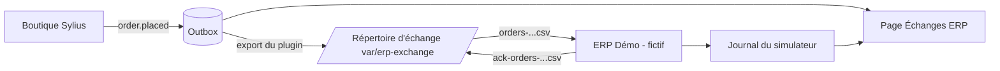

# Échange de fichiers avec l'ERP Démo (fictif) (US-188)

La démo montre l'échange de fichiers plats entre la boutique et un ERP **sans aucun ERP réel** : le plugin `tmonier/sylius-erp-flatfile-plugin` écrit les commandes en CSV dans un répertoire d'échange, et un simulateur nommé « ERP Démo (fictif) » les lit et dépose un **accusé de réception simulé**. L'ERP Démo (fictif) ne représente aucun logiciel réel, aucun appel ne sort du conteneur, et les statuts et les chiffres sont simulés : la page du back-office le dit.

## Parcours

1. Les commandes passées deviennent des événements `order.placed` de l'outbox du plugin `webhook-outbox` (lu sans être modifié).
2. `bin/console tmonier:erp-flatfile:export-orders` écrit un fichier `orders-<date UTC>-<8 caractères>.csv` dans le répertoire d'échange, de façon atomique (contrat : [le README du plugin](https://github.com/thibmonier/sylius-erp-flatfile-plugin#contract-of-the-order-file)).
3. `bin/console app:demo:erp-simulate` : l'ERP Démo (fictif) lit le **dernier** fichier de commandes, contrôle l'en-tête puis chaque ligne, et dépose `ack-<nom du fichier>` (atomique : fichier provisoire puis renommage). Un fichier déjà traité n'est jamais traité deux fois.
4. La page **Intégrations > Échanges ERP** du back-office (`/admin/demo/erp`, lecture seule) liste les fichiers envoyés (journal d'export du plugin) et les réponses (journal du simulateur), avec le sens, le nom, la date, les lignes lues, acceptées et rejetées.

## L'accusé de réception simulé

Format propre à la démo (le plugin d'export ne change pas) : un CSV `order_number;webhook_id;status;reason`, une ligne par ligne du fichier de commandes. `status` vaut `received` ou `rejected` ; pour une ligne rejetée, `reason` donne le premier contrôle en échec.

| `reason` | Contrôle |
|----------|----------|
| `columns` | la ligne n'a pas les dix colonnes du contrat |
| `order_number` | numéro de commande vide |
| `webhook_id` | identifiant d'événement qui n'est pas un UUID |
| `currency` | devise qui n'est pas un code de trois lettres majuscules |
| `quantity` | quantité qui n'est pas un entier strictement positif |
| `amount` | prix unitaire ou total de ligne qui n'est pas un entier positif ou nul (unité mineure) |
| `country` | pays qui n'est pas un code de deux lettres majuscules |

Un fichier dont **l'en-tête n'est pas celui du contrat**, ou qui ne contient aucune ligne, est rejeté **en entier** : aucun accusé n'est déposé, le rejet (`header` ou `empty`) est consigné au journal avec le nombre de lignes rejetées, et le fichier d'origine reste intact.

## Journal du simulateur et remise à zéro

Le journal du simulateur est le fichier caché `.erp-demo-journal.jsonl` du répertoire d'échange, une ligne JSON par fichier traité. La remise à zéro nocturne recharge les fixtures `demo` ; la fixture `demo_erp_export` vide le répertoire (fichiers de commandes, accusés, journal), place les dernières commandes de chaque canal dans l'outbox, lance **un** export puis **une** passe du simulateur. L'état de la démo est donc le même chaque matin : un fichier de commandes, son accusé, une ligne de journal. La rétention du répertoire d'échange est celle de la remise à zéro.

## Ce qui est simulé, ce qui ne l'est pas

- Simulé : l'ERP, son accusé, ses contrôles, ses statuts et ses chiffres.
- Réel : l'export du plugin, le contrat du fichier, l'écriture atomique, le journal d'export.
- Hors périmètre, avec US-187 : l'import de prix et de stock, son rapport de rejet, les scénarios « prix mis à jour » et « lot rejeté à l'import ».
- Garde-fous : le simulateur ne lit et n'écrit que des fichiers du répertoire d'échange ; le client HTTP de la démo reste borné au récepteur local (voir [webhooks-demo.md](webhooks-demo.md)). Données fictives : adresses en `.example`, masquées sur la page publique.

Voir aussi l'[ADR 0017](adr/0017-connecteur-erp-de-reference.md) et la page publique `/{locale}/echange-fichier`.
