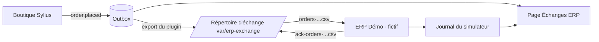
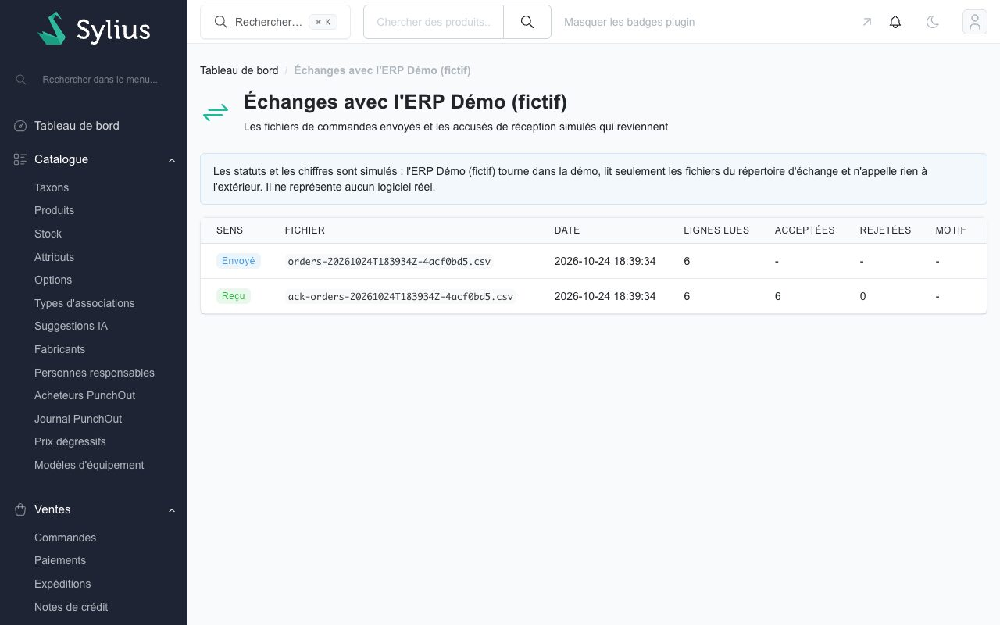
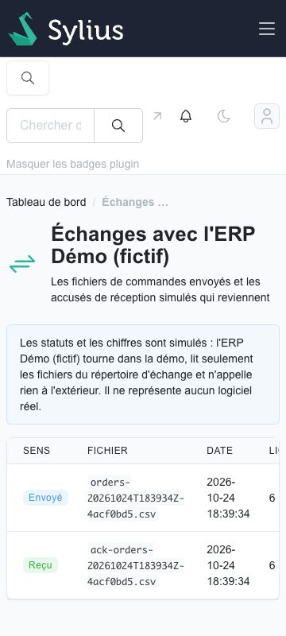
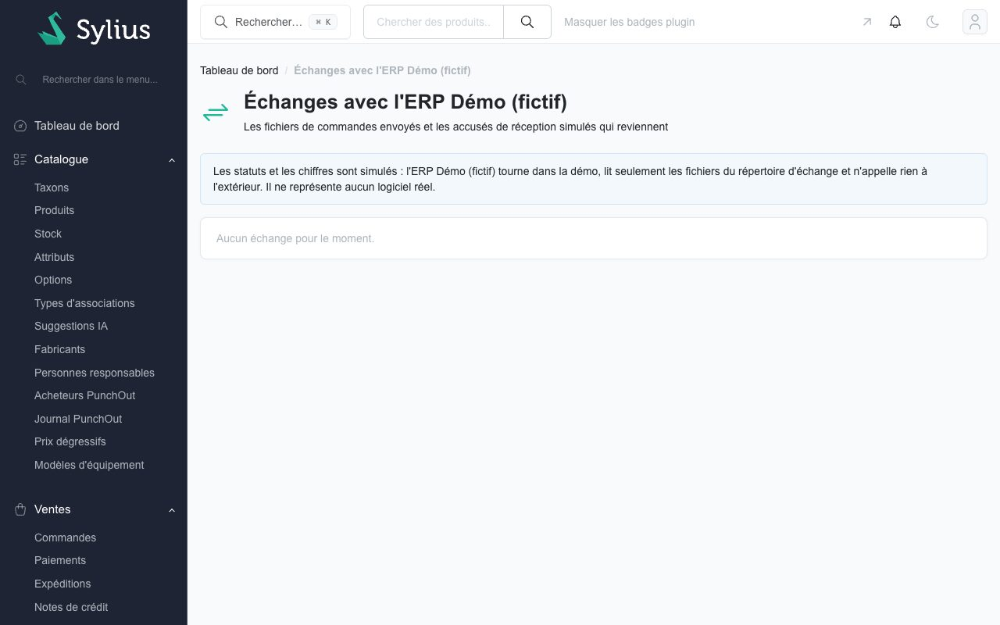

# Échange de fichiers avec l'ERP Démo (fictif) (US-188)

La démo montre l'échange de fichiers plats entre la boutique et un ERP **sans aucun ERP réel** : le plugin `tmonier/sylius-erp-flatfile-plugin` écrit les commandes en CSV dans un répertoire d'échange, et un simulateur nommé « ERP Démo (fictif) » les lit et dépose un **accusé de réception simulé**. L'ERP Démo (fictif) ne représente aucun logiciel réel, aucun appel ne sort du conteneur, et les statuts et les chiffres sont simulés : la page du back-office le dit.

## Parcours

1. Les commandes passées deviennent des événements `order.placed` de l'outbox du plugin `webhook-outbox` (lu sans être modifié).
2. `bin/console tmonier:erp-flatfile:export-orders` écrit un fichier `orders-<date UTC>-<8 caractères>.csv` dans le répertoire d'échange, de façon atomique (contrat : [le README du plugin](https://github.com/thibmonier/sylius-erp-flatfile-plugin#contract-of-the-order-file)).
3. `bin/console app:demo:erp-simulate` : l'ERP Démo (fictif) lit le **dernier** fichier de commandes, contrôle l'en-tête puis chaque ligne, et dépose `ack-<nom du fichier>` (atomique : fichier provisoire puis renommage). Un fichier déjà traité n'est jamais traité deux fois.
4. La page **Intégrations > Échanges ERP** du back-office (`/admin/demo/erp`, lecture seule) liste les fichiers envoyés (journal d'export du plugin) et les réponses (journal du simulateur), avec le sens, le nom, la date, les lignes lues, acceptées et rejetées.

La page du back-office (français ; bureau à 1280 px, téléphone à 360 px, état vide) :

## L'accusé de réception simulé

Format propre à la démo (le plugin d'export ne change pas) : un CSV `order_number;webhook_id;status;reason`, une ligne par ligne du fichier de commandes. `status` vaut `received` ou `rejected` ; pour une ligne rejetée, `reason` donne le premier contrôle en échec.

| `reason` | Contrôle |
|----------|----------|
| `columns` | la ligne n'a pas les dix colonnes du contrat |
| `order_number` | numéro de commande vide |
| `webhook_id` | identifiant d'événement qui n'est pas un UUID |
| `currency` | devise qui n'est pas un code de trois lettres majuscules |
| `quantity` | quantité qui n'est pas un entier strictement positif |
| `amount` | prix unitaire ou total de ligne qui n'est pas un entier positif ou nul (unité mineure) |
| `country` | pays qui n'est pas un code de deux lettres majuscules |

Un fichier dont **l'en-tête n'est pas celui du contrat**, ou qui ne contient aucune ligne, est rejeté **en entier** : aucun accusé n'est déposé, le rejet (`header` ou `empty`) est consigné au journal avec le nombre de lignes rejetées, et le fichier d'origine reste intact.

## Journal du simulateur et remise à zéro

Le journal du simulateur est le fichier caché `.erp-demo-journal.jsonl` du répertoire d'échange, une ligne JSON par fichier traité. La remise à zéro nocturne recharge les fixtures `demo` ; la fixture `demo_erp_export` vide le répertoire (fichiers de commandes, accusés, journal), place les dernières commandes de chaque canal dans l'outbox, lance **un** export puis **une** passe du simulateur. L'état de la démo est donc le même chaque matin : un fichier de commandes, son accusé, une ligne de journal. La rétention du répertoire d'échange est celle de la remise à zéro.

## Les fichiers de prix et de stock (US-187, tranche B)

Après l'accusé de réception, l'ERP Démo (fictif) dépose **trois fichiers** dans le répertoire d'échange, de façon atomique, puis le plugin les **importe** (`ExchangeDirectoryImporter`, commande `tmonier:erp-flatfile:import-batches`) :

| Fichier | Contenu | Résultat attendu |
|---------|---------|------------------|
| `prices-<date UTC>-<empreinte>.csv` | `variant_code;price_minor;currency;channel` pour trois variantes réelles du catalogue, **avec les prix qu'elles ont déjà** | lot appliqué (les prix de la démo ne bougent pas) |
| `prices-<date UTC>-invalid-<empreinte>.csv` | la même première ligne, puis un **montant négatif** et une **devise étrangère au canal** | lot **rejeté en entier** : une ligne invalide rejette un lot de prix, la ligne valide n'est pas appliquée non plus |
| `stock-<date UTC>-<empreinte>.csv` | `variant_code;on_hand` pour trois variantes réelles, avec leur quantité actuelle | lot appliqué, ligne par ligne ; la quantité réservée n'est jamais modifiée |

Les trois fichiers sont ensuite déplacés dans `processed/`. Un lot est son nom de fichier et le SHA-256 de son contenu : un lot déjà traité serait ignoré. La page **Échanges ERP** liste chaque lot importé (nom, empreinte tronquée, lignes lues, appliquées, rejetées) et, pour un lot rejeté, le **rapport** ligne par ligne (« Ligne 3 : devise différente de celle du canal »). Le journal des lots est celui du plugin (`tmonier_erp_flatfile_import_batch`, en base) ; la remise à zéro le régénère, comme le répertoire d'échange. Le CSV est simulé de bout en bout : les valeurs viennent du catalogue de la démo, aucun logiciel réel n'est nommé ni appelé.

## Après un déploiement (US-195)

Le répertoire d'échange (`var/erp-exchange`) vit dans le système de fichiers du conteneur : chaque déploiement Railway démarre un conteneur neuf, donc un répertoire vide, alors que la base (outbox, journal d'export du plugin) survit et que les fixtures ne se rechargent pas (le marqueur de chargement est là). Sans correctif, la page `/echange-fichier` et l'écran Échanges ERP restent vides jusqu'à la remise à zéro de 03:00.

L'entrypoint (`docker/entrypoint.sh`, en `www-data`, après les migrations et les fixtures) lance donc `bin/console app:demo:erp-refresh` à chaque démarrage :

- si le répertoire contient déjà un `orders-*.csv`, la commande ne fait rien (redémarrage sans déploiement, deuxième passage) ;
- sinon, les lignes du journal d'export du plugin, qui pointent vers des fichiers disparus, sont oubliées ; les commandes déjà dans l'outbox sont exportées de nouveau (aucun événement n'est écrit deux fois : une commande qui a déjà son événement `order.placed` n'en reçoit pas un autre) ; s'il n'y en a aucun, les dernières commandes de chaque canal sont enregistrées dans l'outbox, sans webhook en file ; puis un export et une passe de l'ERP Démo (fictif) ;
- un échec est un message clair et un code de sortie non nul, que l'entrypoint tolère : le conteneur démarre quand même, les pages restent vides jusqu'à la remise à zéro suivante. Le plugin d'export n'est pas modifié.

Le répertoire n'est **pas** sur le volume public `media` : les fichiers contiennent des adresses (fictives), et le volume des médias est servi publiquement.

## Ce qui est simulé, ce qui ne l'est pas

- Simulé : l'ERP, son accusé, ses contrôles, ses statuts et ses chiffres.
- Réel : l'export du plugin, le contrat du fichier, l'écriture atomique, le journal d'export.
- Réel aussi : l'import de prix et de stock du plugin (v0.2.0), son rapport de rejet et son journal des lots (US-187).
- Hors périmètre : une API d'import, les prix par groupe de clients, une rétention des fichiers (la remise à zéro nocturne fait la rétention de la démo).
- Garde-fous : le simulateur ne lit et n'écrit que des fichiers du répertoire d'échange ; le client HTTP de la démo reste borné au récepteur local (voir [webhooks-demo.md](webhooks-demo.md)). Données fictives : adresses en `.example`, masquées sur la page publique.

Voir aussi l'[ADR 0017](adr/0017-connecteur-erp-de-reference.md) et la page publique `/{locale}/echange-fichier`.
