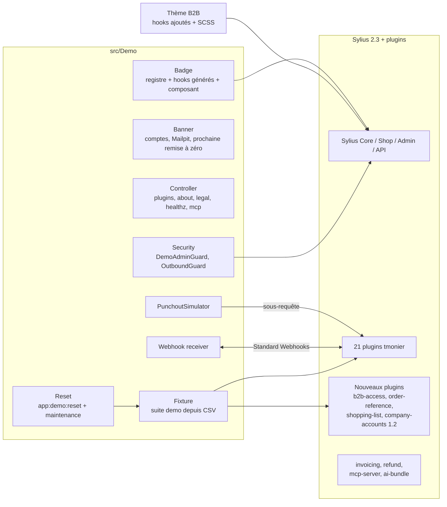

# C4 niveau 3 — Composants de l'application

| Composant | Rôle | Stories |
|-----------|------|---------|
| Badge | Registre `config/demo/badges.yaml`, prepend `sylius_twig_hooks`, composant `DemoPluginBadge` | US-016, US-017 |
| Banner | Bandeau, liens de connexion pré-remplie, interrupteur des badges | US-015 |
| Controller | `/healthz`, `/{_locale}/plugins`, `/about-demo`, `/legal`, `/demo/mcp` | US-014, US-018, US-030 |
| PunchoutSimulator | Setup cXML et OCI, réception du panier, OrderRequest | US-027 |
| Webhook receiver | Réception signée et consultation | US-029 |
| Reset | Commande de remise à zéro, mode maintenance, journal | US-012, US-033 |
| Security | Garde de l'admin de démo, garde des sorties HTTP | US-035, US-036 |
| Fixture | Suite `demo` (CSV → entités Sylius et plugins) | US-007 à US-011 |
