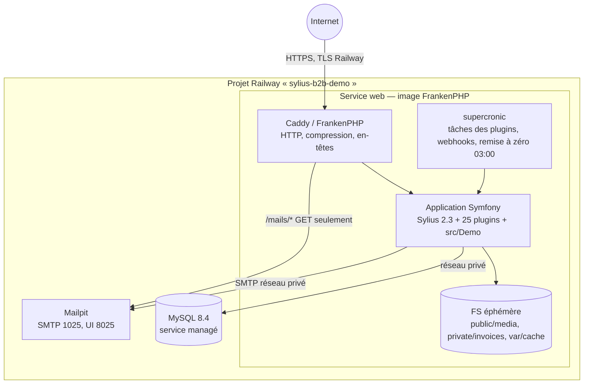

# C4 niveau 2 — Conteneurs (Railway)

| Conteneur | Technologie | Responsabilités | Ressources |
|-----------|-------------|-----------------|------------|
| web | FrankenPHP 1 (PHP 8.4, Caddy), supercronic | Shop, admin, API, MCP, PunchOut, simulateur, tâches, remise à zéro | 1 Go RAM, CPU partagé |
| MySQL | MySQL 8.4 (Railway) | Données Sylius et plugins | volume Railway |
| Mailpit | axllent/mailpit | Réception et consultation des e-mails | minimal |

Le cache applicatif, les verrous (flock) et les limiteurs (cache filesystem) restent locaux : une seule instance, pas de Redis (TH-5).
