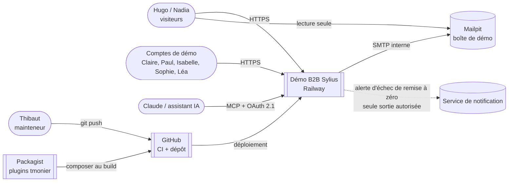

# C4 niveau 1 — Contexte

- L'outil d'achat (Ariba ou SAP) est **simulé à l'intérieur** de la démo : aucun système d'e-procurement réel n'est appelé.
- Aucun e-mail réel, aucun webhook vers l'extérieur, aucune API IA (générateur `demo`).
