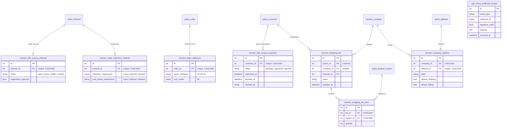

# Modèle de données

Les tables Sylius et celles des 21 plugins existent déjà (voir chaque plugin). Seules les **nouvelles** tables sont décrites ici. Convention : chaque plugin préfixe ses propres tables, sans modifier les entités du cœur.

- `shopping-list` dépend de l'ADR de US-023 (wishlist officielle ou plugin maison).
- `app_demo_webhook_receipt` appartient à la démo (préfixe `app_`) et est vidée à chaque remise à zéro.
- Migrations : Schema API (MySQL, MariaDB, PostgreSQL) pour les plugins ; migrations Doctrine de l'application pour `app_*`.
