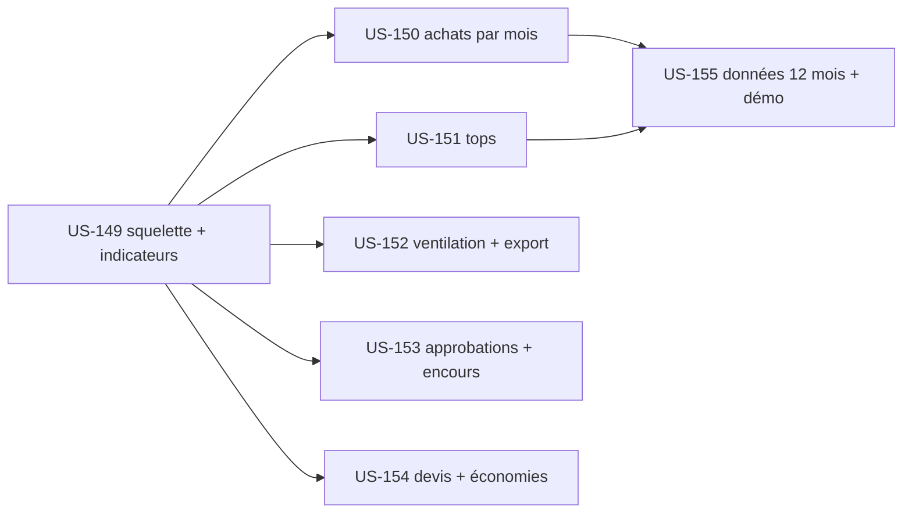

# EPIC-15 — Pilotage des achats de l'entreprise (plugin company-insights)

> Exigences : demande de Thibaut du 2026-10-20 ; audit fonctionnel du 2026-10-18 §4 (« Reporting acheteur : absent », « Tableau de bord société : partiel ») · 7 stories · 33 points

## Description

Donner à l'administratrice d'un compte entreprise (Isabelle, Acme Industries) un tableau de bord de ses achats dans l'espace client :
- des indicateurs de période ;
- un graphique des achats par mois, comparé à l'année précédente ;
- les tops : acheteurs, produits et catégories ;
- une ventilation par site de livraison et par dimension analytique (centre de coût) ;
- un export CSV pour la comptabilité ;
- des indicateurs repris des plugins compagnons quand ils sont installés (approbations, encours, devis, économies de prix dégressifs).

### Plugin dédié plutôt qu'extension de company-accounts

Le tableau de bord sera un **nouveau plugin, `tmonier/sylius-company-insights-plugin`**, qui dépend de `company-accounts`.

1. **Responsabilité unique.** `company-accounts` gère l'entreprise : membres, rôles, adresses, commandes visibles. Le reporting ajoute ses propres requêtes d'agrégation, un cache, une bibliothèque de graphiques et un export. Le mettre dans `company-accounts` alourdirait un plugin stable (v1.1.0) pour tous ceux qui n'en veulent pas.
2. **Extension sans modification.** Le tableau de bord s'appuie sur ce qu'expose `company-accounts` (`CompanyOrder`, membres, rôles, `CompanyVoter`). Les plugins compagnons s'y branchent par des points d'extension optionnels, sans dépendance obligatoire.
3. **Communication.** `company-accounts` recouvre les « Organizations » de Sylius Plus. Le reporting côté acheteur n'apparaît pas dans la fiche du B2B Suite et l'audit le classe « absent » : c'est une lacune de Plus. Un plugin séparé reste donc présentable, sous réserve de vérifier la documentation officielle de Plus avant toute communication (politique du 2026-10-14).
4. **Coût.** Squelette, CI et release d'un 25e plugin : environ 2 points, absorbés par US-149.

### Règles transverses

- **Accès.** Accès réservé à l'administratrice de l'entreprise, avec une nouvelle permission `COMPANY_VIEW_INSIGHTS` portée par le voter. L'approbateur et l'acheteur n'y ont pas accès : pas d'entrée de menu, et un 403 expliqué (US-100) en accès direct.
- **Cloisonnement.** Aucune donnée d'une autre entreprise, contrôlé côté serveur sur chaque requête et chaque export. L'identifiant d'entreprise vient de la session, jamais de la requête.
- **Commandes comptées.** Une commande compte comme « achat » quand son checkout est terminé, qu'elle n'est pas annulée et qu'elle appartient à l'entreprise via `CompanyOrder`. Une commande en attente d'approbation est comptée à part.
- **Montants.** Montants **HT** dans la devise du canal de la commande. Si plusieurs devises coexistent, les totaux sont séparés par devise, sans conversion.
- **Accessibilité.** Chaque graphique a un tableau de données équivalent, des couleurs contrastées (AAA) et ne s'appuie pas sur la couleur seule. Libellés en français et en anglais.
- **Bibliothèque de graphiques.** On réutilise d'abord `apexcharts`, déjà embarqué par Sylius pour le tableau de bord de l'admin, rendu côté boutique. Aucun CDN externe (CSP de la démo). Le choix est consigné dans un ADR du plugin.
- **Performance.** Agrégats calculés en SQL, pas en PHP sur des entités chargées, sur un index (entreprise, date). Le tableau de bord d'une entreprise de 5 000 commandes s'affiche en moins de 500 ms.

## MMF (Minimum Marketable Feature)

**Plus petite version livrable** : US-149, US-150, US-151 et US-155. L'administratrice voit ses indicateurs, le graphique mensuel et les tops sur 12 mois de données de démo crédibles, avec le plugin publié en 0.1.0.
**US incluses** : US-149, US-150, US-151, US-155 (Must, 20 points) ; US-152, US-153 (Should, 10 points) ; US-154 (Could, 3 points).

## Stories

| Story | Titre | MoSCoW | Points | Sprint cible |
|---|---|---|---|---|
| [US-149](../user-stories/US-149.md) | Company-insights : squelette du plugin et indicateurs de la période | Must | 5 | à planifier |
| [US-150](../user-stories/US-150.md) | Company-insights : achats par mois sur 12 mois, comparés à l'année précédente | Must | 5 | à planifier |
| [US-151](../user-stories/US-151.md) | Company-insights : tops acheteurs, produits et catégories | Must | 5 | à planifier |
| [US-152](../user-stories/US-152.md) | Company-insights : ventilation par site et centre de coût, export CSV | Should | 5 | à planifier |
| [US-153](../user-stories/US-153.md) | Company-insights : indicateurs des approbations et de l'encours | Should | 5 | à planifier |
| [US-154](../user-stories/US-154.md) | Company-insights : conversion des devis et économies des prix dégressifs | Could | 3 | à planifier |
| [US-155](../user-stories/US-155.md) | Company-insights : historique d'achats de 12 mois et intégration à la démo | Must | 5 | à planifier |

## Dépendances

**Notes** : Les budgets par membre ou par service restent du ressort du spike P8 (US-135). Le tableau de bord en fournira la visualisation le jour où les budgets existeront ; il ne les crée pas.
