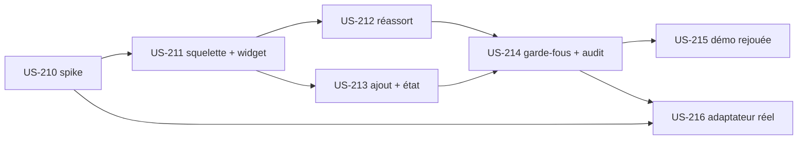

# EPIC-16 — Copilote d'achat B2B (plugin sales-copilot)

> Exigences : décision de Thibaut du 2026-10-28 ([roadmap-innovation](../roadmap-innovation.md)) · 7 stories · 34 points · plugin `tmonier/sylius-b2b-sales-copilot-plugin`

## Description

Donner aux acheteurs B2B un assistant dans leur espace client qui **prépare** un panier à partir d'une demande en langage courant. Intentions du MVP : réassort « comme le mois dernier » avec substitution de référence, ajout par référence, état du panier.

### Principes

- **L'IA prépare le panier, l'acheteur valide.** L'assistant ne paie ni ne commande jamais. Au-dessus du plafond du compte, la validation d'achat (purchase-approval) se déclenche normalement.
- Réutilise les outils du plugin b2b-mcp (reorder, quick_order_add, get_checkout_link…), les prix négociés (tier-pricing) et purchase-approval.
- **Décision de Thibaut du 2026-10-28 : la démo publique est en mode rejoué** (réponses enregistrées et rejouées, aucun appel LLM payant). Le plugin garde un adaptateur LLM réel pour les intégrateurs (US-216, non planifiée).
- Garde-fous : droits du compte connecté seulement, outils autorisés seulement, traces dans le journal d'audit. **Aucun détail de sécurité dans le dépôt public.**
- Spike d'entrée US-210 (3 points) : format de rejeu, choix d'adaptateur, recoupement Sylius Plus.

## MMF (Minimum Marketable Feature)

**Plus petite version livrable** : US-210, US-211, US-212, US-213, US-214 et US-215 (Must). Un acheteur de la démo prépare son réassort mensuel en une phrase, valide lui-même le panier, et chaque action de l'assistant est tracée.
**Valeur** : Le réassort mensuel se prépare en un échange, sans coût d'API en démo.
**US incluses** : US-210, US-211, US-212, US-213, US-214, US-215, US-216 (Must : 29 points, Could : 5 points).

## Règles transverses du plugin

- Definition of Done de chaque nouveau plugin : dépôt durci comme [US-209](../user-stories/US-209.md); CI Sylius 2.2/2.3; README en français (lien démo, profil de l'auteur); intégration dans la démo, page « Plugins » et « Preuve technique »; Packagist soumis par Thibaut, aucun tag sans GO; ton neutre (politique Sylius Plus : aucune comparaison ; chaque spike vérifie l'absence de recoupement avec Sylius Plus avant toute promotion).

## Stories

| Story | Titre | MoSCoW | Points | Sprint cible |
|---|---|---|---|---|
| [US-210](../user-stories/US-210.md) | Spike copilote d'achat : format de rejeu, adaptateur LLM et recoupement Sylius Plus | Must | 3 | 34 |
| [US-211](../user-stories/US-211.md) | Copilote d'achat : squelette du plugin, widget du compte et adaptateur rejoué | Must | 5 | 37 |
| [US-212](../user-stories/US-212.md) | Copilote d'achat : réassort « comme le mois dernier » avec substitution de référence | Must | 8 | 37 |
| [US-213](../user-stories/US-213.md) | Copilote d'achat : ajout par référence et état du panier | Must | 5 | 38 |
| [US-214](../user-stories/US-214.md) | Copilote d'achat : garde-fous et journal d'audit | Must | 5 | 38 |
| [US-215](../user-stories/US-215.md) | Copilote d'achat : mode rejoué de la démo publique et scénarios enregistrés | Must | 3 | 38 |
| [US-216](../user-stories/US-216.md) | Copilote d'achat : adaptateur LLM réel pour les intégrateurs | Could | 5 | non planifiée |

## Dépendances

**Notes** : US-216 (adaptateur réel) reste Could : on ne la lance que sur demande d'un intégrateur.
