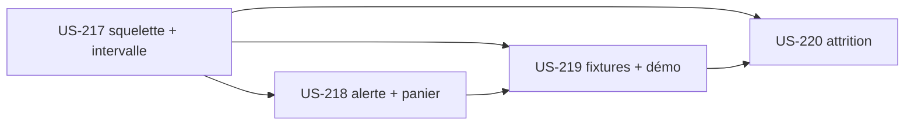

# EPIC-17 — Commerce prédictif (plugin predictive-analytics)

> Exigences : décision de Thibaut du 2026-10-28 ([roadmap-innovation](../roadmap-innovation.md)) · 4 stories · 18 points · plugin `tmonier/sylius-b2b-predictive-analytics-plugin`

## Description

Anticiper les besoins des clients B2B avec des **règles statistiques explicables** (pas de ML opaque), en s'appuyant sur company-insights :

- **Réassort prédictif** : intervalle médian entre commandes d'une référence pour une entreprise ; alerte dans « Mon compte » et panier pré-rempli (lien reorder) ;
- **Score d'attrition** explicable dans l'admin (« commande tous les 21 jours, rien depuis 47 jours ») ;
- fixtures de démo avec des rythmes d'achat réalistes.

Chaque résultat affiche sa raison en clair ; aucune donnée personnelle supplémentaire n'est collectée ; la mention « indicatif » accompagne les scores.

## MMF (Minimum Marketable Feature)

**Plus petite version livrable** : US-217, US-218 et US-219 (Must). Claire voit, dès l'ouverture de la démo, une alerte de réassort expliquée et prépare son panier en un clic.
**Valeur** : Moins de ruptures côté acheteur ; détection des clients qui ralentissent côté marchand.
**US incluses** : US-217, US-218, US-219, US-220 (Must : 13 points, Should : 5 points).

## Règles transverses du plugin

- Definition of Done de chaque nouveau plugin : dépôt durci comme [US-209](../user-stories/US-209.md); CI Sylius 2.2/2.3; README en français (lien démo, profil de l'auteur); intégration dans la démo, page « Plugins » et « Preuve technique »; Packagist soumis par Thibaut, aucun tag sans GO; ton neutre (politique Sylius Plus : aucune comparaison ; chaque spike vérifie l'absence de recoupement avec Sylius Plus avant toute promotion).

## Stories

| Story | Titre | MoSCoW | Points | Sprint cible |
|---|---|---|---|---|
| [US-217](../user-stories/US-217.md) | Commerce prédictif : squelette du plugin et intervalle médian de réassort par référence | Must | 5 | 35 |
| [US-218](../user-stories/US-218.md) | Commerce prédictif : alerte de réassort dans « Mon compte » et panier pré-rempli | Must | 5 | 35 |
| [US-219](../user-stories/US-219.md) | Commerce prédictif : fixtures de rythmes d'achat réalistes et intégration à la démo | Must | 3 | 35 |
| [US-220](../user-stories/US-220.md) | Commerce prédictif : score d'attrition explicable dans l'admin | Should | 5 | 39 |
| [US-250](../user-stories/US-250.md) | Commerce prédictif : conception graphique du bloc de réassort dans Claude Design | Should | 2 | non planifiée |
| [US-251](../user-stories/US-251.md) | Commerce prédictif : mise en forme du bloc de réassort d'après la maquette | Should | 3 | non planifiée |

## Dépendances

**Notes** : L'attrition (US-220) est Should : elle réutilise le calcul d'intervalle d'US-217.
