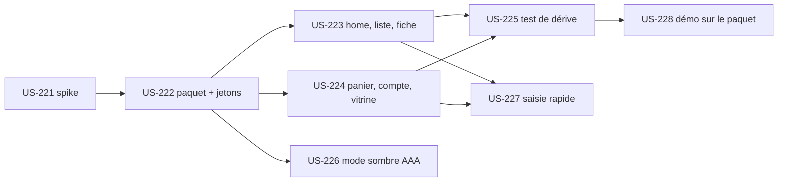

# EPIC-18 — Thème « Industrie & Négoce »

> Exigences : décision de Thibaut du 2026-10-28 ([roadmap-innovation](../roadmap-innovation.md)) · 8 stories · 34 points · plugin `thibmonier/sylius-industry-trade-theme`

## Description

**Décision de Thibaut du 2026-10-28 : un thème complet installable** (pas un simple starter kit), extrait du thème B2B de la démo : home, liste, fiche, panier, compte et pages vitrine déjà refondus (maquettes : canevas Claude Design G2StRQigRKD6SqNRoyHpkW).

- haute densité d'information ;
- mode sombre optionnel **en AAA** ;
- saisie rapide : navigation clavier dans les grilles, autocomplétion de référence, lien vers la palette de commandes ;
- installation par Composer/Flex dans un projet Sylius 2.3 (et 2.2) ;
- test de dérive des surcharges de gabarits (comme [US-203](../user-stories/US-203.md)) ;
- la démo consomme le thème publié.

Spike d'entrée US-221 : packaging d'un thème Sylius 2 (Twig hooks, assets, Flex).

## MMF (Minimum Marketable Feature)

**Plus petite version livrable** : US-221, US-222, US-223, US-224, US-225 et US-228 (Must). Un intégrateur installe le thème par Composer dans un projet vierge et obtient les pages principales à l'identique de la démo, protégées contre la dérive de Sylius.
**Valeur** : Un site B2B industriel présentable en quelques heures, vérifié par la démo.
**US incluses** : US-221, US-222, US-223, US-224, US-225, US-226, US-227, US-228 (Must : 26 points, Should : 8 points).

## Règles transverses du plugin

- Definition of Done de chaque nouveau plugin : dépôt durci comme [US-209](../user-stories/US-209.md); CI Sylius 2.2/2.3; README en français (lien démo, profil de l'auteur); intégration dans la démo, page « Plugins » et « Preuve technique »; Packagist soumis par Thibaut, aucun tag sans GO; ton neutre (politique Sylius Plus : aucune comparaison ; chaque spike vérifie l'absence de recoupement avec Sylius Plus avant toute promotion).

## Stories

| Story | Titre | MoSCoW | Points | Sprint cible |
|---|---|---|---|---|
| [US-221](../user-stories/US-221.md) | Spike packaging d'un thème Sylius 2 : Twig hooks, assets et Flex | Must | 3 | 34 |
| [US-222](../user-stories/US-222.md) | Thème Industrie & Négoce : paquet installable, jetons de design et composants communs (tranche 1) | Must | 5 | 34 |
| [US-223](../user-stories/US-223.md) | Thème Industrie & Négoce : home, liste et fiche produit (tranche 2) | Must | 5 | 40 |
| [US-224](../user-stories/US-224.md) | Thème Industrie & Négoce : panier, compte et pages vitrine | Must | 5 | 40 |
| [US-225](../user-stories/US-225.md) | Thème Industrie & Négoce : test de dérive des surcharges de gabarits | Must | 3 | 40 |
| [US-226](../user-stories/US-226.md) | Thème Industrie & Négoce : mode sombre optionnel en AAA | Should | 3 | 39 |
| [US-227](../user-stories/US-227.md) | Thème Industrie & Négoce : saisie rapide au clavier, autocomplétion de référence et lien palette de commandes | Should | 5 | 39 |
| [US-228](../user-stories/US-228.md) | Thème Industrie & Négoce : installation par Composer/Flex et démo qui consomme le thème publié | Must | 5 | 41 |

## Dépendances

**Notes** : Les tranches 1 (S34) et 2 (S39, S40) suivent la décision d'extraction progressive. Le mode sombre et la saisie rapide (Should) sont en S39.
