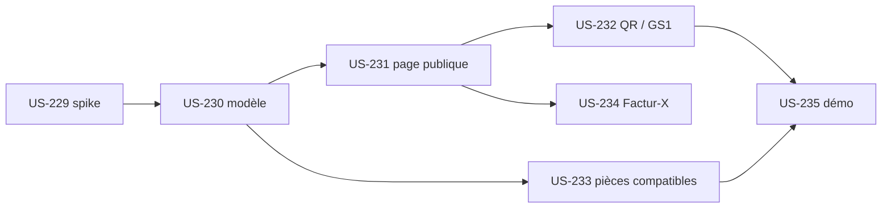

# EPIC-19 — Passeport numérique produit (DPP)

> Exigences : décision de Thibaut du 2026-10-28 ([roadmap-innovation](../roadmap-innovation.md)) · 7 stories · 23 points · plugin `tmonier/sylius-digital-product-passport-plugin`

## Description

**Décision de Thibaut du 2026-10-28 : maintenant, « ça donnera une base ».** Un modèle de données **ouvert et versionné** :

- origine des matériaux, recyclabilité, réparabilité, pièces détachées compatibles (liées au plugin customer-asset-management) ;
- page publique du passeport ;
- QR et lien de type GS1 Digital Link sur le produit et l'emballage ;
- lien optionnel dans la facture Factur-X (plugin facturx).

### Prudence réglementaire

**Aucune promesse de conformité** tant que les actes délégués de l'ESPR ne sont pas fixés. Le spike d'entrée US-229 vérifie le texte (règlement (UE) 2024/1781, calendrier batteries 2027, actes délégués) et formule la portée avec prudence : « base de données ouverte et versionnée », jamais « conforme » ni « certifié ».

## MMF (Minimum Marketable Feature)

**Plus petite version livrable** : US-229, US-230, US-231, US-232 et US-233 (Must). Un marchand renseigne le passeport d'un produit, le publie sur une page, imprime son QR et affiche les pièces compatibles.
**Valeur** : Une base de données produit prête à évoluer avec la réglementation, sans engagement de conformité.
**US incluses** : US-229, US-230, US-231, US-232, US-233, US-234, US-235 (Must : 17 points, Should : 3 points, Could : 3 points).

## Règles transverses du plugin

- Definition of Done de chaque nouveau plugin : dépôt durci comme [US-209](../user-stories/US-209.md); CI Sylius 2.2/2.3; README en français (lien démo, profil de l'auteur); intégration dans la démo, page « Plugins » et « Preuve technique »; Packagist soumis par Thibaut, aucun tag sans GO; ton neutre (politique Sylius Plus : aucune comparaison ; chaque spike vérifie l'absence de recoupement avec Sylius Plus avant toute promotion).

## Stories

| Story | Titre | MoSCoW | Points | Sprint cible |
|---|---|---|---|---|
| [US-229](../user-stories/US-229.md) | Spike passeport numérique produit : texte du règlement ESPR et formulation prudente | Must | 3 | 34 |
| [US-230](../user-stories/US-230.md) | Passeport numérique produit : squelette du plugin et modèle de données ouvert et versionné | Must | 5 | 36 |
| [US-231](../user-stories/US-231.md) | Passeport numérique produit : page publique du passeport | Must | 3 | 36 |
| [US-232](../user-stories/US-232.md) | Passeport numérique produit : QR et lien GS1 Digital Link sur le produit et l'emballage | Must | 3 | 36 |
| [US-233](../user-stories/US-233.md) | Passeport numérique produit : pièces détachées compatibles liées à customer-asset-management | Must | 3 | 36 |
| [US-234](../user-stories/US-234.md) | Passeport numérique produit : lien optionnel du passeport dans la facture Factur-X | Could | 3 | non planifiée |
| [US-235](../user-stories/US-235.md) | Passeport numérique produit : fixtures, intégration à la démo et formulation prudente | Should | 3 | 41 |

## Dépendances

**Notes** : Le lien Factur-X (US-234, Could) n'est pas planifié. La formulation prudente est testée dans la démo (US-235).
