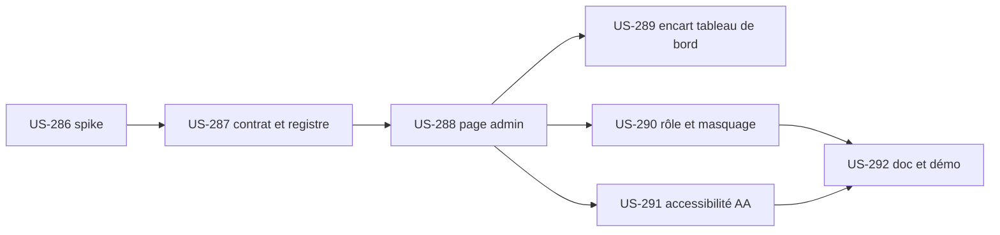

# EPIC-20 — Santé de la plateforme : socle, contrat de sonde et tableau de bord admin

> Exigences : demande de Thibaut du 2026-11-22 · 7 stories · 25 points · paquet Composer `tmonier/sylius-platform-health-plugin` (dépôt GitHub `thibmonier/sylius-platform-health-plugin`)

## Description

Un administrateur Sylius n'a aujourd'hui **aucun écran qui réponde à « est-ce que ma plateforme va bien ? »**. L'information existe, mais éclatée : `bin/console` pour les migrations, les logs du conteneur pour le cron, la grille produits pour les prix manquants, le tableau de bord de l'hébergeur pour la mémoire. Le plugin réunit ces signaux en **un écran d'administration**, et surtout : chaque signal rouge porte **le lien qui le corrige**.

Le cœur du plugin n'est pas la liste des sondes, c'est **le contrat de sonde**. Une sonde est une classe qui répond à trois questions — qui je suis, dans quelle catégorie, quel est mon résultat — et que le conteneur découvre par un tag autoconfiguré. Les 21 plugins de l'écosystème deviennent alors chacun fournisseur de sa propre sonde (EPIC-22), sans que le plugin de santé connaisse leur métier.

```php
interface HealthCheckInterface
{
    public function identifier(): string;        // 'messenger.failed_transport'
    public function category(): HealthCategory;  // enum : Environnement, Données, Tâches, Boutique, Plugins
    public function run(): HealthResult;         // statut + résumé + détail + lien d'action
}
```

`HealthStatus` : `ok` | `warning` | `critical` | `unknown`. Le quatrième statut n'est pas décoratif : une sonde qui ne peut pas mesurer (service absent, budget de temps dépassé) répond `unknown` **au lieu de lever une exception**, pour qu'un écran de diagnostic ne devienne jamais lui-même la panne.

### Ce que le plugin n'est pas

Dit explicitement dans le README, comme l'avertissement réglementaire du plugin DPP ([EPIC-19](EPIC-19.md)) :

- **pas un APM** : ni agent, ni trace, ni profil ; il nomme Sentry et Blackfire plutôt que de prétendre les remplacer ;
- **pas un agrégateur de logs** ni un collecteur de métriques continues : il mesure à l'instant où on le regarde, pas en continu ;
- **pas un scanner de sécurité** : il lit un rapport `composer audit` produit ailleurs (US-298), il ne scanne pas ;
- **aucune télémétrie sortante** : par défaut, aucune sonde n'appelle l'extérieur. Les dates de fin de support sont embarquées dans le code, pas interrogées en ligne.

### Frontière avec les plugins existants

| Plugin | Sa question | Pourquoi ce n'est pas la même |
|---|---|---|
| `audit-log` | **Qui** a changé **quoi** | Traçabilité humaine, après coup. Ici : est-ce que ça tourne, maintenant |
| `company-insights` | Santé **commerciale** d'un compte client | Un indicateur métier par entreprise, pas l'état de la plateforme |
| `b2b-predictive-analytics` | Ce qui **va** se passer | Prévision. Ici : état courant et écarts de configuration |
| `timeline` | Fil d'activité d'une commande | Granularité d'un objet, pas de l'installation |

## MMF (Minimum Marketable Feature)

**Plus petite version livrable** : US-286, US-287, US-288, US-289 et US-290 (Must). Un administrateur ouvre une page et voit, par catégorie, l'état de son installation ; un encart du tableau de bord l'y amène ; l'écran est réservé à un rôle dédié et ne divulgue ni secret ni trace d'exécution.
**Valeur** : La question « est-ce que ma boutique est en bon état ? » a enfin une réponse en un écran, et chaque alerte porte son lien de correction.
**US incluses** : US-286, US-287, US-288, US-289, US-290, US-291, US-292 (Must : 25 points).

## Règles transverses du plugin

- Definition of Done de chaque nouveau plugin : dépôt durci comme [US-209](../user-stories/US-209.md); CI Sylius 2.2/2.3; README en français (lien démo, profil de l'auteur); intégration dans la démo, page « Plugins » et « Preuve technique »; Packagist soumis par Thibaut, aucun tag sans GO; ton neutre (politique Sylius Plus : aucune comparaison ; chaque spike vérifie l'absence de recoupement avec Sylius Plus avant toute promotion).

### Règles de conception propres à cet epic

Ces cinq règles conditionnent toutes les sondes des EPIC-21 à EPIC-23 et sont testées une fois pour toutes dans US-287 :

1. **Budget de temps par sonde.** Chaque sonde reçoit une limite (défaut 500 ms) ; au-delà, son résultat est `unknown` et l'exécution continue. Une sonde lente ne retarde pas les autres.
2. **Aucune exception ne remonte à la page.** Une sonde qui lève est capturée, journalisée, rendue en `unknown` (OWASP A10 : traitement des conditions exceptionnelles).
3. **Rendu différé et mutualisé.** La page s'affiche avant les résultats ; les sondes sont exécutées derrière un cache court (TTL configurable, défaut 60 s) pour que trois administrateurs connectés ne déclenchent pas trois fois les mêmes requêtes.
4. **Lecture seule.** Aucune sonde n'écrit en base, hors la table d'historique d'[EPIC-23](EPIC-23.md) et celle des battements (US-296).
5. **Rien de sensible à l'écran.** Jamais un DSN complet, une clé, un mot de passe ni une trace d'exécution : valeurs masquées, messages formulés pour l'administrateur (OWASP A09/A10).

## Décisions de cadrage (2026-11-22)

Réponses de Thibaut, le jour de la demande :

- **Périmètre complet** : technique, métier *et* une sonde fournie par chacun des plugins de l'écosystème. Les quatre epics sont retenus (113 points).
- **Sondes de plugins par `suggest` et vérification de classe** : l'interface reste propriété du plugin de santé ; aucun plugin surveillé ne gagne de dépendance obligatoire. Pas de paquet de contrats séparé.
- **Historique en base dès la première version** : table d'instantanés, courbe par sonde sur 30 jours, commande de purge.
- **Alertes par courriel *et* par webhook sortant** via `webhook-outbox`, à la transition d'état seulement.

## Stories

> Les fiches US seront rédigées au cadrage, après les réponses de Thibaut aux questions ouvertes (bas de page).

| Story | Titre | MoSCoW | Points | Sprint cible |
|---|---|---|---|---|
| US-286 | Spike santé de la plateforme : ce que Symfony, Sylius et l'écosystème fournissent déjà | Must | 3 | 56 |
| US-287 | Squelette du plugin, contrat `HealthCheckInterface`, registre à tag et exécution à sécurité passive | Must | 5 | 56 |
| US-288 | Page admin « Santé de la plateforme » : synthèse par catégorie, détail par sonde, rendu différé | Must | 5 | 56 |
| US-289 | Encart du tableau de bord admin : un feu par catégorie et le lien vers la page | Must | 3 | 57 |
| US-290 | Rôle dédié, masquage des valeurs sensibles, aucune trace d'exécution à l'écran | Must | 3 | 57 |
| US-291 | Accessibilité AA : statut jamais porté par la seule couleur, tableau annoncé au lecteur d'écran, mode sombre | Must | 3 | 57 |
| US-292 | Traductions FR/EN, README FR+EN, capture, CHANGELOG, intégration à la démo | Must | 3 | 57 |

## Dépendances



**Notes** : US-287 est le goulot de tout le lot : les EPIC-21, 22 et 23 ne sont que des implémentations de son contrat. Le spike US-286 doit trancher un point précis — si `liip/monitor` ou un bundle Symfony de *health check* couvre déjà le contrat, le plugin les enveloppe au lieu de les réécrire.

## Questions ouvertes (à trancher avec Thibaut)

1. **Rôle d'accès** : nouveau `ROLE_PLATFORM_HEALTH_VIEW`, ou réservé à `ROLE_ADMINISTRATION_ACCESS` sans distinction ?
2. **Nom du paquet** : `sylius-platform-health-plugin` ou plus court (`sylius-health-plugin`) ?
3. **Live Component ou `fetch`** pour le rendu différé : le thème et la palette de commandes utilisent déjà des Live Components.
