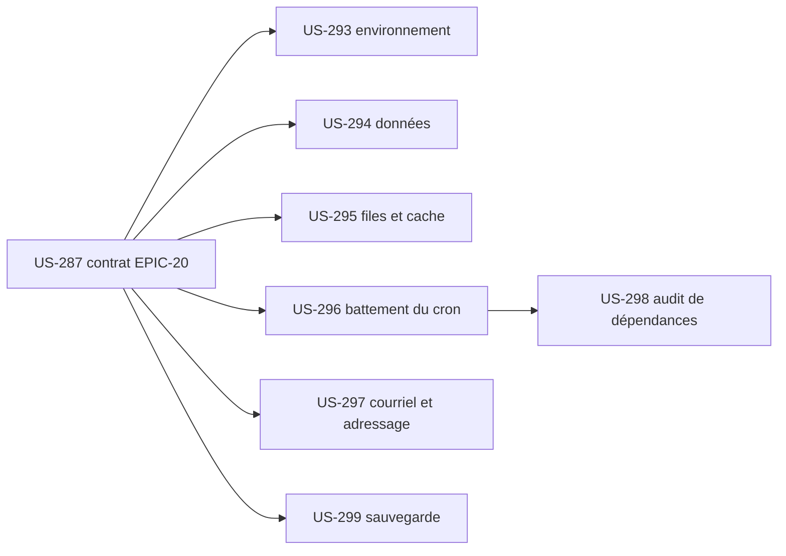

# EPIC-21 — Santé de la plateforme : sondes d'environnement, de données et de tâches planifiées

> Exigences : demande de Thibaut du 2026-11-22 · 7 stories · 31 points · paquet Composer `tmonier/sylius-platform-health-plugin` · dépend d'[EPIC-20](EPIC-20.md)

## Description

Les sondes **techniques** livrées avec le plugin : celles qu'aucun plugin métier ne peut fournir parce qu'elles portent sur l'installation elle-même. Elles sont toutes des implémentations du contrat d'US-287 ([EPIC-20](EPIC-20.md)) et n'ont aucune dépendance entre elles.

Trois catégories :

- **Environnement** — versions, fin de support, extensions, mode debug. Ce sont les sondes qui auraient signalé à l'écran ce que l'[ADR-0021](../../../docs/adr/0021-montee-php-8-6-reportee.md) a dû documenter à la main : « votre PHP sort de support dans N mois ».
- **Données** — connexion, migrations en attente, dérive du schéma, tables qui grossissent sans purge.
- **Tâches planifiées** — le trou le plus coûteux de l'exploitation actuelle. La démo exécute **16 commandes de cron** (`docker/crontab`) ; aujourd'hui, si `tmonier:feeds:generate` cesse de réussir, rien ne le dit. Personne ne regarde les logs d'un conteneur qui tourne.

### Le battement des tâches planifiées (US-296)

La sonde la plus utile du lot, et celle qui demande le plus de soin. Le principe :

- un abonné aux événements console enregistre, pour chaque commande **déclarée surveillée**, la date et le code de sortie de sa dernière exécution (une ligne par commande, pas un journal) ;
- la configuration déclare le battement attendu : `tmonier:feeds:generate` toutes les 15 min, `app:demo:reset` une fois par jour ;
- une commande qui n'a pas **réussi** depuis N battements passe en `warning` puis en `critical`.

Ce qui en fait une vraie sonde et pas un gadget : elle détecte **l'absence d'événement**, le seul type de panne qu'un journal d'erreurs ne montre jamais. Un cron qui ne se lance plus n'écrit rien.

### Réserve sur l'audit de dépendances (US-298)

Le plugin **ne lance pas** `composer audit` depuis l'administration : ce serait un appel réseau sortant déclenché par une requête HTTP, lent et imprévisible. Il **lit un rapport** déposé par la CI ou par une commande de cron. La sonde répond `unknown` si le rapport est absent ou vieux de plus de 7 jours — formulation prudente plutôt que faux sentiment de sécurité.

## MMF (Minimum Marketable Feature)

**Plus petite version livrable** : US-293, US-294, US-295 et US-296 (Must). L'administrateur voit l'état de son environnement, de ses données et de ses files, et il est averti d'un cron qui ne tourne plus.
**Valeur** : Les trois pannes d'exploitation réellement vécues sur la démo — migration oubliée, transport d'échec qui se remplit, cron silencieux — deviennent visibles sans ouvrir un terminal.
**US incluses** : US-293, US-294, US-295, US-296, US-297, US-298, US-299 (Must : 20 points, Should : 8 points, Could : 3 points).

## Règles transverses du plugin

- Definition of Done de chaque nouveau plugin : dépôt durci comme [US-209](../user-stories/US-209.md); CI Sylius 2.2/2.3; README en français (lien démo, profil de l'auteur); intégration dans la démo, page « Plugins » et « Preuve technique »; Packagist soumis par Thibaut, aucun tag sans GO; ton neutre (politique Sylius Plus : aucune comparaison ; chaque spike vérifie l'absence de recoupement avec Sylius Plus avant toute promotion).
- Les cinq règles de conception d'[EPIC-20](EPIC-20.md#règles-de-conception-propres-à-cet-epic) s'appliquent à chaque sonde : budget de temps, aucune exception remontée, rendu mutualisé, lecture seule, rien de sensible à l'écran.

## Stories

> Les fiches US seront rédigées au cadrage, après les réponses de Thibaut aux questions ouvertes (bas de page).

| Story | Titre | MoSCoW | Points | Sprint cible |
|---|---|---|---|---|
| US-293 | Sondes d'environnement : versions PHP/Symfony/Sylius, fin de support, extensions, OPcache, `APP_DEBUG` | Must | 5 | 57 |
| US-294 | Sondes de données : connexion, migrations en attente, dérive du schéma, tables qui grossissent sans purge | Must | 5 | 58 |
| US-295 | Sondes de files et de cache : messages en attente et âge du plus ancien, transport d'échec, cache, dossiers inscriptibles | Must | 5 | 58 |
| US-296 | Battement des tâches planifiées : déclaration du rythme attendu, détection d'un cron qui ne réussit plus | Must | 5 | 58 |
| US-297 | Sondes de courriel et d'adressage : mailer configuré et dernier envoi, canal sans URL, HTTPS et en-têtes | Should | 3 | 59 |
| US-298 | Audit de dépendances : lecture d'un rapport `composer audit` produit ailleurs, `unknown` si absent ou périmé | Should | 5 | 59 |
| US-299 | Sonde de dernière sauvegarde ou remise à zéro, par crochet facultatif de l'hébergeur | Could | 3 | non planifiée |

## Dépendances

**Notes** : US-298 suit US-296 parce qu'elle réutilise sa table de battements pour savoir quand le rapport a été produit. US-299 (Could) n'est pas planifiée : elle n'a de sens que si un hébergeur expose la date de sa dernière sauvegarde, ce qui n'est pas le cas de Railway sur le plan utilisé.

## Questions ouvertes (à trancher avec Thibaut)

1. **Dates de fin de support embarquées** : les figer dans le code (vérifiées par un test qui échoue quand elles approchent) ou lire `composer.json` d'`endoflife.date` ? La première option respecte « aucun appel réseau », la seconde reste à jour sans release.
2. ~~**Battement** : YAML ou attribut PHP sur la commande ?~~ **Tranché le 2026-11-22 par la décision sur l'inversion de dépendance** : un attribut `#[Heartbeat]` obligerait le plugin surveillé à connaître le plugin de santé. Le rythme attendu est donc déclaré en configuration, dans l'application ou dans le plugin de santé, jamais sur la commande surveillée.
3. **Seuils** : des valeurs par défaut opinionnées (ex. transport d'échec non vide = `warning`, plus de 100 = `critical`) ou tout configurable dès la première version ?
