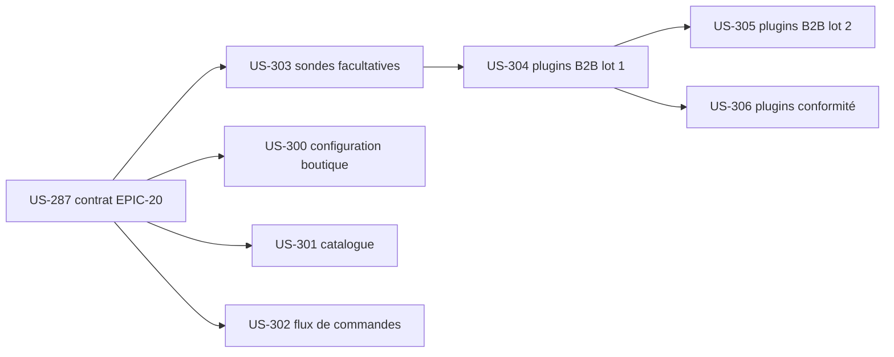

# EPIC-22 — Santé de la plateforme : sondes métier et sondes des plugins de l'écosystème

> Exigences : demande de Thibaut du 2026-11-22 · 7 stories · 33 points · paquet Composer `tmonier/sylius-platform-health-plugin` et les 10 plugins concernés · dépend d'[EPIC-20](EPIC-20.md)

## Description

L'epic qui différencie ce plugin d'un simple écran de supervision technique. Une plateforme peut être parfaitement « verte » côté infrastructure et **ne rien vendre** : un canal sans moyen de paiement activé, 40 produits publiés sans prix, des commandes bloquées en attente de paiement depuis trois semaines. C'est la question que se pose réellement un administrateur, et c'est celle qu'aucun outil de monitoring ne pose.

Deux moitiés :

**Les sondes métier Sylius** (US-300 à US-302) vivent dans le plugin de santé : elles ne parlent que d'entités du cœur. Chacune porte **le lien vers la grille filtrée** qui montre les objets fautifs — « 7 produits activés sans prix sur le canal B2B » ouvre la grille produits déjà filtrée. Sans ce lien, l'écran ne fait que déprimer son lecteur.

**Les sondes des plugins** (US-304 à US-306) vivent **dans leur propre dépôt**, chacune livrée par le plugin qu'elle surveille. `webhook-outbox` sait seul ce qu'« outbox en retard » veut dire ; le plugin de santé ne doit pas l'apprendre.

### La règle d'inversion (US-303) — à traiter en premier

Le piège architectural est net : si `webhook-outbox` doit `require` le plugin de santé pour implémenter son interface, alors **installer un plugin de webhooks impose d'installer un tableau de bord de santé**. Inacceptable pour dix plugins publiés sur Packagist.

Le mécanisme retenu :

- le plugin de santé reste le propriétaire de l'interface ;
- chaque plugin surveillé la déclare en `suggest` / `require-dev`, jamais en `require` ;
- sa classe de sonde n'est enregistrée **que si l'interface existe** (vérification à la compilation du conteneur) ;
- sonde absente = catégorie simplement masquée, **jamais une erreur**.

C'est exactement la leçon tirée du point d'extension du thème (PR #31 du 2026-11-21) : une installation qui n'a pas la pièce d'en face doit se comporter comme avant, pas rendre une erreur. La story doit prouver ce comportement par un test qui **boote le conteneur sans le plugin de santé**.

## MMF (Minimum Marketable Feature)

**Plus petite version livrable** : US-300, US-301, US-302, US-303 et US-304 (Must). L'administrateur voit les écarts de configuration qui empêchent de vendre, les produits inexploitables, les commandes immobilisées, et les trois plugins B2B les plus critiques remontent leur propre état.
**Valeur** : La différence entre « mes serveurs tournent » et « ma boutique vend ». Un écran qui dit quoi corriger, avec le lien pour le corriger.
**US incluses** : US-300, US-301, US-302, US-303, US-304, US-305, US-306 (Must : 25 points, Should : 8 points).

## Règles transverses du plugin

- Definition of Done de chaque nouveau plugin : dépôt durci comme [US-209](../user-stories/US-209.md); CI Sylius 2.2/2.3; README en français (lien démo, profil de l'auteur); intégration dans la démo, page « Plugins » et « Preuve technique »; Packagist soumis par Thibaut, aucun tag sans GO; ton neutre (politique Sylius Plus : aucune comparaison ; chaque spike vérifie l'absence de recoupement avec Sylius Plus avant toute promotion).
- Les cinq règles de conception d'[EPIC-20](EPIC-20.md#règles-de-conception-propres-à-cet-epic) s'appliquent à chaque sonde.
- **Aucun plugin surveillé ne gagne une dépendance obligatoire.** Toute story de sonde de plugin ajoute un `suggest`, une vérification d'existence de classe et un test de boot sans le plugin de santé. Cette story ouvre un tag mineur dans le dépôt surveillé, pas dans celui de la santé.
- Les sondes métier sont **bornées en coût** : jamais un `COUNT` sans index, jamais un chargement d'entités ; des requêtes agrégées, et un seuil au-delà duquel la sonde répond « plus de 500 » sans compter exactement.

## Stories

> Les fiches US seront rédigées au cadrage, après les réponses de Thibaut aux questions ouvertes (bas de page).

| Story | Titre | MoSCoW | Points | Sprint cible |
|---|---|---|---|---|
| [US-303](../user-stories/US-303.md) | Mécanisme des sondes facultatives : un plugin fournit sa sonde sans dépendre du plugin de santé | Must | 5 | 59 |
| US-300 | Sondes de configuration de boutique : canal sans paiement, sans livraison, sans locale, sans devise, zone ou taxe manquante | Must | 5 | 59 |
| US-301 | Sondes de catalogue : produits activés sans prix, sans image, sans stock ni réassort — avec lien vers la grille filtrée | Must | 5 | 59 |
| US-302 | Sondes de flux de commandes : commandes immobilisées dans un état, paiements en échec, impayés, taux de paniers abandonnés | Must | 5 | 60 |
| US-304 | Sondes des plugins B2B (lot 1) : `webhook-outbox`, `purchase-approval`, `trade-credit` | Must | 5 | 60 |
| US-305 | Sondes des plugins B2B (lot 2) : `punchout-cxml`, `facturx` / `einvoice-transmission`, `company-verification`, `b2b-mcp` | Should | 5 | 61 |
| US-306 | Sondes des plugins de conformité : `gpsr`, `digital-product-passport`, `withdrawal` | Should | 3 | 61 |

## Dépendances

**Notes** : US-303 précède toutes les sondes de plugins — c'est elle qui fixe le mécanisme que les trois lots suivants ne font qu'appliquer. Les sondes métier (US-300 à US-302) sont indépendantes d'US-303 et peuvent avancer en parallèle. US-304 ouvre un tag mineur dans trois dépôts ; prévoir la charge de publication, pas seulement celle du code.

## Questions ouvertes (à trancher avec Thibaut)

1. ~~**Périmètre des sondes métier**~~ **Tranché le 2026-11-22** : les trois lots sont retenus (configuration, catalogue, flux de commandes), et le mécanisme de sondes facultatives aussi.
2. ~~**Paniers abandonnés** : taux ou compte instantané ?~~ **Tranché le 2026-11-22** : l'historique étant retenu dans [EPIC-23](EPIC-23.md), la sonde rend un **taux** comparé à la fenêtre précédente, pas un compte brut.
3. **Ordre des lots de plugins** : les trois plugins d'US-304 sont mon choix (les plus exposés à une panne silencieuse). Si un autre plugin vous a déjà coûté un incident, il passe devant.
4. **Multi-canal** : les sondes métier rendent-elles un résultat par canal (plus juste, plus verbeux) ou un résultat agrégé avec le détail au survol ?
