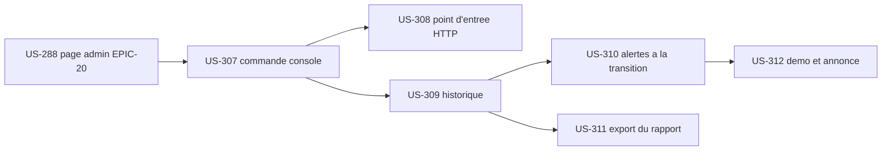

# EPIC-23 — Santé de la plateforme : exposition, historique et alertes

> Exigences : demande de Thibaut du 2026-11-22 · 6 stories · 24 points · paquet Composer `tmonier/sylius-platform-health-plugin` · dépend d'[EPIC-20](EPIC-20.md)

## Description

Un écran de santé a un défaut structurel : **il faut penser à l'ouvrir**. Cet epic rend le diagnostic utile sans spectateur.

- **La commande console** (US-307) : le même diagnostic en sortie texte ou JSON, avec un code de sortie qui vaut quelque chose — `0` tout va bien, `1` avertissements, `2` au moins une sonde critique. Utilisable dans la CI (porte de recette après déploiement) et dans le cron.
- **Le point d'entrée HTTP** (US-308) : un JSON réduit, protégé par jeton, lisible par la sonde d'un hébergeur. Il **remplace et généralise** le `/healthz` écrit à la main dans la démo (US-049), qui ne vérifie aujourd'hui que le boot du noyau.
- **L'historique** (US-309) : un instantané périodique en base, et une courbe par sonde sur 30 jours. Sans historique, impossible de répondre à « est-ce que ça empire ? », qui est la seule question qui compte quand une sonde est en avertissement depuis longtemps.
- **Les alertes** (US-310) : à chaque **changement d'état** d'une sonde, un message Messenger, transformé en courriel et/ou en webhook sortant via `webhook-outbox`.

### Pourquoi « changement d'état » et pas « statut rouge »

La règle anti-répétition n'est pas un détail d'implémentation, c'est ce qui décide si le plugin sera utilisé ou désactivé au bout d'une semaine. Une sonde exécutée toutes les 5 minutes et en alerte pendant deux jours produirait **576 courriels**. Le plugin n'alerte qu'à la **transition** (`ok` → `warning`, `warning` → `critical`, et le retour à `ok`), avec une temporisation configurable avant la première alerte pour absorber les faux positifs d'un redémarrage.

### Exigences de sécurité du point d'entrée HTTP (US-308)

L'adresse est publique par construction, donc :

- **jeton obligatoire**, comparé en temps constant ; sans jeton valide, `404`, pas `401` — l'existence du point d'entrée n'est pas une information à donner ;
- **deux niveaux de détail** : par défaut un statut global et rien d'autre ; le détail par sonde seulement avec un second jeton ou depuis un réseau déclaré ;
- **jamais de version, de chemin, de nom de table ni de message d'exception** dans la charge publique (OWASP A01 et A05 du relevé 2025 : divulgation par message d'erreur) ;
- **limitation de débit** et cache, pour que le point d'entrée ne devienne pas un levier de charge sur la base.

## MMF (Minimum Marketable Feature)

**Plus petite version livrable** : US-307, US-308 et US-309 (Must, l'historique ayant été retenu dès la première version le 2026-11-22). Le diagnostic est consultable sans ouvrir l'administration : en ligne de commande pour la CI et le cron, en JSON pour la sonde de l'hébergeur.
**Valeur** : Le diagnostic cesse de dépendre de quelqu'un qui regarde un écran.
**US incluses** : US-307, US-308, US-309, US-310, US-311, US-312 (Must : 13 points, Should : 8 points, Could : 3 points).

## Règles transverses du plugin

- Definition of Done de chaque nouveau plugin : dépôt durci comme [US-209](../user-stories/US-209.md); CI Sylius 2.2/2.3; README en français (lien démo, profil de l'auteur); intégration dans la démo, page « Plugins » et « Preuve technique »; Packagist soumis par Thibaut, aucun tag sans GO; ton neutre (politique Sylius Plus : aucune comparaison ; chaque spike vérifie l'absence de recoupement avec Sylius Plus avant toute promotion).
- Les cinq règles de conception d'[EPIC-20](EPIC-20.md#règles-de-conception-propres-à-cet-epic) s'appliquent à chaque sonde.
- L'historique et les battements sont les **seules** écritures en base du plugin, toutes deux purgées par une commande dédiée (comme `tmonier:audit-log:purge` et `tmonier:webhook:purge`).

## Stories

> Les fiches US seront rédigées au cadrage, après les réponses de Thibaut aux questions ouvertes (bas de page).

| Story | Titre | MoSCoW | Points | Sprint cible |
|---|---|---|---|---|
| [US-307](../user-stories/US-307.md) | Commande `tmonier:health:check` : sortie texte ou JSON, code de sortie 0/1/2, filtres `--category` et `--only` | Must | 3 | 59 (avancée le 2026-11-26) |
| US-308 | Point d'entrée HTTP JSON protégé par jeton, deux niveaux de détail, limitation de débit — généralise le `/healthz` de la démo | Must | 5 | 60 |
| US-309 | Historique : instantané périodique, courbe par sonde sur 30 jours, purge configurable | Must | 5 | 61 |
| US-310 | Alertes à la transition d'état : message Messenger, courriel et webhook sortant, temporisation anti-faux-positif | Should | 5 | 61 |
| US-311 | Export du rapport : page imprimable et JSON daté, pour une revue d'exploitation mensuelle | Could | 3 | non planifiée |
| US-312 | Démo : page « Preuve technique », fixtures produisant une alerte volontaire, capture et GIF, post d'annonce (EPIC-13) | Should | 3 | 61 |

## Dépendances

**Notes** : US-310 dépend d'US-309 pour une raison de fond — détecter une *transition* suppose de connaître l'état précédent, donc de l'avoir stocké. US-308 remplace le `/healthz` manuel de la démo : prévoir dans la story la bascule de `.railway/railway.ts` et le retrait du contrôleur maison, sinon les deux coexistent.

## Questions ouvertes (à trancher avec Thibaut)

1. ~~**Canal d'alerte par défaut**~~ **Tranché le 2026-11-22** : **les deux** — courriel par le mailer Symfony, et webhook sortant par `webhook-outbox` en dépendance facultative (même mécanisme d'inversion qu'[US-303](EPIC-22.md)). US-310 couvre les deux canaux et passe de ce fait à 5 points fermes.
2. **Rythme de l'instantané** : toutes les 15 min comme les flux, ou une fois par heure ? Trente jours d'historique à 15 min pour 25 sondes font ~72 000 lignes — acceptable, mais à décider plutôt qu'à subir.
3. **Destinataire des alertes** : une adresse configurée, ou tous les administrateurs Sylius portant le rôle d'[US-290](EPIC-20.md) ?
4. **`/healthz` de la démo** : le remplacer vraiment (et donc toucher la configuration Railway, qui est votre domaine) ou garder les deux, le plugin n'exposant que son propre point d'entrée ?
