# Feuille de route : ouverture publique puis démo comme preuve (sprints 14 à 23)

> Proposition du Product Owner du 2026-10-18, à valider par Thibaut. Entrées : audit fonctionnel B2B, audits accessibilité (58/100), UX (68), UI (66), Lighthouse, sécurité et qualité du même jour. Backlog : EPIC-10 à EPIC-14 (68 nouvelles stories, 255 points) plus 11 stories existantes reprises (33 points), soit 79 stories et 288 points sur 8 sprints. Les dates sont indicatives (sprints de 2 semaines à la suite du sprint 13) ; le planning détaillé se fait au lancement de chaque sprint. Aucune section sprint-14 n'est créée dans `.bmad/sprint-status.yaml`.
>
> **Mise à jour du 2026-10-18 (décision « démo d'abord »)** : le sprint 16 est recentré sur la crédibilité de la démo (27 points, nouvelle US-145 pour les images persistantes) ; US-093, US-116, US-118, US-122, US-126 sont décalées, avec report en cascade sur les sprints 17 à 19 (sprint 19 en débordement à arbitrer).
> **Recadrage du 2026-10-21 (décision de Thibaut : « recherche d'emploi »).** La démo B2B Sylius et les 24 plugins open source servent désormais sa recherche d'emploi (Delivery Manager, CTO, directeur de la production ou de projets IT ; Nantes ou full remote ; disponible immédiatement). Ils ne vendent plus de missions de conseil. Ils prouvent : 25 ans de delivery, l'IA générative intégrée au delivery avec qualité, sécurité et conformité intactes, l'humain au centre, une expertise Symfony, Sylius et e-commerce B2B. Le point d'arrivée des appels à l'action est le profil LinkedIn (`DEMO_PROFILE_URL`, qui remplace `DEMO_BOOKING_URL`) ; la page « Intégrer » devient un guide technique ; le site `thibaut-monier.fr` n'existe pas.
> Effet sur le backlog : **9 stories retirées** (38 points : US-069, US-109, US-110, US-112, US-114, US-118, US-119, US-125, US-126), **4 créées** (US-158 repositionnement, US-159 contenu réaligné, US-160 dettes du sprint 17, US-161 actions de rétro, 16 points), 8 réécrites ou recadrées (US-068, US-108, US-111, US-113, US-124, US-128, et amendements d'US-106, US-107, US-116, US-122, US-123, US-127, US-129, US-142), 3 non planifiées (US-136, US-137, US-138, 18 points : connecteur ERP et assortiments, en attente d'arbitrage). Sprints 18 à 23 : 46 stories, 170 points. Dates et planning détaillé à confirmer au lancement de chaque sprint.

## Cap

1. **Ouvrir au public** (sprints 14-15, fait) : bloquants d'accessibilité mobile et de structure, sécurité, signaux « prototype », prix B2B visibles, dossier de GO. La démo est publique depuis le 2026-10-19.
2. **Rendre crédible** (sprints 15-16, fait) : catalogue et photos cohérents, données vivantes.
3. **Prouver** (sprints 17-18) : parcours guidés, guide technique « Intégrer », CTA neutre vers le profil LinkedIn, bloc de preuve de qualité, contenu LinkedIn réaligné (delivery augmenté par l'IA, qualité et garde-fous, coulisses, leadership). Communication uniquement par LinkedIn (profil de Thibaut) ; jamais sur les canaux Sylius, jamais de comparaison avec une offre éditeur, jamais de pitch de prestation.
4. **Approfondir la preuve** (sprints 19-23) : pilotage des achats (EPIC-15), catalogue et données vivantes, plugin parc d'équipements, spikes de cadrage. Chaque story est jugée sur « est-ce une preuve vérifiable de ce que dit le profil ? ».

## Jalons

| Jalon | Quand (indicatif) | Condition |
|---|---|---|
| Revue de GO d'ouverture publique | Fin du sprint 15 (revue, US-085) | Bloquants a11y, sécurité et signaux « prototype » traités |
| **Ouverture publique : GO de Thibaut** | Après la revue du sprint 15 | Décision de Thibaut seul ; bascule US-052 (commandes Railway par Thibaut) |
| Prérequis bloquant du dossier de GO levé (images persistantes) et démo crédible | Fin du sprint 16 | US-145, US-092, US-096, US-097 |
| Charte v2 et calendrier prêts (à réaligner) | Charte v2 rédigée le 2026-10-21 ; calendrier et posts réalignés au sprint 18 | US-116, US-122, US-159 |
| ~~Six fiches plugins prêtes~~ | Retiré le 2026-10-21 (le site n'existe pas) | ~~US-118~~ |
| ~~Mise en ligne des fiches et pages du site~~ | Retiré le 2026-10-21 : pas de site, le profil LinkedIn est le point d'arrivée | ~~US-118, US-125, US-126~~ |
| README des 24 dépôts reliés à la démo et au profil de l'auteur | Sprint 18 (GO unique de merge de Thibaut) | US-068 ; URL du profil |
| Suivi de l'annonce (J+7 puis J+30) | Sprint 17 : bilan à J+7 le 2026-10-26 | US-127, US-123, US-129, US-117 |
| **Annonce LinkedIn de l'ouverture** | **Faite le 2026-10-19 par Thibaut**, avant le site et la page contact (environ 380 réactions et environ 10 vues du profil au 2026-10-20) | Démo publique depuis le 2026-10-19 |
| Calendrier éditorial de 8 semaines (charte v2) | Sprints 17 à 19 (premier post de suite au plus tard le 2026-10-26) | US-122, US-123, US-159, US-124 |
| Démo repositionnée, PHP 8.5, dettes du sprint 17 soldées | Fin du sprint 18 | US-158, US-147, US-148, US-160 |
| Tableau de bord des achats en démo (MMF EPIC-15) | Fin du sprint 19 | US-149, US-150, US-151, US-155 |
| Plugin parc d'équipements publié | Sprint 22 | US-056 à US-060 |

## Sprints

### Sprint 14 (2026-12-25 au 2027-01-08) : 32 points (dont 25 Must)

**Objectif** : Supprimer les bloquants d'accessibilité mobile et de structure, retirer les signaux « prototype » et fermer les risques de sécurité immédiats.

| Story | Titre | MoSCoW | Pts |
|---|---|---|---|
| US-070 (reprise) | Plugin punchout : traduire le titre et le fil d'Ariane des acheteurs PunchOut | Should | 1 |
| US-071 | Mise en page mobile sans débordement ni cible trop petite | Must | 3 |
| US-072 | Structure sémantique du thème : repères, lien d'évitement et annonces | Must | 5 |
| US-073 | Contrastes AAA et jetons de couleur uniques | Must | 3 |
| US-074 | Pied de page dédié à la démo B2B | Must | 3 |
| US-075 | Connexion : comptes de démo en premier, groupés par société | Should | 2 |
| US-076 | Barre de démo sur une ligne, dans la langue du visiteur | Should | 2 |
| US-077 | Libellés accessibles du cœur en français | Should | 2 |
| US-079 | Sécurité avant ouverture : exposition, configuration versionnée, branche protégée | Must | 3 |
| US-080 | Boîte de courriels de démo limitée aux mails des fixtures | Must | 2 |
| US-086 | Exemple de commande rapide avec de vraies références | Must | 2 |
| US-087 | Signaux « prototype » : 23/24 plugins, clés brutes, libellés anglais | Must | 3 |
| US-104 | Retirer l'encart « Sylius Plus » de la page Plugins | Must | 1 |

*Jalon* : Période de fêtes : capacité réelle à confirmer.

### Sprint 15 (2027-01-08 au 2027-01-22) : 34 points (dont 18 Must)

**Objectif** : Fermer la sécurité et la performance, afficher les prix B2B et obtenir le dossier de GO d'ouverture publique.

| Story | Titre | MoSCoW | Pts |
|---|---|---|---|
| US-052 (reprise) | Ouverture publique de la démo | Must | 3 |
| US-078 | SEO de base et vitesse d'affichage mobile | Should | 5 |
| US-081 | Chaîne d'approvisionnement : Dependabot, scan d'image, SBOM et empreintes | Should | 5 |
| US-082 | Durcissement applicatif : en-têtes, fichiers servis, formulaire du simulateur, correctifs de dépendances | Should | 5 |
| US-083 | Relire la licence du plugin MCP tiers | Should | 1 |
| US-085 | Revue de sécurité de réouverture et dossier de GO | Must | 2 |
| US-089 | Accueil connecté sans doublon : références habituelles, réassort, promotions négociées | Must | 5 |
| US-090 | Paliers de prix et prix négocié sur la fiche produit | Must | 5 |
| US-091 | Paliers et prix négocié au catalogue et au panier | Must | 3 |

*Jalon* : Fin de sprint : revue de GO (US-085) puis décision de Thibaut.

### Sprint 16 (2027-01-22 au 2027-02-05) : 27 points (dont 26 Must)

> **Décision de Thibaut du 2026-10-18 : « démo d'abord ».** Périmètre arrêté au planning (voir [sprint-goal.md](../sprints/sprint-16-demo-credible/sprint-goal.md)). Les stories de communication et de site (US-116, US-118, US-122, US-126) et le catalogue étendu (US-093) sont décalées ; le sprint 16 reçoit trois stories nouvelles ou promues (US-145, US-142, US-143). Les sept stories décidées totalisent 27 points (≈ 34 annoncés au cadrage) : l'écart est un tampon de capacité.

**Objectif** : Rendre la démo crédible avant de la montrer : images produit persistantes, photos cohérentes et crédits, données vivantes, appel à l'action « Me contacter » et mesure d'audience sans cookie.

| Story | Titre | MoSCoW | Pts |
|---|---|---|---|
| US-145 (nouvelle) | Images produit persistantes sur Railway (volume sur `public/media`) | Must | 3 |
| US-142 | Appel à l'action « Me contacter » mis en avant dans toute la démo (absorbe US-115) | Must | 5 |
| US-143 | Mesure d'audience de la démo avec Umami | Must | 3 |
| US-092 | Catalogue crédible, tranche 1 : photos cohérentes avec les produits | Must | 5 |
| US-096 | Données vivantes (1/2) : panier de départ, historique et approbation en attente | Must | 5 |
| US-097 | Données vivantes (2/2) : devis, crédit, brouillons, suggestions IA et journal d'audit | Must | 5 |
| US-061 (reprise) | Crédits des images de démo | Should | 1 |

*Décalées hors du sprint 16 (décision « démo d'abord »)* : US-093 (8, Should, voir report en cascade), US-116 (2, Must), US-118 (5, Must), US-122 (3, Must), US-126 (5, Should).

*Jalon* : Prérequis bloquant du dossier de GO levé (images persistantes, US-145) ; démo crédible avant toute communication. Mise en ligne des fiches du site repoussée au sprint 17.

> **Planification complète demandée par Thibaut le 2026-10-20 (sprints 18 à 23 remplacés par le recadrage du 2026-10-21 ci-dessus ; le reste de ce bloc est conservé pour l'historique).**
> - **Périmètre :** tout le scope restant, soit 64 stories et 250 points (253 avant le recadrage de l'annonce). Cela comprend le contenu des anciens sprints 17 à 21, US-146, EPIC-15 et US-156/157.
> - **Capacité :** 7 sprints de 34 à 39 points, pour une capacité de 35 à 39. Tous les Must sont placés au plus tard au sprint 20, et les Could sont regroupés au sprint 23.
> - **Dépendances :** l'ordre respecte le graphe ci-dessous (US-107 puis US-106 ; US-118 puis US-125 ; spikes avant les tranches ; US-149 avant le reste d'EPIC-15).
> - **Révision :** le planning détaillé reste fait au lancement de chaque sprint.
> - **Annonce déjà publiée (rappel de Thibaut du 2026-10-20) :** le premier post est parti le 2026-10-19, avant le site. US-127 devient le suivi de l'annonce (2 points), US-123 se réduit aux trois posts de suite (3 points), et US-129 (profil, devenue Must) et US-117 (mesure) passent au sprint 17. Le sprint 17 fait 38 points, le sprint 18 en fait 34.
> - **Risque de vélocité :** si elle reste sous 35 points, on retire d'abord les Could du sprint 23, puis on décale les Should du sprint 22.

### Sprint 17 (2027-02-05 au 2027-02-19) : 38 points (dont 35 Must)

**Objectif** : Transformer l'élan de l'annonce du 2026-10-19 en visites et en échanges (profil, posts de suite, suivi à J+7 et J+30, mesure, charte, calendrier, kit média) et livrer la conversion dans la démo (parcours guidés complets, page « Intégrer »).

| Story | Titre | MoSCoW | Pts |
|---|---|---|---|
| US-105 | Parcours guidés : moteur de visite par étapes | Must | 8 |
| US-106 | Parcours guidés : contenu par persona et écran de sortie vers le contact | Must | 5 |
| US-107 | Page « Intégrer ces plugins dans votre projet » | Must | 5 |
| US-116 | Charte éditoriale LinkedIn et messages clés | Must | 2 |
| US-120 | Kit média (1/2) : GIF courts de PunchOut, devis et commande rapide | Must | 5 |
| US-122 | Calendrier éditorial LinkedIn sur huit semaines | Must | 3 |
| US-123 | Posts LinkedIn rédigés, lot 1 : trois posts de suite à l'annonce | Must | 3 |
| US-127 | Suivi de l'annonce d'ouverture, de J+1 à J+30 | Must | 2 |
| US-129 | Profil LinkedIn : texte, bannière et section « À la une » | Must | 2 |
| US-117 | Mesure de la communication : visites par campagne sans cookie (outil : Umami, US-143) | Should | 3 |

*Jalon* : Les quatre actions de la rétro du sprint 16 sont prises en tâches, sans points : verrou de `bin/run-tests`, isolation des comptes de démo partagés, arrêt des tâches de fond, reconstruction de l'image. Premier post de suite publié au plus tard le 2026-10-26 et profil à jour avant lui. Fin de sprint : bilan à J+7 fait, parcours guidés et page « Intégrer » en ligne.

> **Recadrage du 2026-10-21 sur le sprint 17 (stories en review).** US-106, US-107 et US-142 sont recadrées par US-158 (CTA vers le profil, guide technique) ; US-116 (charte v2), US-129 (profil v2), US-122, US-123 et US-127 sont amendées. Le Sprint Goal du sprint 17 reste inchangé (livré) ; les écarts sont repris au sprint 18.

### Sprint 18 (2027-02-19 au 2027-03-05) : 36 points (dont 22 Must)

> **Replanifié le 2026-10-21 (recherche d'emploi).** Remplace le sprint « lancement du site » : plus de fiches, de page démo ni de pages services/contact (US-126 retirée ; US-118, US-119 et US-125 en réserve le 2026-10-21 : le site personnel est en cours de développement, elles seront replanifiées et réalignées quand il sera en ligne ; US-136 à US-138 également en réserve).

**Objectif** : Aligner la démo, les plugins et le contenu LinkedIn sur la recherche d'emploi (CTA vers le profil, guide technique, preuve de qualité), tout en passant à PHP 8.5 et en soldant les dettes et les actions de rétro du sprint 17.

| Story | Titre | MoSCoW | Pts |
|---|---|---|---|
| US-158 (nouvelle, en cours) | Repositionnement de la démo : profil LinkedIn, libellés neutres, guide technique | Must | 3 |
| US-147 | Démo en PHP 8.5 (image, CI et plateforme Composer) ; **prioritaire : faille critique PHP (CVSS 9.2) publiée le 2026-10-21** ; peut être livrée avant par la veille programmée ; **reportée le 2026-10-21** (correctif non publié à la clôture du sprint) : PR séparée dès l'image FrankenPHP corrigée, sinon sprint 19 ; **livrée hors sprint le 2026-10-22** (PR #46, dc60b56) | Must | 3 |
| US-148 | Plugins : limiteurs de débit typés `RateLimiterFactoryInterface` (Symfony 8) | Must | 3 |
| US-160 (nouvelle) | Dettes du sprint 17 : verrou atomique, GET sans écriture de session, menu compte nommé | Must | 5 |
| US-161 (nouvelle) | Actions de la rétrospective du sprint 17 (disque, isolation, vérification croisée, attente bornée, prérequis) | Must | 5 |
| US-159 (nouvelle) | Contenu LinkedIn réaligné sur la recherche d'emploi : calendrier et posts de suite | Must | 3 |
| US-124 (réécrite) | Posts LinkedIn, lot 2 : semaines 3 à 8, quatre piliers | Should | 5 |
| US-111 (recadrée) | Bloc de preuve technique : qualité, compatibilité, versions | Should | 3 |
| US-103 | Assistants IA : page utile avec transcript d'une vraie conversation | Should | 3 |
| US-068 (réécrite, 5 → 3) | Liens vers la démo et le profil de l'auteur dans les 24 README | Should | 3 |

*Ordre de sacrifice* : US-068, US-103, US-111, puis la seconde tranche d'US-124. Les Must (22 points) ne se sacrifient pas ; US-147 passe en tête si la veille programmée ne l'a pas livrée.

*Jalon* : Premier post de suite publié au plus tard le 2026-10-26 (profil v2 appliqué avant). Bilan J+30 de l'annonce (2026-11-18) en tâche de US-127. GO unique de merge des 24 PR de README (US-068).

### Sprint 19 (2027-03-05 au 2027-03-19) : 33 points (dont 20 Must)

**Objectif** : Livrer le tableau de bord des achats en démo (MMF d'EPIC-15), compléter le kit média et rendre le simulateur PunchOut lisible.

| Story | Titre | MoSCoW | Pts |
|---|---|---|---|
| US-149 | Company-insights : squelette du plugin et indicateurs de la période | Must | 5 |
| US-150 | Company-insights : achats par mois sur 12 mois, comparés à l'année précédente | Must | 5 |
| US-151 | Company-insights : tops acheteurs, produits et catégories | Must | 5 |
| US-155 | Company-insights : historique d'achats de 12 mois et intégration à la démo | Must | 5 |
| US-121 | Kit média (2/2) : approbation, MCP, container-fill et visite complète | Should | 5 |
| US-146 | Création de commande admin : choisir une adresse de l'entreprise ou du carnet du client | Should | 5 |
| US-099 | Simulateur PunchOut habillé et expliqué | Should | 3 |

*Jalon* : MMF d'EPIC-15 en démo (Isabelle) ; plugin company-insights 0.1.0, soumis à Packagist par Thibaut. US-121 dépend de US-103 (sprint 18).

*Clôture du 2026-10-22* : sprint clos (PR #47, 27148b7). Les 5 stories engagées (25 points : US-149, US-150, US-151, US-155, US-146) sont livrées et restent en review, la vérification en production attendant la reprise des builds Railway. US-121 et US-099 sont sacrifiées au planning (statut backlog) et reportées au sprint 20. Plugins publiés : company-insights v0.1.0, admin-order-creation v1.1.0, company-accounts v1.3.0.

### Sprint 20 (2027-03-19 au 2027-04-02) : 35 points à la feuille de route, **22 points engagés** (dont 0 Must)

*Mise à jour du 2026-10-22* : périmètre validé à 30 points puis US-093 (8 points) sacrifiée au planning (86 h de charge Claude pour 71 h de capacité) et **reportée au sprint 21** ; engagement final : US-113, US-152, US-153, US-156, US-108, US-099 (22 points, ~69,5 h). US-094 (5) et US-100 (3) restent hors périmètre (backlog).

**Objectif** : Rendre la démo plus riche et plus lisible (catalogue de 150 références, stock et délais, accueil, intégrations) et compléter le pilotage des achats.

| Story | Titre | MoSCoW | Pts |
|---|---|---|---|
| ~~US-093~~ → sprint 21 | Catalogue crédible, tranche 2 : environ 150 références réalistes | Should | 8 |
| US-094 | Stock et délais indicatifs sur la fiche produit (données de démonstration) | Should | 5 |
| US-152 | Company-insights : ventilation par site et centre de coût, export CSV | Should | 5 |
| US-153 | Company-insights : indicateurs des approbations et de l'encours | Should | 5 |
| US-156 | Purchase-approval : approbations en attente signalées dans l'en-tête | Should | 3 |
| US-113 (réécrite) | Accueil réorganisé : trois colonnes, pourquoi cette démo, qui l'a conçue | Should | 3 |
| US-108 (réécrite) | Page « Intégrations » : ERP, PIM, transporteurs, e-facture, grands comptes, assistants | Should | 3 |
| US-100 | Les 403 expliqués et les menus inaccessibles masqués | Should | 3 |

*Jalon* : La décision « administratrice approbatrice » de US-156 est à prendre au planning.

### Sprint 21 (2027-04-02 au 2027-04-16) : 33 points + 8 reportés (US-093) = 41 points à arbitrer (dont 0 Must)

**Objectif** : Livrer le cœur du plugin parc d'équipements, cadrer le connecteur ERP et compléter l'espace acheteur.

| Story | Titre | MoSCoW | Pts |
|---|---|---|---|
| US-093 | Catalogue crédible, tranche 2 : environ 150 références réalistes (reportée du sprint 20, sacrifiée le 2026-10-22) | Should | 8 |
| US-056 | Plugin équipements : modèles d'équipement liés aux variantes compatibles (admin) | Should | 5 |
| US-057 | Plugin équipements : parc du client dans l'espace client (CRUD) | Should | 5 |
| US-058 | Plugin équipements : filtre « pièces compatibles » au catalogue | Should | 5 |
| US-101 | Factures PDF et relevé de compte côté acheteur | Should | 5 |
| US-088 | Journal d'audit lisible : reset masqué et événements métier | Should | 3 |
| US-130 | Spike P5 : connecteur ERP de référence | Should | 3 |
| US-154 | Company-insights : conversion des devis et économies des prix dégressifs | Could | 3 |
| US-098 | Jauge de remplissage condensée sur la fiche produit | Should | 2 |
| US-157 | Purchase-approval : aperçu des approbations en attente depuis l'en-tête | Could | 2 |

*Jalon* : Les posts peuvent évoquer le plugin équipements en cours, sans date.

### Sprint 22 (2027-04-16 au 2027-04-30) : 22 points (dont 0 Must)

**Objectif** : Publier le parc d'équipements, cadrer les derniers plugins (assortiments, facture électronique, contrats-cadres), mesurer la qualité et faire le bilan de la communication.

| Story | Titre | MoSCoW | Pts |
|---|---|---|---|
| US-059 | Plugin équipements : publication 0.1.0 (tag, Packagist, README) | Should | 2 |
| US-060 | Plugin équipements : intégration à la démo | Should | 3 |
| US-131 | Spike P3 : assortiments et prix par société | Should | 3 |
| US-132 | Spike P7 : facture électronique France (PA/PDP) et e-reporting | Should | 3 |
| US-133 | Spike P2 : contrats-cadres | Could | 3 |
| US-084 | Qualité : Rector en CI, couverture mesurée, méthodes longues, enregistrement de la liste société | Could | 5 |
| US-128 (réécrite) | Bilan de communication (indicateurs de recrutement) | Could | 2 |
| US-062 | Mineurs du script d'images | Could | 1 |

*Jalon* : Packagist : Thibaut soumet le plugin parc d'équipements (US-059). Capacité volontairement réduite : tampon pour les entretiens éventuels.

### Sprint 23 (2027-04-30 au 2027-05-14) : 11 points (dont 0 Must)

**Objectif** : Finitions optionnelles (Could) et décision de la suite selon le bilan de communication et la situation professionnelle de Thibaut.

| Story | Titre | MoSCoW | Pts |
|---|---|---|---|
| US-095 | Fiches techniques PDF fictives | Could | 3 |
| US-102 | Suivi de commande côté acheteur | Could | 3 |
| US-134 | Spike P4 : stock multi-entrepôts et délais | Could | 3 |
| US-135 | Spike P8 : budgets et centres de coût | Could | 2 |

*Jalon* : Provisoire. Sprint de repli : si Thibaut a trouvé un poste, passer la démo en vitrine passive (la remise à zéro et la mise à jour des versions suffisent).

### Hors sprint (non planifiées, arbitrage de Thibaut)

US-136 (connecteur ERP, tranche 1, 5 pts), US-137 (tranche 2, 5 pts), US-138 (assortiments, 8 pts) : développements de plugins nés des « offres bankables », sans valeur directe pour la recherche d'emploi tant que les spikes (US-130, US-131) ne montrent pas un intérêt de démonstration.

## Dépendances

```mermaid
graph TD
  subgraph S14[Sprint 14 : bloquants]
    US071[US-071 mobile] --> US085
    US072[US-072 structure] --> US085
    US073[US-073 contrastes] --> US085
    US079[US-079 sécurité 1] --> US085
    US080[US-080 mails] --> US085
    US087[US-087 signaux prototype]
    US104[US-104 encart Plus : décision]
  end
  subgraph S15[Sprint 15 : GO]
    US081[US-081 supply chain] --> US085
    US082[US-082 durcissement] --> US085
    US083[US-083 licence MCP] --> US085
    US090[US-090 paliers fiche] --> US091[US-091 paliers panier]
    US085[US-085 dossier de GO] --> GO{{GO de Thibaut}}
    GO --> US052[US-052 bascule publique]
  end
  subgraph S16[Sprint 16 : crédibilité]
    US092[US-092 photos] --> US093[US-093 150 références]
    US093 --> US096[US-096 données vivantes 1]
    US096 --> US097[US-097 données vivantes 2]
    US116[US-116 charte + UTM] --> US122[US-122 calendrier]
  end
  subgraph S17[Sprint 17 : conversion]
    US105[US-105 moteur de parcours] --> US106[US-106 parcours]
    US107[US-107 guide technique]
    US097 --> US120[US-120 kit média 1]
    US122[US-122 calendrier] --> US123[US-123 posts lot 1]
    US120 --> US123
    US127[US-127 suivi de l annonce]
  end
  subgraph S18[Sprint 18 : repositionnement emploi]
    DEC{{Décision du 2026-10-21 : recherche d emploi}} --> US158[US-158 CTA profil + guide technique]
    US106 --> US158
    US107 --> US158
    DEC --> US159[US-159 contenu réaligné]
    US122 --> US159
    US123 --> US159
    US159 --> US124[US-124 posts lot 2]
    US158 --> US068[US-068 README démo + profil]
    US147[US-147 PHP 8.5]
    US148[US-148 limiteurs typés]
    US160[US-160 dettes S17]
    US161[US-161 actions de rétro S17]
    US103[US-103 transcript MCP]
    US111[US-111 preuve technique]
    ANN{{Annonce LinkedIn faite le 2026-10-19}} --> US127
    ANN --> US123
  end
  subgraph S19_23[Sprints 19 à 23 : approfondir la preuve]
    US103 --> US121[US-121 kit média 2]
    US120 --> US121
    US149[US-149 indicateurs] --> US150[US-150 achats par mois] --> US155[US-155 démo 12 mois]
    US149 --> US151[US-151 tops] --> US155
    US149 --> US152[US-152 ventilation + CSV]
    US149 --> US153[US-153 approbations + encours] --> US154[US-154 devis + économies]
    US156[US-156 approbations en-tête] --> US157[US-157 aperçu]
    US130[US-130 spike ERP]
    US131[US-131 spike P3]
    US056[US-056] --> US057[US-057] --> US058[US-058] --> US059[US-059] --> US060[US-060]
  end
  subgraph HORS[Non planifié]
    US130 -.-> US136[US-136 export ERP]
    US136 -.-> US137[US-137 import ERP]
    US131 -.-> US138[US-138 assortiments]
  end
  US087 --> US085
  US090 --> US096
  US105 --> US106
  US107 --> US106
  ANN --> US128[US-128 bilan]
  US158 --> US128
```

Dépendances externes : l'URL du profil LinkedIn (`DEMO_PROFILE_URL`, fournie par Thibaut et conservée par l'IaC Railway) conditionne US-158 et US-068 ; sans URL, le CTA est masqué sans erreur (schéma https exigé). `DEMO_SITE_URL` et `DEMO_CONTACT_URL` restent facultatives : le site n'existe pas.

## Actions de Thibaut (hors développement)

| Action | Quand | Story liée |
|---|---|---|
| Relire et valider la charte v2 (T-116-06), le profil v2 et le calendrier réaligné | Avant le 2026-10-26 pour le profil et le premier post | US-116, US-129, US-159 |
| Mettre à jour le profil LinkedIn (texte, titre, « À la une ») et publier le premier post de suite | Avant le 2026-10-26 | US-129, US-123 |
| Fournir l'URL du profil LinkedIn et la poser sur Railway (`DEMO_PROFILE_URL`) | Sprint 18, avant le déploiement d'US-158 | US-158 |
| Valider les libellés neutres du CTA et le guide technique | Sprint 18 | US-158 |
| Appliquer le correctif de sécurité PHP (veille programmée ou US-147) et lancer la reconstruction de l'image | Dès publication de la faille (2026-10-21) | US-147 |
| Réaliser une vraie conversation avec un assistant et la fournir | Sprint 18 | US-103 |
| Merger les 24 PR de README (GO unique), publier les versions correctives des plugins | Sprint 18 | US-068, US-148 |
| Publier les posts du lot 2 | À partir du sprint 18 | US-124 |
| Packagist : soumettre company-insights (sprint 19) puis le plugin parc d'équipements (sprint 22) | Sprints 19 et 22 | US-155, US-059 |
| Arbitrer les stories hors sprint (ERP, assortiments) | Planning du sprint 21 | US-136, US-137, US-138 |

## Décisions attendues

1. **Profil** : URL exacte du profil LinkedIn (`DEMO_PROFILE_URL`) ; la démo doit-elle apparaître dans le texte du profil (point 1 de `profil.md`) ou seulement dans « À la une » ?
2. **Libellés du CTA** : « Voir le profil de l'auteur » convient-il ? Faut-il une mention de disponibilité dans la démo elle-même (aujourd'hui : non, le profil la porte) ?
3. **EPIC-15** (company-insights, 33 points) : le garder en entier ou réduire au MMF (20 points) pour libérer 13 points vers la qualité (US-084, couverture mesurée) ?
4. **Site personnel** : confirmer qu'aucun site n'est prévu (US-118, US-119, US-125 retirées, fiches conservées).
5. **Stories hors sprint** (US-136, US-137, US-138) : abandon ou conservation en réserve.
6. **Stratégie si embauche** : sprint 23 de repli (démo en vitrine passive) ; seuil de fermeture du calendrier éditorial (US-128).
7. **Plugin MCP** et ordre de sacrifice en cas de capacité réduite (voir risques).

## Risques

| Risque | Impact | Mitigation |
|---|---|---|
| **Vélocité** : les sprints 8 à 13 ont embarqué 10 à 15 points pour 30 à 35 heures, la cible de 20 à 40 points suppose une estimation plus légère par point | Débordement, GO retardé | Au planning, décomposer en tâches avant d'engager ; ordre de sacrifice : Could puis Should (US-084, US-095, US-128, US-114, US-102), puis finitions du sprint 18 ; ne jamais sacrifier US-085 |
| Fêtes de fin d'année pendant le sprint 14 | Capacité réduite | Les Must du sprint 14 sont courts (US-104, US-086, US-080) ; reporter les Should en sprint 15 |
| URL du profil non posée sur Railway | CTA masqué, démo sans point d'arrivée | `DEMO_PROFILE_URL` à fournir (action de Thibaut) ; `preserve()` dans l'IaC |
| Licence du plugin MCP incompatible avec une démo publique | Retrait d'une fonction vitrine, contenus MCP à revoir | US-083 en sprint 15, avant le GO ; US-103 et US-121 dépendent du résultat |
| Contenus non crédibles (photos, données) | Perte de crédibilité auprès des recruteurs | US-092 à US-097 livrées, US-093 au sprint 21 et US-094 au sprint 20, relecture de Thibaut |
| Dérive de ton (pitch de prestation, Calendly, comparaison avec une offre éditeur, promotion sur des canaux Sylius) | Message brouillé pour les recruteurs, atteinte au positionnement | Charte v2 (US-116), test de termes interdits en CI (US-158) et `charter_check.py` pour les contenus |
| **Faille critique PHP (CVSS 9.2) publiée le 2026-10-21** | Démo publique exposée tant que PHP n'est pas à jour | US-147 en tête du sprint 18 ; veille programmée possible avant ; vérification de l'image après reconstruction |
| Message incohérent entre profil, posts et démo | Perte de confiance d'un recruteur | US-159 et US-158 livrées ensemble au sprint 18 ; relecture croisée par Thibaut |
| Disponibilité de Thibaut réduite (entretiens, embauche) | Sprints non tenus | Sprints 22 et 23 allégés (22 et 11 points), sprint de repli en vitrine passive |
| Détails de sécurité dans un dépôt public | Information exploitable | Stories sans détail, constats dans les rapports privés |
| Gros plugins mal estimés (P2, P4, P7) | Dérapage | Spike de 2 à 3 points avant toute story de développement ; estimations marquées provisoires |
| Effort de communication sous-estimé (relectures de Thibaut) | Calendrier décalé | Lots de posts livrés en avance, calendrier recalable (US-122, US-159) |

## Hors périmètre actuel (consigné, non planifié)

Offres de conseil, site personnel, pages services et contact (retirés le 2026-10-21). Retours et RMA B2B (P6), réassort automatique (P9), vente assistée (P10), vérification d'inscription VIES/SIRENE (P11), configurateur (P12), livraison multi-sites (P13), hiérarchie multi-niveaux, place de marché. Les plugins P6 à P13 sont à réexaminer après le bilan de communication (US-128) seulement s'ils servent de preuve.
