# Feuille de route : ouverture publique puis communication (sprints 14 à 23)

> Proposition du Product Owner du 2026-10-18, à valider par Thibaut. Entrées : audit fonctionnel B2B, audits accessibilité (58/100), UX (68), UI (66), Lighthouse, sécurité et qualité du même jour. Backlog : EPIC-10 à EPIC-14 (68 nouvelles stories, 255 points) plus 11 stories existantes reprises (33 points), soit 79 stories et 288 points sur 8 sprints. Les dates sont indicatives (sprints de 2 semaines à la suite du sprint 13) ; le planning détaillé se fait au lancement de chaque sprint. Aucune section sprint-14 n'est créée dans `.bmad/sprint-status.yaml`.
>
> **Mise à jour du 2026-10-18 (décision « démo d'abord »)** : le sprint 16 est recentré sur la crédibilité de la démo (27 points, nouvelle US-145 pour les images persistantes) ; US-093, US-116, US-118, US-122, US-126 sont décalées, avec report en cascade sur les sprints 17 à 19 (sprint 19 en débordement à arbitrer).

## Cap

1. **Ouvrir au public** (sprints 14-15) : bloquants d'accessibilité mobile et de structure, sécurité, signaux « prototype », prix B2B visibles, dossier de GO. Rappel : la démo est publique mais non promue ; la décision d'ouvrir est celle de Thibaut (US-052 pour la bascule).
2. **Rendre crédible** (sprints 15-16) : catalogue et photos cohérents, données vivantes.
3. **Convertir et communiquer** (sprints 16-18) : parcours guidés, page « Intégrer ces plugins », fiches et pages du site, kit média, annonce LinkedIn. Communication uniquement par LinkedIn (profil de Thibaut) et son site ; jamais sur les canaux Sylius, jamais de comparaison avec une offre éditeur.
4. **Nourrir les offres** (sprints 19-23) : pilotage des achats (EPIC-15), cas d'usage, diagnostic, plugins bankables (spikes d'abord).

## Jalons

| Jalon | Quand (indicatif) | Condition |
|---|---|---|
| Revue de GO d'ouverture publique | Fin du sprint 15 (revue, US-085) | Bloquants a11y, sécurité et signaux « prototype » traités |
| **Ouverture publique : GO de Thibaut** | Après la revue du sprint 15 | Décision de Thibaut seul ; bascule US-052 (commandes Railway par Thibaut) |
| Prérequis bloquant du dossier de GO levé (images persistantes) et démo crédible | Fin du sprint 16 | US-145, US-092, US-096, US-097 |
| Charte et calendrier prêts | Fin du sprint 17 | US-116, US-122 |
| Six fiches plugins prêtes | Sprint 18 (décalé du sprint 17, plan du 2026-10-20) | US-118 |
| **Mise en ligne des fiches et pages du site** | Sprint 18 : fiches phares puis page démo, services et contact, par Thibaut | URL du site connue ; US-118, US-125, US-126 |
| README des 24 dépôts reliés au site | Sprint 18 (décalé du sprint 17, GO unique de merge) | US-068 ; URL du site |
| Suivi de l'annonce (J+7 puis J+30) | Sprint 17 : bilan à J+7 le 2026-10-26 | US-127, US-123, US-129, US-117 |
| **Annonce LinkedIn de l'ouverture** | **Faite le 2026-10-19 par Thibaut**, avant le site et la page contact (environ 380 réactions et environ 10 vues du profil au 2026-10-20) | Démo publique depuis le 2026-10-19 |
| Calendrier éditorial de 8 semaines | Sprints 17 à 21 (premier post de suite au plus tard le 2026-10-26) | US-122, US-123, US-124 |
| 24 fiches du site en ligne | Fin du sprint 18 | US-119 |
| Tableau de bord des achats en démo (MMF EPIC-15) | Fin du sprint 20 | US-149, US-150, US-151, US-155 |
| Plugin parc d'équipements publié | Sprint 22 | US-056 à US-060 |

## Sprints

### Sprint 14 (2026-12-25 au 2027-01-08) : 32 points (dont 25 Must)

**Objectif** : Supprimer les bloquants d'accessibilité mobile et de structure, retirer les signaux « prototype » et fermer les risques de sécurité immédiats.

| Story | Titre | MoSCoW | Pts |
|---|---|---|---|
| US-070 (reprise) | Plugin punchout : traduire le titre et le fil d'Ariane des acheteurs PunchOut | Should | 1 |
| US-071 | Mise en page mobile sans débordement ni cible trop petite | Must | 3 |
| US-072 | Structure sémantique du thème : repères, lien d'évitement et annonces | Must | 5 |
| US-073 | Contrastes AAA et jetons de couleur uniques | Must | 3 |
| US-074 | Pied de page dédié à la démo B2B | Must | 3 |
| US-075 | Connexion : comptes de démo en premier, groupés par société | Should | 2 |
| US-076 | Barre de démo sur une ligne, dans la langue du visiteur | Should | 2 |
| US-077 | Libellés accessibles du cœur en français | Should | 2 |
| US-079 | Sécurité avant ouverture : exposition, configuration versionnée, branche protégée | Must | 3 |
| US-080 | Boîte de courriels de démo limitée aux mails des fixtures | Must | 2 |
| US-086 | Exemple de commande rapide avec de vraies références | Must | 2 |
| US-087 | Signaux « prototype » : 23/24 plugins, clés brutes, libellés anglais | Must | 3 |
| US-104 | Retirer l'encart « Sylius Plus » de la page Plugins | Must | 1 |

*Jalon* : Période de fêtes : capacité réelle à confirmer.

### Sprint 15 (2027-01-08 au 2027-01-22) : 34 points (dont 18 Must)

**Objectif** : Fermer la sécurité et la performance, afficher les prix B2B et obtenir le dossier de GO d'ouverture publique.

| Story | Titre | MoSCoW | Pts |
|---|---|---|---|
| US-052 (reprise) | Ouverture publique de la démo | Must | 3 |
| US-078 | SEO de base et vitesse d'affichage mobile | Should | 5 |
| US-081 | Chaîne d'approvisionnement : Dependabot, scan d'image, SBOM et empreintes | Should | 5 |
| US-082 | Durcissement applicatif : en-têtes, fichiers servis, formulaire du simulateur, correctifs de dépendances | Should | 5 |
| US-083 | Relire la licence du plugin MCP tiers | Should | 1 |
| US-085 | Revue de sécurité de réouverture et dossier de GO | Must | 2 |
| US-089 | Accueil connecté sans doublon : références habituelles, réassort, promotions négociées | Must | 5 |
| US-090 | Paliers de prix et prix négocié sur la fiche produit | Must | 5 |
| US-091 | Paliers et prix négocié au catalogue et au panier | Must | 3 |

*Jalon* : Fin de sprint : revue de GO (US-085) puis décision de Thibaut.

### Sprint 16 (2027-01-22 au 2027-02-05) : 27 points (dont 26 Must)

> **Décision de Thibaut du 2026-10-18 : « démo d'abord ».** Périmètre arrêté au planning (voir [sprint-goal.md](../sprints/sprint-16-demo-credible/sprint-goal.md)). Les stories de communication et de site (US-116, US-118, US-122, US-126) et le catalogue étendu (US-093) sont décalées ; le sprint 16 reçoit trois stories nouvelles ou promues (US-145, US-142, US-143). Les sept stories décidées totalisent 27 points (≈ 34 annoncés au cadrage) : l'écart est un tampon de capacité.

**Objectif** : Rendre la démo crédible avant de la montrer : images produit persistantes, photos cohérentes et crédits, données vivantes, appel à l'action « Me contacter » et mesure d'audience sans cookie.

| Story | Titre | MoSCoW | Pts |
|---|---|---|---|
| US-145 (nouvelle) | Images produit persistantes sur Railway (volume sur `public/media`) | Must | 3 |
| US-142 | Appel à l'action « Me contacter » mis en avant dans toute la démo (absorbe US-115) | Must | 5 |
| US-143 | Mesure d'audience de la démo avec Umami | Must | 3 |
| US-092 | Catalogue crédible, tranche 1 : photos cohérentes avec les produits | Must | 5 |
| US-096 | Données vivantes (1/2) : panier de départ, historique et approbation en attente | Must | 5 |
| US-097 | Données vivantes (2/2) : devis, crédit, brouillons, suggestions IA et journal d'audit | Must | 5 |
| US-061 (reprise) | Crédits des images de démo | Should | 1 |

*Décalées hors du sprint 16 (décision « démo d'abord »)* : US-093 (8, Should, voir report en cascade), US-116 (2, Must), US-118 (5, Must), US-122 (3, Must), US-126 (5, Should).

*Jalon* : Prérequis bloquant du dossier de GO levé (images persistantes, US-145) ; démo crédible avant toute communication. Mise en ligne des fiches du site repoussée au sprint 17.

> **Planification complète demandée par Thibaut le 2026-10-20.**
> - **Périmètre :** tout le scope restant, soit 64 stories et 250 points (253 avant le recadrage de l'annonce). Cela comprend le contenu des anciens sprints 17 à 21, US-146, EPIC-15 et US-156/157.
> - **Capacité :** 7 sprints de 34 à 39 points, pour une capacité de 35 à 39. Tous les Must sont placés au plus tard au sprint 20, et les Could sont regroupés au sprint 23.
> - **Dépendances :** l'ordre respecte le graphe ci-dessous (US-107 puis US-106 ; US-118 puis US-125 ; spikes avant les tranches ; US-149 avant le reste d'EPIC-15).
> - **Révision :** le planning détaillé reste fait au lancement de chaque sprint.
> - **Annonce déjà publiée (rappel de Thibaut du 2026-10-20) :** le premier post est parti le 2026-10-19, avant le site. US-127 devient le suivi de l'annonce (2 points), US-123 se réduit aux trois posts de suite (3 points), et US-129 (profil, devenue Must) et US-117 (mesure) passent au sprint 17. Le sprint 17 fait 38 points, le sprint 18 en fait 34.
> - **Risque de vélocité :** si elle reste sous 35 points, on retire d'abord les Could du sprint 23, puis on décale les Should du sprint 22.

### Sprint 17 (2027-02-05 au 2027-02-19) : 38 points (dont 35 Must)

**Objectif** : Transformer l'élan de l'annonce du 2026-10-19 en visites et en échanges (profil, posts de suite, suivi à J+7 et J+30, mesure, charte, calendrier, kit média) et livrer la conversion dans la démo (parcours guidés complets, page « Intégrer »).

| Story | Titre | MoSCoW | Pts |
|---|---|---|---|
| US-105 | Parcours guidés : moteur de visite par étapes | Must | 8 |
| US-106 | Parcours guidés : contenu par persona et écran de sortie vers le contact | Must | 5 |
| US-107 | Page « Intégrer ces plugins dans votre projet » | Must | 5 |
| US-116 | Charte éditoriale LinkedIn et messages clés | Must | 2 |
| US-120 | Kit média (1/2) : GIF courts de PunchOut, devis et commande rapide | Must | 5 |
| US-122 | Calendrier éditorial LinkedIn sur huit semaines | Must | 3 |
| US-123 | Posts LinkedIn rédigés, lot 1 : trois posts de suite à l'annonce | Must | 3 |
| US-127 | Suivi de l'annonce d'ouverture, de J+1 à J+30 | Must | 2 |
| US-129 | Profil LinkedIn : texte, bannière et section « À la une » | Must | 2 |
| US-117 | Mesure de la communication : visites par campagne sans cookie (outil : Umami, US-143) | Should | 3 |

*Jalon* : Les quatre actions de la rétro du sprint 16 sont prises en tâches, sans points : verrou de `bin/run-tests`, isolation des comptes de démo partagés, arrêt des tâches de fond, reconstruction de l'image. Premier post de suite publié au plus tard le 2026-10-26 et profil à jour avant lui. Fin de sprint : bilan à J+7 fait, parcours guidés et page « Intégrer » en ligne.

### Sprint 18 (2027-02-19 au 2027-03-05) : 34 points (dont 14 Must)

**Objectif** : Mettre en ligne le site (fiches, page démo, services, contact) pour donner un point d'arrivée aux posts, relier les README et passer la démo et les plugins aux dernières versions (PHP 8.5, Symfony 8).

| Story | Titre | MoSCoW | Pts |
|---|---|---|---|
| US-118 | Fiches plugins pour le site : gabarit et six plugins phares | Must | 5 |
| US-125 | Page « démo » du site personnel | Must | 3 |
| US-147 | Démo en PHP 8.5 (image, CI et plateforme Composer) | Must | 3 |
| US-148 | Plugins : limiteurs de débit typés `RateLimiterFactoryInterface` (Symfony 8) | Must | 3 |
| US-068 | Liens vers le site et la page contact dans les 24 README | Should | 5 |
| US-119 | Fiches plugins pour le site : les dix-huit autres plugins | Should | 5 |
| US-124 | Posts LinkedIn rédigés, lot 2 : semaines 3 à 8 | Should | 5 |
| US-126 | Pages « services » et « contact » du site : offres bankables | Should | 5 |

*Jalon* : Six fiches phares puis page démo du site en ligne, par Thibaut ; les posts suivants pointent vers le site dès qu'il existe. GO unique de merge des 24 PR de README (US-068). Bilan à J+30 de l'annonce (US-127).

### Sprint 19 (2027-03-05 au 2027-03-19) : 35 points (dont 15 Must)

**Objectif** : Montrer le pilotage des achats (indicateurs, graphique mensuel, tops), signaler les approbations dans l'en-tête et compléter le kit média et la page des assistants IA.

| Story | Titre | MoSCoW | Pts |
|---|---|---|---|
| US-149 | Company-insights : squelette du plugin et indicateurs de la période | Must | 5 |
| US-150 | Company-insights : achats par mois sur 12 mois, comparés à l'année précédente | Must | 5 |
| US-151 | Company-insights : tops acheteurs, produits et catégories | Must | 5 |
| US-103 | Assistants IA : page utile avec transcript d'une vraie conversation | Should | 3 |
| US-121 | Kit média (2/2) : approbation, MCP, container-fill et visite complète | Should | 5 |
| US-146 | Création de commande admin : choisir une adresse de l'entreprise ou du carnet du client | Should | 5 |
| US-156 | Purchase-approval : approbations en attente signalées dans l'en-tête | Should | 3 |
| US-069 | La page Plugins de la démo renvoie vers le site | Could | 2 |
| US-157 | Purchase-approval : aperçu des approbations en attente depuis l'en-tête | Could | 2 |

*Jalon* : La décision « administratrice approbatrice » de US-156 est à prendre au planning. US-121 dépend de la licence du plugin MCP (US-083).

### Sprint 20 (2027-03-19 au 2027-04-02) : 35 points (dont 5 Must)

**Objectif** : Livrer le tableau de bord des achats en démo (MMF d'EPIC-15) et rendre la vitrine plus convaincante (accueil, preuve technique, intégrations, simulateur, catalogue).

| Story | Titre | MoSCoW | Pts |
|---|---|---|---|
| US-155 | Company-insights : historique d'achats de 12 mois et intégration à la démo | Must | 5 |
| US-093 | Catalogue crédible, tranche 2 : environ 150 références réalistes | Should | 8 |
| US-099 | Simulateur PunchOut habillé et expliqué | Should | 3 |
| US-108 | Page « Intégrations » : ERP, PIM, transporteurs, e-facture, grands comptes, assistants | Should | 3 |
| US-111 | Bloc de preuve technique : qualité, compatibilité, versions | Should | 3 |
| US-113 | Accueil réorganisé : trois colonnes, pourquoi cette démo, qui l'a conçue | Should | 3 |
| US-152 | Company-insights : ventilation par site et centre de coût, export CSV | Should | 5 |
| US-153 | Company-insights : indicateurs des approbations et de l'encours | Should | 5 |

*Jalon* : MMF d'EPIC-15 en démo (Isabelle) ; plugin company-insights 0.1.0, soumis à Packagist par Thibaut.

### Sprint 21 (2027-04-02 au 2027-04-16) : 37 points (dont 0 Must)

**Objectif** : Cadrer les plugins bankables (spikes ERP, facture électronique, assortiments) et livrer le cœur du plugin parc d'équipements.

| Story | Titre | MoSCoW | Pts |
|---|---|---|---|
| US-056 | Plugin équipements : modèles d'équipement liés aux variantes compatibles (admin) | Should | 5 |
| US-057 | Plugin équipements : parc du client dans l'espace client (CRUD) | Should | 5 |
| US-058 | Plugin équipements : filtre « pièces compatibles » au catalogue | Should | 5 |
| US-088 | Journal d'audit lisible : reset masqué et événements métier (le noyau d'événements métier est livré par US-097) | Should | 3 |
| US-094 | Stock et délais indicatifs sur la fiche produit (données de démonstration) | Should | 5 |
| US-110 | Mini-diagnostic en six questions | Should | 5 |
| US-130 | Spike P5 : connecteur ERP de référence | Should | 3 |
| US-131 | Spike P3 : assortiments et prix par société | Should | 3 |
| US-132 | Spike P7 : facture électronique France (PA/PDP) et e-reporting | Should | 3 |

*Jalon* : Les posts des semaines 5 à 8 peuvent annoncer le plugin équipements en cours, sans date.

### Sprint 22 (2027-04-16 au 2027-04-30) : 34 points (dont 0 Must)

**Objectif** : Publier le parc d'équipements, livrer la tranche 1 du connecteur ERP et les contenus de conversion (cas sectoriels, mode présentation).

| Story | Titre | MoSCoW | Pts |
|---|---|---|---|
| US-059 | Plugin équipements : publication 0.1.0 (tag, Packagist, README) | Should | 2 |
| US-060 | Plugin équipements : intégration à la démo | Should | 3 |
| US-098 | Jauge de remplissage condensée sur la fiche produit | Should | 2 |
| US-100 | Les 403 expliqués et les menus inaccessibles masqués | Should | 3 |
| US-101 | Factures PDF et relevé de compte côté acheteur | Should | 5 |
| US-109 | Cas d'usage sectoriels : quatre pages avec appel à l'action | Should | 5 |
| US-112 | Mode « présentation commerciale » | Should | 5 |
| US-136 | Connecteur ERP, tranche 1 : export des commandes et contrat d'événements | Should | 5 |
| US-062 | Mineurs du script d'images | Could | 1 |
| US-154 | Company-insights : conversion des devis et économies des prix dégressifs | Could | 3 |

*Jalon* : Packagist : Thibaut soumet le plugin parc d'équipements (US-059).

### Sprint 23 (2027-04-30 au 2027-05-14) : 37 points (dont 0 Must)

**Objectif** : Tranches optionnelles et finitions (Could), puis bilan de la communication pour décider de la suite.

| Story | Titre | MoSCoW | Pts |
|---|---|---|---|
| US-084 | Qualité : Rector en CI, couverture mesurée, méthodes longues, enregistrement de la liste société | Could | 5 |
| US-095 | Fiches techniques PDF fictives | Could | 3 |
| US-102 | Suivi de commande côté acheteur | Could | 3 |
| US-114 | Études de cas fictives signalées | Could | 3 |
| US-128 | Bilan de communication : retours, échanges et rétrospective | Could | 2 |
| US-133 | Spike P2 : contrats-cadres | Could | 3 |
| US-134 | Spike P4 : stock multi-entrepôts et délais | Could | 3 |
| US-135 | Spike P8 : budgets et centres de coût | Could | 2 |
| US-137 | Connecteur ERP, tranche 2 : import des prix et du stock | Could | 5 |
| US-138 | Assortiments par société, tranche 1 | Could | 8 |

*Jalon* : Provisoire : à revoir selon le bilan de communication (US-128) et les retours des prospects.

## Dépendances

```mermaid
graph TD
  subgraph S14[Sprint 14 : bloquants]
    US071[US-071 mobile] --> US085
    US072[US-072 structure] --> US085
    US073[US-073 contrastes] --> US085
    US079[US-079 sécurité 1] --> US085
    US080[US-080 mails] --> US085
    US087[US-087 signaux prototype]
    US104[US-104 encart Plus : décision]
  end
  subgraph S15[Sprint 15 : GO]
    US081[US-081 supply chain] --> US085
    US082[US-082 durcissement] --> US085
    US083[US-083 licence MCP] --> US085
    US090[US-090 paliers fiche] --> US091[US-091 paliers panier]
    US085[US-085 dossier de GO] --> GO{{GO de Thibaut}}
    GO --> US052[US-052 bascule publique]
  end
  subgraph S16[Sprint 16 : crédibilité]
    US092[US-092 photos] --> US093[US-093 150 références]
    US093 --> US096[US-096 données vivantes 1]
    US096 --> US097[US-097 données vivantes 2]
    US116[US-116 charte + UTM] --> US122[US-122 calendrier]
    US116 --> US118[US-118 fiches phares]
  end
  subgraph S17[Sprint 17 : conversion]
    US105[US-105 moteur de parcours] --> US106[US-106 parcours]
    US107[US-107 page Intégrer]
    US097 --> US120[US-120 kit média 1]
    US122 --> US123[US-123 posts lot 1]
    US120 --> US123
    US127[US-127 suivi de l annonce]
  end
  subgraph S18[Sprint 18 : lancement]
    URL{{URL du site}} --> US068[US-068 README]
    US118[US-118 fiches phares] --> US125[US-125 page démo du site]
    US052 --> ANN{{Annonce LinkedIn faite le 2026-10-19}}
    ANN --> US127
    ANN --> US123
    US123 --> US124[US-124 posts lot 2]
    US118 --> US119[US-119 18 fiches]
  end
  subgraph S19_23[Sprints 19 à 23 : pilotage et offres]
    URL --> US069[US-069 page Plugins]
    US103[US-103 transcript MCP] --> US121[US-121 kit média 2]
    US149[US-149 indicateurs] --> US150[US-150 achats par mois] --> US155[US-155 démo 12 mois]
    US149 --> US151[US-151 tops] --> US155
    US149 --> US152[US-152 ventilation + CSV]
    US149 --> US153[US-153 approbations + encours] --> US154[US-154 devis + économies]
    US156[US-156 approbations en-tête] --> US157[US-157 aperçu]
    US130[US-130 spike ERP] --> US136[US-136 export ERP]
    US136 --> US137[US-137 import ERP]
    US131[US-131 spike P3] --> US138[US-138 assortiments]
    US056[US-056] --> US057[US-057] --> US058[US-058] --> US059[US-059] --> US060[US-060]
  end
  US087 --> US085
  US090 --> US096
  US105 --> US106
  US107 --> US106
  ANN --> US128[US-128 bilan]
```

Dépendances externes : l'URL du site et de la page contact conditionne US-068, US-069, US-074 (liens), US-076, US-106, US-107, US-110, US-115, US-118 (liens retour) et US-125 ; sans URL, les blocs concernés restent masqués (paramètres de configuration, schéma https exigé).

## Actions de Thibaut (hors développement)

| Action | Quand | Story liée |
|---|---|---|
| Décider du sort de l'encart « Sylius Plus » de la page Plugins (texte validé en sprint 10) | Avant le sprint 14 | US-104 |
| Choisir et enregistrer le domaine (pressenti thibaut-monier.fr), créer le sous-domaine de la démo `sylius-b2b.<domaine>`, fournir l'URL du site et de la page contact | Avant le sprint 16 (bloque les liens) | US-066, US-068, US-069 |
| Actions de plateforme : vérifier l'exposition des services internes, protéger la branche principale, confirmer la clé de paiement de production | Sprint 14 | US-079 |
| Trancher la licence du plugin MCP tiers | Sprint 15 | US-083 |
| Donner le GO d'ouverture publique et lancer la bascule (moniteur `/healthz`, commandes Railway) | Fin du sprint 15 | US-085, US-052 |
| Relire et valider la charte, les fiches, les offres et les posts | Sprints 16 à 18 | US-116, US-118, US-119, US-122 à US-127 |
| Mettre en ligne le site (fiches, page démo, services, contact) | Sprints 17 à 18 | US-118, US-125, US-126 |
| Réaliser une vraie conversation avec un assistant et la fournir | Sprint 18 | US-103 |
| Choisir l'outil de mesure respectueux de la vie privée | Sprint 17 | US-117 |
| Merger les 24 PR de README (GO unique), publier les versions correctives des plugins | Sprint 18 | US-068, US-086 |
| Publier les posts, mettre à jour le profil LinkedIn | À partir du sprint 18 | US-123, US-124, US-129 |
| Packagist : soumettre le plugin parc d'équipements | Sprint 21 | US-059 |

## Décisions attendues

1. US-104 : retirer ou non l'encart « Sylius Plus » (recommandation de l'audit : le retirer).
2. Domaine du site et sous-domaine de la démo.
3. Outil de mesure sans cookie (US-117).
4. Licence du plugin MCP (US-083) : conséquence possible sur la démo publique et les contenus.
5. Ordre de sacrifice en cas de capacité réduite (voir risques).

## Risques

| Risque | Impact | Mitigation |
|---|---|---|
| **Vélocité** : les sprints 8 à 13 ont embarqué 10 à 15 points pour 30 à 35 heures, la cible de 20 à 40 points suppose une estimation plus légère par point | Débordement, GO retardé | Au planning, décomposer en tâches avant d'engager ; ordre de sacrifice : Could puis Should (US-084, US-095, US-128, US-114, US-102), puis finitions du sprint 18 ; ne jamais sacrifier US-085 |
| Fêtes de fin d'année pendant le sprint 14 | Capacité réduite | Les Must du sprint 14 sont courts (US-104, US-086, US-080) ; reporter les Should en sprint 15 |
| URL du site inconnue | Liens masqués, annonce sans appel à l'action | Paramètres de configuration, blocs masqués ; domaine à fixer avant le sprint 16 |
| Licence du plugin MCP incompatible avec une démo publique | Retrait d'une fonction vitrine, contenus MCP à revoir | US-083 en sprint 15, avant le GO ; US-103 et US-121 dépendent du résultat |
| Contenus non crédibles (photos, données) à l'annonce | Perte de crédibilité | US-092 à US-097 avant le sprint 18, relecture de Thibaut |
| Dérive de ton (comparaison avec une offre éditeur, promotion sur des canaux Sylius) | Atteinte au positionnement | Charte US-116 et contrôle de termes interdits dans chaque story de contenu |
| Détails de sécurité dans un dépôt public | Information exploitable | Stories sans détail, constats dans les rapports privés |
| Gros plugins mal estimés (P2, P4, P7) | Dérapage | Spike de 2 à 3 points avant toute story de développement ; estimations marquées provisoires |
| Effort de communication sous-estimé (relectures de Thibaut) | Calendrier décalé | Lots de posts livrés en avance, calendrier recalable (US-122) |

## Hors périmètre actuel (consigné, non planifié)

Retours et RMA B2B (P6), réassort automatique (P9), vente assistée (P10), vérification d'inscription VIES/SIRENE (P11), configurateur (P12), livraison multi-sites (P13), hiérarchie multi-niveaux, place de marché. À réexaminer après le bilan de communication (US-128).
