# Task Board — Sprint 1 (Walking Skeleton)

## Légende

- 🔲 À faire
- 🔄 En cours
- 👀 En review
- ✅ Terminé
- 🚫 Bloqué

---

## Graphe de dépendances global

```mermaid
graph TD
    subgraph US031["US-031 Correctifs plugins (parallèle dès J1)"]
        T03101["T-031-01 README punchout [DOC] 0.5h"]
        T03102["T-031-02 Patch release punchout [OPS] 0.5h"]
        T03103["T-031-03 Packagist agentic-feeds [OPS] 0.5h"]
        T03101 --> T03102
    end

    subgraph TECH["Tâches transverses (dès J1)"]
        TTECH01["T-TECH-01 .gitignore + .editorconfig [OPS] 0.5h"]
        TTECH02["T-TECH-02 php.ini [OPS] 0.5h"]
        TTECH03["T-TECH-03 Makefile [OPS] 0.5h"]
        TTECH04["T-TECH-04 src/Demo/ + /healthz [BE] 0.5h"]
        TTECH05["T-TECH-05 PHPStan baseline + ECS [OPS] 0.5h"]
    end

    subgraph US001["US-001 Socle Sylius (26 pts → 8h)"]
        T00101["T-001-01 Scaffolding + retrait paiement [OPS] 1h"]
        T00102["T-001-02 21 plugins + dépendances [BE] 2h"]
        T00103["T-001-03 Ordre bundles [BE] 1h"]
        T00104["T-001-04 Config par plugin + routes [BE] 2h"]
        T00105["T-001-05 Symfony Workflow [BE] 0.5h"]
        T00106["T-001-06 trusted_proxies + DEFAULT_URI [BE] 0.5h"]
        T00107["T-001-07 Validation lint/schema [TEST] 0.5h"]
        T00108["T-001-08 Test fonctionnel PHPUnit [TEST] 0.5h"]
        T00101 --> T00102 --> T00103 --> T00104
        T00104 --> T00105 --> T00107
        T00104 --> T00106 --> T00107
        T00107 --> T00108
    end

    subgraph US007["US-007 Canaux B2B/B2C (3h)"]
        T00701["T-007-01 Fixture géographie + taxes [BE] 1h"]
        T00702["T-007-02 Fixture canal B2B [BE] 1h"]
        T00703["T-007-03 Fixture canal B2C [BE] 0.5h"]
        T00704["T-007-04 Test canaux [TEST] 0.5h"]
        T00701 --> T00702 --> T00703 --> T00704
    end

    subgraph US002["US-002 Image FrankenPHP (6h)"]
        T00201["T-002-01 Stage composer [OPS] 0.5h"]
        T00202["T-002-02 Stage assets [OPS] 1h"]
        T00203["T-002-03 Stage final [OPS] 2h"]
        T00204["T-002-04 Caddyfile [OPS] 1h"]
        T00205["T-002-05 entrypoint.sh [OPS] 1h"]
        T00206["T-002-06 Test build + healthcheck [TEST] 0.5h"]
        T00201 --> T00202 --> T00203
        T00201 --> T00204
        T00203 --> T00205
        T00204 --> T00205
        T00205 --> T00206
    end

    subgraph US003["US-003 docker compose local (3.5h)"]
        T00301["T-003-01 compose.yaml [OPS] 1.5h"]
        T00302["T-003-02 compose.override.dist [OPS] 1h"]
        T00303["T-003-03 Variables d'env [OPS] 0.5h"]
        T00304["T-003-04 Test docker compose up [TEST] 0.5h"]
        T00301 --> T00302
        T00301 --> T00303
        T00302 --> T00304
        T00303 --> T00304
    end

    subgraph US004["US-004 supercronic (3h)"]
        T00401["T-004-01 Fichier crontab [OPS] 1.5h"]
        T00402["T-004-02 Intégration entrypoint [OPS] 0.5h"]
        T00403["T-004-03 Test logs [TEST] 1h"]
        T00401 --> T00402 --> T00403
    end

    subgraph US005["US-005 CI GitHub Actions (4.5h)"]
        T00501["T-005-01 Workflow GitHub Actions [OPS] 2h"]
        T00502["T-005-02 Tests de fumée PHPUnit [TEST] 2h"]
        T00503["T-005-03 ECS + PHPStan CI [OPS] 0.5h"]
        T00501 --> T00502
        T00501 --> T00503
    end

    %% Dépendances inter-US
    US001 --> T00701
    US001 --> T00201
    US002 --> T00301
    US002 --> T00401
    US002 --> T00501
    TTECH04 --> T00107
    TTECH05 --> T00503
```

---

## 🔲 À faire

### Tâches à démarrer en priorité (J1)

| ID | US | Tâche | Type | Estimation |
|----|-----|-------|------|------------|
| T-TECH-01 | — | Structure Git et .gitignore | [OPS] | 0.5h |
| T-TECH-02 | — | docker/php.ini | [OPS] | 0.5h |
| T-TECH-03 | — | Makefile | [OPS] | 0.5h |
| T-031-01 | US-031 | README punchout | [DOC] | 0.5h |
| T-031-03 | US-031 | Packagist agentic-feeds | [OPS] | 0.5h |

### US-001 — Socle Sylius 2.3 (séquentiel)

| ID | Tâche | Type | Estimation |
|----|-------|------|------------|
| T-001-01 | Scaffolding + retrait paiement | [OPS] | 1h |
| T-001-02 | 21 plugins + dépendances | [BE] | 2h |
| T-001-03 | Ordre des bundles | [BE] | 1h |
| T-001-04 | Config par plugin + routes | [BE] | 2h |
| T-001-05 | Symfony Workflow | [BE] | 0.5h |
| T-001-06 | trusted_proxies + DEFAULT_URI | [BE] | 0.5h |
| T-TECH-04 | src/Demo/ + /healthz | [BE] | 0.5h |
| T-001-07 | Validation lint/schema | [TEST] | 0.5h |
| T-001-08 | Test fonctionnel PHPUnit | [TEST] | 0.5h |

### US-007 — Canaux (parallèle à US-002 après US-001)

| ID | Tâche | Type | Estimation |
|----|-------|------|------------|
| T-007-01 | Fixture géographie + taxes | [BE] | 1h |
| T-007-02 | Fixture canal B2B | [BE] | 1h |
| T-007-03 | Fixture canal B2C | [BE] | 0.5h |
| T-007-04 | Test canaux | [TEST] | 0.5h |

### US-002 — Image Docker (après US-001)

| ID | Tâche | Type | Estimation |
|----|-------|------|------------|
| T-002-01 | Stage composer | [OPS] | 0.5h |
| T-002-02 | Stage assets | [OPS] | 1h |
| T-002-03 | Stage final (FrankenPHP + wkhtmltox + supercronic) | [OPS] | 2h |
| T-002-04 | Caddyfile | [OPS] | 1h |
| T-002-05 | entrypoint.sh | [OPS] | 1h |
| T-002-06 | Test build + healthcheck | [TEST] | 0.5h |

### US-003, US-004, US-005 (après US-002)

| ID | US | Tâche | Type | Estimation |
|----|-----|-------|------|------------|
| T-003-01 | US-003 | compose.yaml | [OPS] | 1.5h |
| T-003-02 | US-003 | compose.override.dist | [OPS] | 1h |
| T-003-03 | US-003 | Variables d'env | [OPS] | 0.5h |
| T-003-04 | US-003 | Test docker compose up | [TEST] | 0.5h |
| T-004-01 | US-004 | Fichier crontab | [OPS] | 1.5h |
| T-004-02 | US-004 | Intégration entrypoint | [OPS] | 0.5h |
| T-004-03 | US-004 | Test logs | [TEST] | 1h |
| T-005-01 | US-005 | Workflow GitHub Actions | [OPS] | 2h |
| T-005-02 | US-005 | Tests de fumée PHPUnit | [TEST] | 2h |
| T-TECH-05 | — | PHPStan baseline + ECS | [OPS] | 0.5h |
| T-005-03 | US-005 | ECS + PHPStan CI | [OPS] | 0.5h |
| T-031-02 | US-031 | Patch release punchout | [OPS] | 0.5h |

---

## 🔄 En cours

| ID | US | Tâche | Démarré | Assigné |
|----|-----|-------|---------|---------|
| — | — | — | — | — |

---

## 👀 En review

| ID | US | Tâche | Reviewer |
|----|-----|-------|----------|
| — | — | — | — |

---

## ✅ Terminé

| ID | US | Tâche | Réel | Terminé |
|----|-----|-------|------|---------|
| — | — | — | — | — |

---

## 🚫 Bloqué

| ID | US | Raison | Action |
|----|-----|--------|--------|
| — | — | — | — |

---

## Métriques

- **Tâches** : 36 total | 0 terminées (0%)
- **Heures** : 32h estimées | 0h consommées | 32h restantes
- **Points** : 26 engagés | 0 livrés
