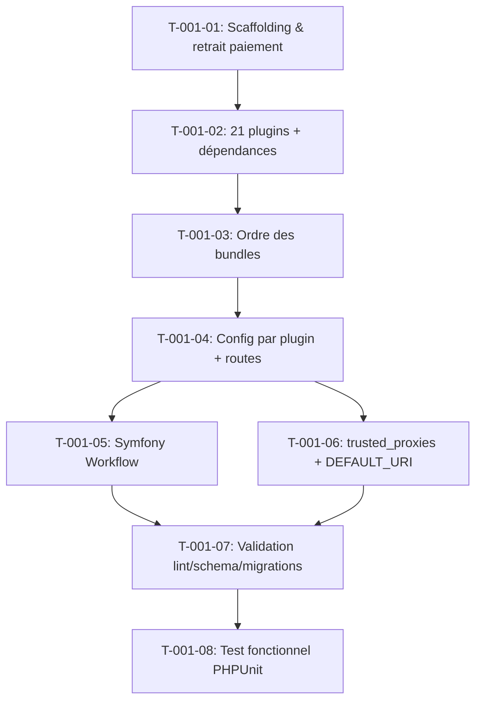

# Tâches — US-001 : Projet Sylius 2.3 avec les 21 plugins

## Informations US

- **Epic** : EPIC-01 — Socle applicatif et conteneurisation
- **Persona** : Thibaut (mainteneur)
- **Story Points** : 8
- **Sprint** : sprint-1-walking-skeleton
- **Dépendances** : aucune

## Résumé

En tant que Thibaut, je veux un projet Sylius-Standard 2.3 qui installe les 21 plugins depuis Packagist, afin de montrer l'installation comme un intégrateur.

## Vue d'ensemble des tâches

| ID | Type | Tâche | Estimation | Dépend de | Statut |
|----|------|-------|------------|-----------|--------|
| T-001-01 | [OPS] | Scaffolding Sylius-Standard 2.3, retrait plugins de paiement | 1h | — | 🔲 |
| T-001-02 | [BE] | Ajouter les 21 plugins + dépendances tierces (composer require) | 2h | T-001-01 | 🔲 |
| T-001-03 | [BE] | Ordre des bundles dans config/bundles.php | 1h | T-001-02 | 🔲 |
| T-001-04 | [BE] | Fichiers de config par plugin (config/packages/tmonier/*.yaml) et routes | 2h | T-001-03 | 🔲 |
| T-001-05 | [BE] | Configuration Symfony Workflow pour les graphes de commande (order-hold) | 0.5h | T-001-04 | 🔲 |
| T-001-06 | [BE] | trusted_proxies, DEFAULT_URI et framework.router (Railway) | 0.5h | T-001-04 | 🔲 |
| T-001-07 | [TEST] | Validation : lint:container, doctrine:schema:validate, migrations sans attente | 0.5h | T-001-05 | 🔲 |
| T-001-08 | [TEST] | Test fonctionnel PHPUnit : install → 21 plugins enregistrés, zéro migration en attente | 0.5h | T-001-07 | 🔲 |

**Total estimé : 8h**

---

## Détail des tâches

### T-001-01 — Scaffolding Sylius-Standard 2.3, retrait plugins de paiement

- **Type** : [OPS]
- **Estimation** : 1h
- **Dépend de** : —

**Description** :
Créer le projet depuis le squelette officiel, épingler `sylius/sylius-standard:~2.3`, puis retirer les plugins de paiement en ligne (Stripe, Adyen, Mollie, PayPal) hors périmètre. Conserver `sylius/refund-plugin` ^2.3.

**Actions** :
```bash
composer create-project sylius/sylius-standard:~2.3 sylius-b2b-demo
cd sylius-b2b-demo
composer remove sylius/stripe-plugin sylius/adyen-plugin \
  mollie/sylius-mollie-plugin sylius/paypal-plugin --no-update
composer update
```

**Fichiers modifiés** :
- `composer.json` (suppressions + ajustement version)
- `config/bundles.php` (retrait des bundles de paiement supprimés)
- `config/packages/` (retrait des fichiers de config des plugins supprimés)

**Critères de validation** :
- [ ] `composer install` sans erreur
- [ ] Aucun plugin de paiement en ligne dans `composer.lock`
- [ ] `sylius/refund-plugin` présent

---

### T-001-02 — Ajouter les 21 plugins + dépendances tierces

- **Type** : [BE]
- **Estimation** : 2h
- **Dépend de** : T-001-01

**Description** :
Ajouter via Composer les 21 plugins tmonier en versions taguées depuis Packagist, ainsi que les dépendances communautaires requises.

**Plugins tmonier** (versions taguées à résoudre au moment du sprint) :
`thibmonier/sylius-order-hold-plugin`, `thibmonier/sylius-company-accounts-plugin`, `thibmonier/sylius-purchase-approval-plugin`, `thibmonier/sylius-trade-credit-plugin`, `thibmonier/sylius-tier-pricing-plugin`, `thibmonier/sylius-container-fill-plugin`, `thibmonier/sylius-quick-order-plugin`, `thibmonier/sylius-order-reference-plugin` *(ou équivalent sprint-3)*, `thibmonier/sylius-b2b-quote-plugin`, `thibmonier/sylius-punchout-plugin`, `thibmonier/sylius-b2b-mcp-plugin`, `thibmonier/sylius-agentic-feeds-plugin`, `thibmonier/sylius-gpsr-plugin`, `thibmonier/sylius-facturx-plugin`, `thibmonier/sylius-pdf-generation-plugin`, `thibmonier/sylius-audit-log-plugin`, `thibmonier/sylius-command-palette-plugin`, `thibmonier/sylius-withdrawal-plugin`, `thibmonier/sylius-b2b-access-plugin` *(sprint-3)*, `thibmonier/sylius-shopping-list-plugin` *(sprint-5)*, et les deux nouveaux en développement (intégrer comme path repos en attendant leurs releases).

**Dépendances tierces** :
```bash
composer require \
  sylius/invoicing-plugin:"^2.3" \
  sylius/mcp-server-plugin:"^0.2" \
  symfony/ai-bundle:"^0.14" \
  knplabs/knp-snappy-bundle:"^1.0" \
  wkhtmltopdf binaire via Dockerfile
```

**Fichiers modifiés** :
- `composer.json`
- `composer.lock`

**Critères de validation** :
- [ ] `composer install` sans conflit
- [ ] 21 plugins présents dans `vendor/`
- [ ] Versions taguées (pas de `dev-main`)

---

### T-001-03 — Ordre des bundles dans config/bundles.php

- **Type** : [BE]
- **Estimation** : 1h
- **Dépend de** : T-001-02

**Description** :
Éditer `config/bundles.php` pour respecter l'ordre prescrit dans la tech-spec §2 :
1. Bundles Sylius standard
2. SyliusInvoicingPlugin, KnpSnappyBundle, KnpGaufretteBundle, SyliusPdfGenerationPlugin
3. McpBundle, SyliusMcpServerPlugin, AiBundle
4. OrderHoldPlugin, CompanyAccountsPlugin, puis les autres plugins tmonier par ordre alphabétique
5. Nouveaux plugins (b2b-access, order-reference, shopping-list)

**Fichiers modifiés** :
- `config/bundles.php`

**Critères de validation** :
- [ ] Ordre exact respecté
- [ ] Aucun bundle dupliqué
- [ ] `php bin/console debug:container --no-debug` ne lève pas d'erreur d'initialisation

---

### T-001-04 — Fichiers de config par plugin et routes

- **Type** : [BE]
- **Estimation** : 2h
- **Dépend de** : T-001-03

**Description** :
Créer un fichier YAML par plugin dans `config/packages/tmonier/` qui importe `@Plugin/config/config.yaml` et applique les options de démo. Créer `config/routes/tmonier.yaml` qui importe les routes de chaque plugin. Créer `config/routes/demo.yaml` (vide pour l'instant).

**Structure à créer** :
```
config/packages/tmonier/
  order_hold.yaml
  company_accounts.yaml
  purchase_approval.yaml
  trade_credit.yaml
  tier_pricing.yaml
  container_fill.yaml
  quick_order.yaml
  b2b_quote.yaml
  punchout.yaml
  b2b_mcp.yaml
  agentic_feeds.yaml
  gpsr.yaml
  facturx.yaml
  pdf_generation.yaml
  audit_log.yaml
  command_palette.yaml
  withdrawal.yaml
  invoicing.yaml
  mcp_server.yaml
  ai_bundle.yaml
config/routes/tmonier.yaml
config/routes/demo.yaml
```

**Critères de validation** :
- [ ] `php bin/console debug:router --no-debug` liste les routes des plugins
- [ ] Aucune erreur de configuration au démarrage

---

### T-001-05 — Configuration Symfony Workflow (order-hold)

- **Type** : [BE]
- **Estimation** : 0.5h
- **Dépend de** : T-001-04

**Description** :
Importer ou créer la configuration Symfony Workflow requise par `order-hold` pour les graphes d'état de commande. Vérifier que les transitions `hold`, `resume`, `cancel` sont définies.

**Fichiers modifiés** :
- `config/packages/workflow.yaml` ou `config/packages/tmonier/order_hold.yaml`

**Critères de validation** :
- [ ] `php bin/console debug:workflow --no-debug` liste les workflows de commande

---

### T-001-06 — trusted_proxies, DEFAULT_URI et framework.router

- **Type** : [BE]
- **Estimation** : 0.5h
- **Dépend de** : T-001-04

**Description** :
Configurer dans `config/packages/framework.yaml` :
- `trusted_proxies: REMOTE_ADDR`
- En-têtes de proxy : `x-forwarded-for`, `x-forwarded-host`, `x-forwarded-port`, `x-forwarded-proto`
- `framework.router.default_uri: '%env(DEFAULT_URI)%'`

Ajouter `DEFAULT_URI=https://localhost` dans `.env`.

**Critères de validation** :
- [ ] Configuration présente et syntaxe valide
- [ ] Variable `DEFAULT_URI` dans `.env`

---

### T-001-07 — Validation : lint, schema, migrations

- **Type** : [TEST]
- **Estimation** : 0.5h
- **Dépend de** : T-001-05, T-001-06

**Description** :
Exécuter et vérifier manuellement (puis automatisé en CI) :
```bash
php bin/console lint:container
php bin/console doctrine:schema:validate
php bin/console doctrine:migrations:migrate --no-interaction
php bin/console doctrine:migrations:status
```

**Critères de validation** :
- [ ] `lint:container` : 0 erreur
- [ ] `doctrine:schema:validate` : mapping et base synchronisés
- [ ] `doctrine:migrations:status` : 0 migration en attente

---

### T-001-08 — Test fonctionnel PHPUnit

- **Type** : [TEST]
- **Estimation** : 0.5h
- **Dépend de** : T-001-07

**Description** :
Écrire un test de fumée PHPUnit WebTestCase (TDD) qui vérifie :
- La page d'accueil répond 200
- Le kernel démarre sans erreur (les 21 bundles sont chargés)

**Fichiers à créer** :
- `tests/Smoke/InstallationTest.php`

**Critères de validation** :
- [ ] Test rouge avant fix
- [ ] Test vert après fix
- [ ] Exécutable via `php bin/phpunit tests/Smoke/InstallationTest.php`

---

## Graphe de dépendances



## Résumé

| Type | Nb tâches | Heures |
|------|-----------|--------|
| [OPS] | 1 | 1h |
| [BE] | 5 | 6h |
| [TEST] | 2 | 1h |
| **TOTAL** | **8** | **8h** |
