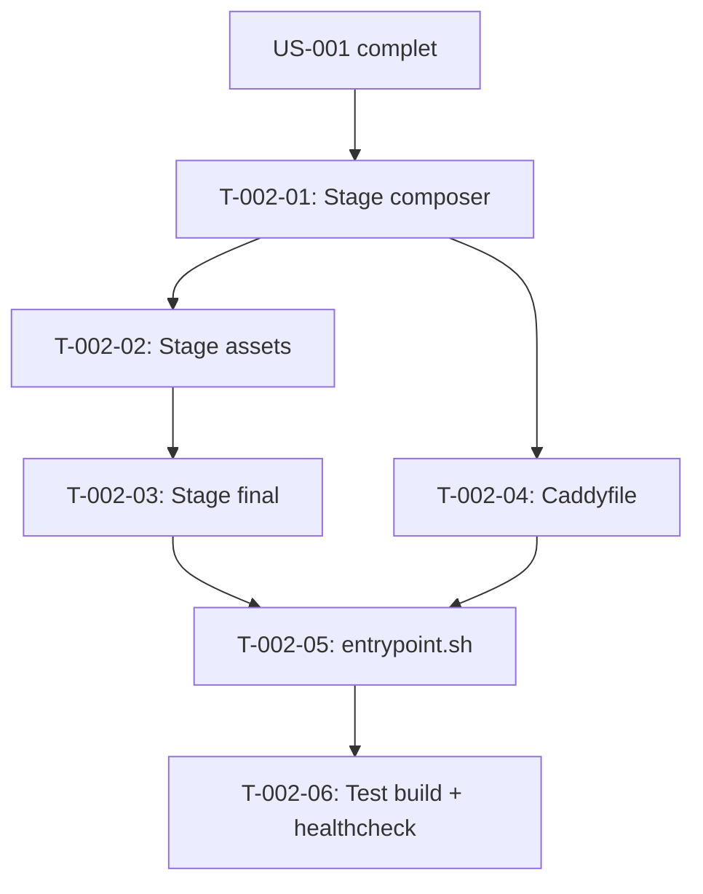

# Tâches — US-002 : Image Docker FrankenPHP multi-stage

## Informations US

- **Epic** : EPIC-01 — Socle applicatif et conteneurisation
- **Persona** : Thibaut (mainteneur)
- **Story Points** : 5
- **Sprint** : sprint-1-walking-skeleton
- **Dépendances** : US-001

## Résumé

En tant que Thibaut, je veux une image Docker FrankenPHP (Caddy), afin de servir la démo de façon performante et identique partout.

## Vue d'ensemble des tâches

| ID | Type | Tâche | Estimation | Dépend de | Statut |
|----|------|-------|------------|-----------|--------|
| T-002-01 | [OPS] | Stage composer : dépendances sans dev, autoloader optimisé | 0.5h | US-001 | 🔲 |
| T-002-02 | [OPS] | Stage assets : Node LTS, yarn install, yarn build (Encore) | 1h | T-002-01 | 🔲 |
| T-002-03 | [OPS] | Stage final : dunglas/frankenphp:1-php8.4-bookworm, extensions PHP, wkhtmltox, supercronic | 2h | T-002-02 | 🔲 |
| T-002-04 | [OPS] | Caddyfile : php_server, compression, headers de sécurité, port $PORT:8080 | 1h | T-002-01 | 🔲 |
| T-002-05 | [OPS] | entrypoint.sh : attente DB, app:demo:reset si vide, supercronic + FrankenPHP | 1h | T-002-03 | 🔲 |
| T-002-06 | [TEST] | Test CI : build image, démarrage, /healthz → 200 | 0.5h | T-002-05 | 🔲 |

**Total estimé : 6h**

---

## Détail des tâches

### T-002-01 — Stage composer

- **Type** : [OPS]
- **Estimation** : 0.5h
- **Dépend de** : US-001 complet

**Description** :
Premier stage du Dockerfile. Utiliser l'image officielle Composer pour installer les dépendances sans `--dev`, avec autoloader optimisé.

```dockerfile
FROM composer:2 AS composer
WORKDIR /app
COPY composer.json composer.lock ./
RUN composer install --no-dev --optimize-autoloader --no-scripts --prefer-dist
COPY . .
RUN composer dump-autoload --optimize
```

**Critères de validation** :
- [ ] Stage `composer` construit sans erreur
- [ ] `vendor/` présent, pas de dépendance dev
- [ ] Autoloader optimisé (classe map générée)

---

### T-002-02 — Stage assets

- **Type** : [OPS]
- **Estimation** : 1h
- **Dépend de** : T-002-01

**Description** :
Second stage pour la compilation des assets Webpack Encore (shop et admin des plugins).

```dockerfile
FROM node:20-alpine AS assets
WORKDIR /app
COPY --from=composer /app .
RUN yarn install --frozen-lockfile
RUN yarn build
```

**Critères de validation** :
- [ ] `public/build/` contient les assets compilés
- [ ] Node absent de l'image finale

---

### T-002-03 — Stage final

- **Type** : [OPS]
- **Estimation** : 2h
- **Dépend de** : T-002-02

**Description** :
Stage final à partir de `dunglas/frankenphp:1-php8.4-bookworm`. Installer les extensions PHP requises, wkhtmltox 0.12.6.1 (patched qt), supercronic, préchauffer le cache, installer les assets Sylius. Utiliser un utilisateur non root.

**Extensions PHP** : `intl`, `gd`, `zip`, `pdo_mysql`, `opcache`, `apcu`

**wkhtmltox** :
```dockerfile
RUN curl -L https://github.com/wkhtmltopdf/packaging/releases/download/0.12.6.1-3/wkhtmltox_0.12.6.1-3.bookworm_amd64.deb \
    -o /tmp/wkhtmltox.deb && dpkg -i /tmp/wkhtmltox.deb && rm /tmp/wkhtmltox.deb
```

**supercronic** :
```dockerfile
ARG SUPERCRONIC_VERSION=0.2.33
RUN curl -fsSL https://github.com/aptible/supercronic/releases/download/v${SUPERCRONIC_VERSION}/supercronic-linux-amd64 \
    -o /usr/local/bin/supercronic && chmod +x /usr/local/bin/supercronic
```

**Cache et assets** :
```dockerfile
RUN php bin/console cache:warmup --env=prod \
 && php bin/console assets:install --env=prod
```

**Fichiers** : `docker/Dockerfile`, `docker/php.ini`

**Critères de validation** :
- [ ] `php --version` retourne 8.4.x
- [ ] `wkhtmltopdf --version` retourne 0.12.6.1
- [ ] `supercronic --version` retourne 0.2.x
- [ ] Utilisateur non root (UID 1000)
- [ ] `public/build/` présent depuis le stage assets

---

### T-002-04 — Caddyfile

- **Type** : [OPS]
- **Estimation** : 1h
- **Dépend de** : T-002-01 (peut être écrit en parallèle du stage final)

**Description** :
Rédiger le `docker/Caddyfile` :
- `php_server` sur le port `{$PORT:8080}` (Railway)
- Compression zstd et gzip
- En-têtes de sécurité (HSTS, X-Content-Type-Options, Referrer-Policy)
- Route `/healthz` → `respond 200`
- TLS automatique local (Caddy), terminé par Railway en production

**Fichiers** : `docker/Caddyfile`

**Critères de validation** :
- [ ] `caddy validate --config docker/Caddyfile` sans erreur
- [ ] Port `{$PORT:8080}` configuré
- [ ] `/healthz` répond 200 sans passer par PHP

---

### T-002-05 — entrypoint.sh

- **Type** : [OPS]
- **Estimation** : 1h
- **Dépend de** : T-002-03, T-002-04

**Description** :
Script shell `docker/entrypoint.sh` :
1. Attente de MySQL (boucle `mysqladmin ping` ou `nc`)
2. Si la base est vide (`doctrine:migrations:status` retourne 0 migrations exécutées) → lancer `php bin/console app:demo:reset`
3. Démarrer supercronic en arrière-plan (`supercronic /app/docker/crontab &`)
4. Démarrer FrankenPHP au premier plan (`exec frankenphp run --config /app/docker/Caddyfile`)

**Fichiers** : `docker/entrypoint.sh`, `docker/crontab` (placeholder pour US-004)

**Critères de validation** :
- [ ] Script exécutable (chmod +x)
- [ ] Attente MySQL avec timeout (30 tentatives × 2 s)
- [ ] `app:demo:reset` appelé uniquement au premier démarrage (base vide)
- [ ] FrankenPHP lancé en premier plan (signal forwarding)

---

### T-002-06 — Test CI : build et healthcheck

- **Type** : [TEST]
- **Estimation** : 0.5h
- **Dépend de** : T-002-05

**Description** :
Vérifier manuellement (et automatisé à US-005) que l'image se construit et répond :
```bash
docker build -f docker/Dockerfile -t sylius-b2b-demo:test .
docker run -d -p 8080:8080 --env-file .env.test sylius-b2b-demo:test
curl -f http://localhost:8080/healthz
```

**Critères de validation** :
- [ ] `docker build` : exit 0
- [ ] `/healthz` → 200 en moins de 30 s
- [ ] Aucun processus root dans le conteneur

---

## Graphe de dépendances



## Résumé

| Type | Nb tâches | Heures |
|------|-----------|--------|
| [OPS] | 5 | 5.5h |
| [TEST] | 1 | 0.5h |
| **TOTAL** | **6** | **6h** |
