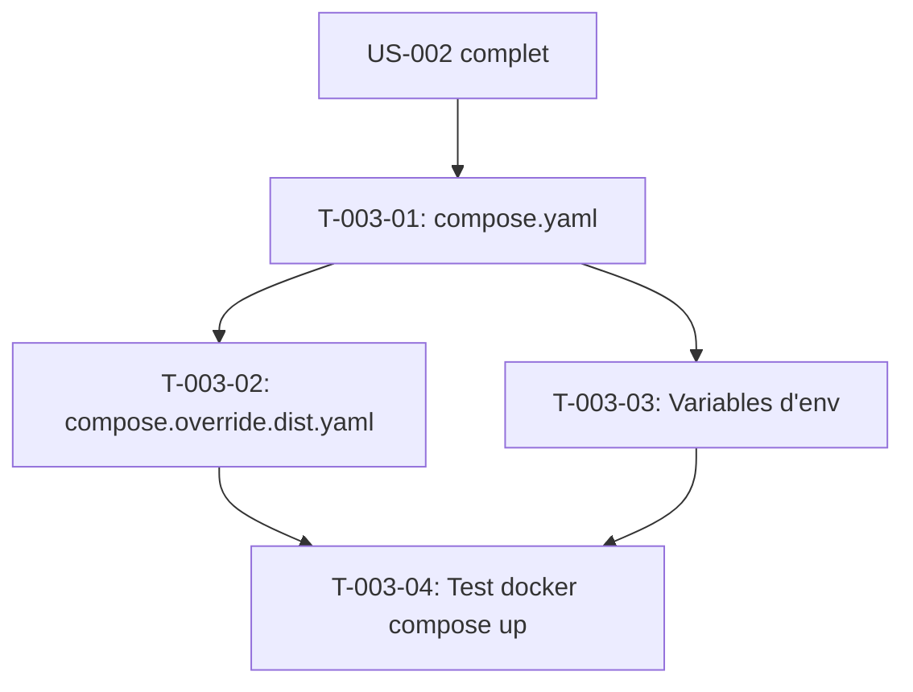

# Tâches — US-003 : Environnement local docker compose

## Informations US

- **Epic** : EPIC-01 — Socle applicatif et conteneurisation
- **Persona** : Thibaut (mainteneur)
- **Story Points** : 3
- **Sprint** : sprint-1-walking-skeleton
- **Dépendances** : US-002

## Résumé

En tant que Thibaut, je veux lancer toute la démo en local avec une commande, afin de développer dans les conditions de la production.

## Vue d'ensemble des tâches

| ID | Type | Tâche | Estimation | Dépend de | Statut |
|----|------|-------|------------|-----------|--------|
| T-003-01 | [OPS] | compose.yaml : services web, MySQL 8.4, Mailpit | 1.5h | US-002 | 🔲 |
| T-003-02 | [OPS] | compose.override.dist.yaml : ports locaux et volumes de développement | 1h | T-003-01 | 🔲 |
| T-003-03 | [OPS] | Variables d'environnement (.env, .env.dist, .env.test) | 0.5h | T-003-01 | 🔲 |
| T-003-04 | [TEST] | Test : docker compose up → accueil 200, Mailpit accessible | 0.5h | T-003-02 | 🔲 |

**Total estimé : 3.5h**

---

## Détail des tâches

### T-003-01 — compose.yaml : services web, MySQL 8.4, Mailpit

- **Type** : [OPS]
- **Estimation** : 1.5h
- **Dépend de** : US-002 complet

**Description** :
Rédiger `compose.yaml` avec trois services :
- **web** : image construite depuis `docker/Dockerfile`, variables d'environnement depuis `.env`, healthcheck `/healthz`, dépend de `database`
- **database** : `mysql:8.4`, `MYSQL_ROOT_PASSWORD`, `MYSQL_DATABASE=sylius`, volume persistant `db_data`
- **mailpit** : `axllent/mailpit:latest`, ports 1025 (SMTP) et 8025 (UI)

Réseau interne `app_net` pour la communication entre services.

**Fichiers** :
- `compose.yaml`

**Critères de validation** :
- [ ] Trois services définis avec healthchecks
- [ ] Volumes nommés pour MySQL
- [ ] Réseau interne configuré
- [ ] Aucun port exposé en dehors du override

---

### T-003-02 — compose.override.dist.yaml

- **Type** : [OPS]
- **Estimation** : 1h
- **Dépend de** : T-003-01

**Description** :
Créer `compose.override.dist.yaml` (à copier en `compose.override.yaml`, gitignoré). Ce fichier expose les ports locaux et monte le volume de code source pour le développement live :
- web : ports `443:443` (HTTPS Caddy), `8080:8080` (HTTP fallback)
- database : port `3306:3306`
- mailpit : port `8025:8025`
- Volume `./:/app` pour le hot reload (monter en `:cached`)

Documenter la procédure dans README : `cp compose.override.dist.yaml compose.override.yaml`.

**Fichiers** :
- `compose.override.dist.yaml`
- `.gitignore` (ajouter `compose.override.yaml`)

**Critères de validation** :
- [ ] `compose.override.dist.yaml` versionné
- [ ] `compose.override.yaml` dans `.gitignore`
- [ ] Procédure documentée

---

### T-003-03 — Variables d'environnement

- **Type** : [OPS]
- **Estimation** : 0.5h
- **Dépend de** : T-003-01

**Description** :
Créer `.env` avec les valeurs locales par défaut (sans secret réel), `.env.dist` comme template documenté, et `.env.test` pour les tests CI.

Variables minimales :
```
APP_ENV=dev
APP_SECRET=changeme-dev-secret
DATABASE_URL=mysql://root@database:3306/sylius?serverVersion=8.4
MAILER_DSN=smtp://mailpit:1025
DEFAULT_URI=https://localhost
TMONIER_AI_GENERATOR=demo
```

**Fichiers** :
- `.env` (versionné, valeurs non sensibles)
- `.env.dist` (template avec commentaires)
- `.env.test` (CI, valeurs de test)

**Critères de validation** :
- [ ] Aucun secret réel dans `.env`
- [ ] `.env.local` et `.env.*.local` dans `.gitignore`

---

### T-003-04 — Test : docker compose up

- **Type** : [TEST]
- **Estimation** : 0.5h
- **Dépend de** : T-003-01, T-003-02, T-003-03

**Description** :
Vérifier manuellement que `docker compose up -d` démarre les trois services et que l'application est disponible.

```bash
cp compose.override.dist.yaml compose.override.yaml
docker compose up -d
docker compose ps  # les trois services "healthy"
curl -k https://localhost/healthz  # 200
curl http://localhost:8025  # Mailpit UI
```

**Critères de validation** :
- [ ] Trois services `healthy` dans `docker compose ps`
- [ ] Page d'accueil → 200
- [ ] Mailpit UI accessible
- [ ] `docker compose logs web` sans erreur critique

---

## Graphe de dépendances



## Résumé

| Type | Nb tâches | Heures |
|------|-----------|--------|
| [OPS] | 3 | 3h |
| [TEST] | 1 | 0.5h |
| **TOTAL** | **4** | **3.5h** |
