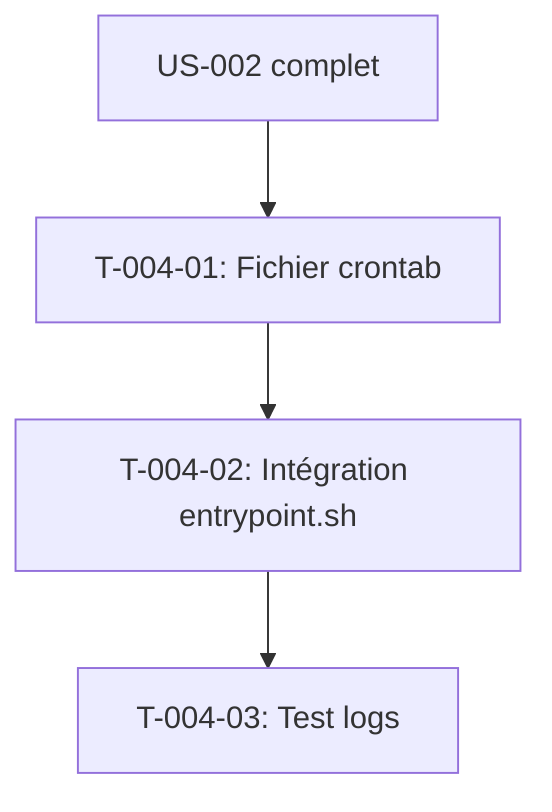

# Tâches — US-004 : Tâches planifiées dans le conteneur

## Informations US

- **Epic** : EPIC-01 — Socle applicatif et conteneurisation
- **Persona** : Thibaut (mainteneur)
- **Story Points** : 3
- **Sprint** : sprint-1-walking-skeleton
- **Dépendances** : US-002

## Résumé

En tant que Thibaut, je veux que les tâches des plugins tournent dans le conteneur web, afin de ne pas payer de service supplémentaire.

## Vue d'ensemble des tâches

| ID | Type | Tâche | Estimation | Dépend de | Statut |
|----|------|-------|------------|-----------|--------|
| T-004-01 | [OPS] | Fichier crontab supercronic (TZ=Europe/Paris, toutes les tâches du sprint 1) | 1.5h | US-002 | 🔲 |
| T-004-02 | [OPS] | Intégration supercronic dans entrypoint.sh et documentation dans docker/Dockerfile | 0.5h | T-004-01 | 🔲 |
| T-004-03 | [TEST] | Test : logs du conteneur montrent l'exécution de webhook:dispatch après 1 minute | 1h | T-004-02 | 🔲 |

**Total estimé : 3h**

---

## Détail des tâches

### T-004-01 — Fichier crontab supercronic

- **Type** : [OPS]
- **Estimation** : 1.5h
- **Dépend de** : US-002 complet

**Description** :
Rédiger `docker/crontab` avec le fuseau `TZ=Europe/Paris`. Inclure toutes les tâches planifiées définies dans la tech-spec §4 :

```cron
TZ=Europe/Paris

# Webhook dispatch — chaque minute (borné dans le temps)
* * * * * php /app/bin/console tmonier:webhook:dispatch --max-runtime=50

# Feeds — toutes les 15 minutes
*/15 * * * * php /app/bin/console tmonier:feeds:generate --stale

# Tâches nocturnes — chaque nuit à 01:00
0 1 * * * php /app/bin/console tmonier:purchase-approval:expire
0 1 * * * php /app/bin/console tmonier:b2b-quote:expire
0 1 * * * php /app/bin/console tmonier:trade-credit:recalculate
0 1 * * * php /app/bin/console tmonier:punchout:purge-sessions
0 1 * * * php /app/bin/console tmonier:audit-log:purge
0 1 * * * php /app/bin/console tmonier:b2b-mcp:purge
0 1 * * * php /app/bin/console sylius:remove-expired-carts

# Remise à zéro — chaque nuit à 03:00
0 3 * * * php /app/bin/console app:demo:reset
```

**Fichiers** :
- `docker/crontab`

**Critères de validation** :
- [ ] Fuseau `TZ=Europe/Paris` défini
- [ ] Toutes les commandes des plugins documentées dans la tech-spec présentes
- [ ] `app:demo:reset` à 03:00
- [ ] `supercronic -test docker/crontab` sans erreur

---

### T-004-02 — Intégration supercronic dans entrypoint.sh

- **Type** : [OPS]
- **Estimation** : 0.5h
- **Dépend de** : T-004-01

**Description** :
Vérifier que `docker/entrypoint.sh` (créé à US-002) lance bien supercronic avec le fichier crontab :
```bash
supercronic /app/docker/crontab &
SUPERCRONIC_PID=$!
```

Et que le signal `SIGTERM` arrête proprement supercronic avant FrankenPHP (trap).

Vérifier que le Dockerfile final copie `docker/crontab` dans l'image :
```dockerfile
COPY docker/crontab /app/docker/crontab
```

**Critères de validation** :
- [ ] `COPY docker/crontab` présent dans le Dockerfile
- [ ] supercronic lancé en arrière-plan dans entrypoint.sh
- [ ] Gestion propre des signaux

---

### T-004-03 — Test : logs des tâches planifiées

- **Type** : [TEST]
- **Estimation** : 1h
- **Dépend de** : T-004-02

**Description** :
Vérifier manuellement (et documenté pour la CI) que supercronic exécute les tâches et que leur sortie apparaît dans les logs.

**Procédure de test manuelle** :
```bash
docker compose up -d
# Attendre 1 minute
docker compose logs web | grep -i "webhook:dispatch\|supercronic"
# Doit afficher l'exécution de la commande
```

**Test PHPUnit (TDD)** — optionnel pour ce sprint, documenté pour la CI :
Vérifier que le fichier crontab existe dans l'image et contient les commandes critiques.

**Critères de validation** :
- [ ] `docker compose logs web` contient la trace de `tmonier:webhook:dispatch`
- [ ] Aucune erreur supercronic dans les logs
- [ ] Exécution visible dans les journaux du conteneur (non silencieuse)

---

## Graphe de dépendances



## Résumé

| Type | Nb tâches | Heures |
|------|-----------|--------|
| [OPS] | 2 | 2h |
| [TEST] | 1 | 1h |
| **TOTAL** | **3** | **3h** |
