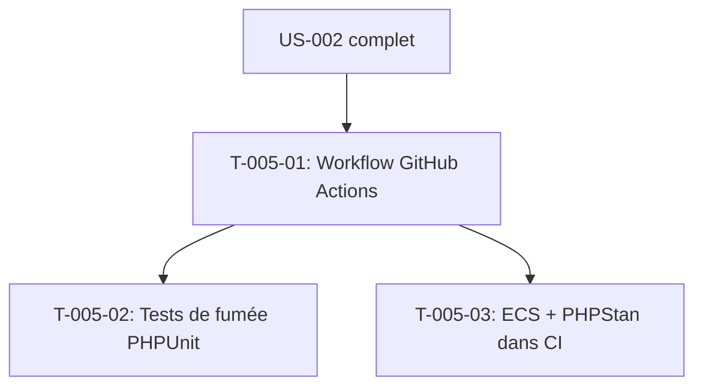

# Tâches — US-005 : CI GitHub Actions et tests de fumée

## Informations US

- **Epic** : EPIC-01 — Socle applicatif et conteneurisation
- **Persona** : Thibaut (mainteneur)
- **Story Points** : 3
- **Sprint** : sprint-1-walking-skeleton
- **Dépendances** : US-002

## Résumé

En tant que Thibaut, je veux une CI qui construit l'image et vérifie les pages clés, afin de ne jamais déployer une démo cassée.

## Vue d'ensemble des tâches

| ID | Type | Tâche | Estimation | Dépend de | Statut |
|----|------|-------|------------|-----------|--------|
| T-005-01 | [OPS] | Workflow GitHub Actions : build image, service MySQL 8.4, chargement des fixtures demo | 2h | US-002 | 🔲 |
| T-005-02 | [TEST] | Tests de fumée PHPUnit WebTestCase : accueil, catalogue, fiche produit, panier, admin | 2h | T-005-01 | 🔲 |
| T-005-03 | [OPS] | Qualité dans la CI : ECS + PHPStan niveau max sur src/Demo/ | 0.5h | T-005-01 | 🔲 |

**Total estimé : 4.5h**

---

## Détail des tâches

### T-005-01 — Workflow GitHub Actions

- **Type** : [OPS]
- **Estimation** : 2h
- **Dépend de** : US-002 complet

**Description** :
Créer `.github/workflows/ci.yml` avec les jobs :

**Job `build`** :
- Construire l'image Docker multi-stage
- Pousser l'image dans le cache GitHub Container Registry (GHCR)
- Artefact : image tagguée `sha-${{ github.sha }}`

**Job `smoke`** (dépend de `build`) :
- Service `mysql:8.4` (healthcheck `mysqladmin ping`)
- Lancer l'image construite, injecter les variables d'env de test
- Attendre le healthcheck `/healthz`
- Lancer `php bin/console sylius:fixtures:load demo --no-interaction`
- Exécuter `php bin/phpunit tests/Smoke/`

**Job `quality`** (en parallèle de `smoke`) :
- ECS sur `src/`
- PHPStan niveau max sur `src/Demo/`

**Déclencheurs** : `push` sur `main`, `pull_request`

**Fichiers** :
- `.github/workflows/ci.yml`

**Critères de validation** :
- [ ] Pipeline déclenché sur push main
- [ ] Job `build` → image construite avec succès
- [ ] Job `smoke` → tests de fumée passent
- [ ] Échec sur une page cassée → pipeline rouge
- [ ] Cache Docker layers entre les builds (réduction de 50% du temps)

---

### T-005-02 — Tests de fumée PHPUnit WebTestCase

- **Type** : [TEST]
- **Estimation** : 2h
- **Dépend de** : T-005-01

**Description** :
Écrire les tests de fumée (TDD) qui vérifient les pages clés en réponse HTTP 200. Utiliser `BrowserKit` (WebTestCase) plutôt que des requêtes curl pour une meilleure intégration PHPUnit.

**Tests à écrire** (fichier `tests/Smoke/PagesSmokeTest.php`) :
- Accueil B2B (`/`) → 200
- Catalogue B2B (`/fr_FR/taxons/...` ou `/fr_FR/products`) → 200
- Fiche produit (première disponible) → 200
- Panier (`/fr_FR/cart`) → 200 ou 302 (redirect vers connexion)
- Admin login (`/en_US/login`) → 200
- Healthcheck (`/healthz`) → 200

**Tests d'absence d'erreur** (fichier `tests/Smoke/HookablesTest.php`) :
- Vérifier que la liste des hookables des plugins correspond à la référence CI
  (comparaison de `php bin/console debug:twig-hooks --format=json`)

**Fichiers** :
- `tests/Smoke/PagesSmokeTest.php`
- `tests/Smoke/HookablesTest.php`
- `tests/fixtures/hookables-reference.json` (généré à la première exécution)

**Critères de validation** :
- [ ] Tests rouges avant la mise en place des fixtures
- [ ] Tests verts avec fixtures demo chargées
- [ ] `php bin/phpunit tests/Smoke/` exécutable en moins de 30 s
- [ ] Couverture des 9 pages clés

---

### T-005-03 — Qualité dans la CI : ECS + PHPStan

- **Type** : [OPS]
- **Estimation** : 0.5h
- **Dépend de** : T-005-01 (workflow déjà créé)

**Description** :
Ajouter les étapes qualité dans le job `quality` du workflow CI :

```yaml
- name: ECS
  run: vendor/bin/ecs check src/

- name: PHPStan
  run: vendor/bin/phpstan analyse src/Demo/ --level=max
```

Créer (ou ajuster) les fichiers de configuration :
- `ecs.php` : règles PER-CS 3.0 (si pas encore créé par Sylius-Standard)
- `phpstan.neon` : baseline vide + chemin `src/Demo/`

**Fichiers** :
- `ecs.php`
- `phpstan.neon`
- `.github/workflows/ci.yml` (job quality, mis à jour)

**Critères de validation** :
- [ ] `vendor/bin/ecs check src/` → 0 violation sur le code de la démo
- [ ] `vendor/bin/phpstan analyse src/Demo/` → 0 erreur
- [ ] Job quality vert sur CI

---

## Graphe de dépendances



## Résumé

| Type | Nb tâches | Heures |
|------|-----------|--------|
| [OPS] | 2 | 2.5h |
| [TEST] | 1 | 2h |
| **TOTAL** | **3** | **4.5h** |
