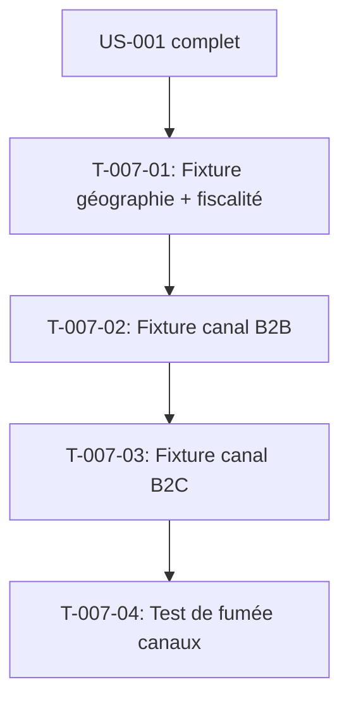

# Tâches — US-007 : Canaux B2B et B2C, FR/EN

## Informations US

- **Epic** : EPIC-02 — Données de démo B2B
- **Persona** : Nadia (responsable e-commerce B2B)
- **Story Points** : 3
- **Sprint** : sprint-1-walking-skeleton
- **Dépendances** : US-001

## Résumé

En tant que Nadia, je veux un canal B2B principal et un petit canal B2C en français et en anglais, afin de montrer chaque plugin dans son contexte.

## Vue d'ensemble des tâches

| ID | Type | Tâche | Estimation | Dépend de | Statut |
|----|------|-------|------------|-----------|--------|
| T-007-01 | [BE] | Fixture de base : géographie, devises, locales, zones, taxes | 1h | US-001 | 🔲 |
| T-007-02 | [BE] | Fixture canal B2B (EUR, fr_FR + en_US, livraison, paiement sur compte) | 1h | T-007-01 | 🔲 |
| T-007-03 | [BE] | Fixture canal B2C (EUR, fr_FR + en_US, livraison, paiement CB simulé) | 0.5h | T-007-02 | 🔲 |
| T-007-04 | [TEST] | Test de fumée : les deux canaux existent, bouton rétractation absent sur B2B | 0.5h | T-007-03 | 🔲 |

**Total estimé : 3h**

---

## Détail des tâches

### T-007-01 — Fixture de base : géographie et fiscalité

- **Type** : [BE]
- **Estimation** : 1h
- **Dépend de** : US-001 complet

**Description** :
Créer la classe de fixture `DemoGeographyFixture` (extends `AbstractFixture`) pour les données de base partagées par les deux canaux.

**Contenu** :
- Devise EUR
- Locales : `fr_FR`, `en_US`
- Zones fiscales : `FR` (France), `EU` (Union Européenne), `WORLD` (reste du monde)
- Pays : au minimum FR, BE, CH, DE, GB, US
- Taux de TVA : `TVA_FR_NORMAL` (20%), `TVA_FR_REDUIT` (5.5%), `TVA_EU_NORMAL` (20%), `EXONERE` (0%)
- Méthodes de livraison : `DHL Express` (B2B et B2C), `Retrait entrepôt` (B2B)
- Méthode de paiement : `Compte entreprise` (B2B), `Carte bancaire simulée` (B2C)

**Fichiers** :
- `src/Demo/Fixture/DemoGeographyFixture.php`
- `config/packages/demo.yaml` (déclaration de la suite `demo`, priorité 1)

**Critères de validation** :
- [ ] `php bin/console sylius:fixtures:load demo --append --group=geography` sans erreur
- [ ] Devise EUR, zones et taxes visibles dans l'admin

---

### T-007-02 — Fixture canal B2B

- **Type** : [BE]
- **Estimation** : 1h
- **Dépend de** : T-007-01

**Description** :
Créer `DemoB2BChannelFixture` pour le canal B2B principal :

| Attribut | Valeur |
|----------|--------|
| Code | `B2B` |
| Nom | `Démo B2B` |
| URL | `b2b.localhost` (local) |
| Devise | EUR |
| Locales | fr_FR (défaut), en_US |
| Zone fiscale | FR |
| Thème | `demo` (à créer sprint 4, placeholder) |
| Contact | `b2b@demo.example.com` |

Activer tous les plugins pertinents sur ce canal (via les fixtures de chaque plugin au sprint 2).

**Fichiers** :
- `src/Demo/Fixture/DemoB2BChannelFixture.php`

**Critères de validation** :
- [ ] Canal B2B visible dans l'admin Sylius
- [ ] Locales fr_FR et en_US configurées
- [ ] Zone fiscale FR appliquée

---

### T-007-03 — Fixture canal B2C

- **Type** : [BE]
- **Estimation** : 0.5h
- **Dépend de** : T-007-02

**Description** :
Créer `DemoB2CChannelFixture` pour le canal B2C secondaire.

| Attribut | Valeur |
|----------|--------|
| Code | `B2C` |
| Nom | `Démo B2C` |
| URL | `b2c.localhost` (local) |
| Devise | EUR |
| Locales | fr_FR (défaut), en_US |
| Zone fiscale | FR |
| Contact | `b2c@demo.example.com` |

Plugins actifs sur B2C : `withdrawal`, `gpsr`, `agentic-feeds`. Les plugins B2B exclusivement (purchase-approval, trade-credit, etc.) ne sont pas actifs sur B2C.

**Fichiers** :
- `src/Demo/Fixture/DemoB2CChannelFixture.php`

**Critères de validation** :
- [ ] Canal B2C visible dans l'admin Sylius
- [ ] Configuration distincte du canal B2B

---

### T-007-04 — Test de fumée : canaux

- **Type** : [TEST]
- **Estimation** : 0.5h
- **Dépend de** : T-007-03

**Description** :
Écrire un test PHPUnit WebTestCase (TDD) qui vérifie :
- Le canal B2B est accessible
- Le canal B2C est accessible
- Le bouton de rétractation est absent sur le canal B2B (vérifié sur la page de commande)

**Fichier** : `tests/Smoke/ChannelsSmokeTest.php`

```php
public function test_b2b_channel_exists(): void {
    // Vérifie que le canal B2B répond 200
}

public function test_b2c_channel_exists(): void {
    // Vérifie que le canal B2C répond 200
}

public function test_withdrawal_only_on_b2c(): void {
    // Vérifie l'absence du bouton sur B2B
}
```

**Critères de validation** :
- [ ] Tests rouges avant les fixtures
- [ ] Tests verts après les fixtures
- [ ] Les deux canaux distincts dans la réponse HTTP (header `Host`)

---

## Graphe de dépendances



## Résumé

| Type | Nb tâches | Heures |
|------|-----------|--------|
| [BE] | 3 | 2.5h |
| [TEST] | 1 | 0.5h |
| **TOTAL** | **4** | **3h** |
