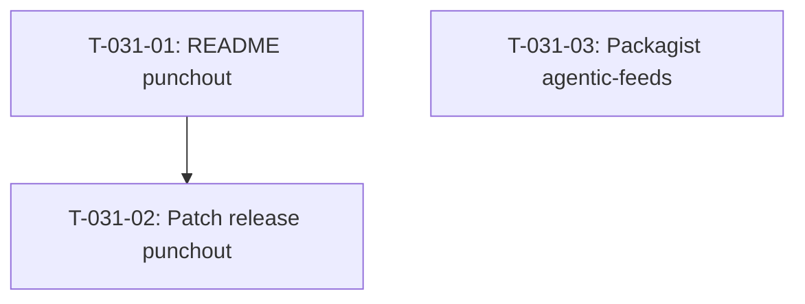

# Tâches — US-031 : Correctifs des plugins publiés

## Informations US

- **Epic** : EPIC-07 — Intégration des plugins et scénarios
- **Persona** : Thibaut (mainteneur)
- **Story Points** : 1
- **Sprint** : sprint-1-walking-skeleton
- **Dépendances** : aucune (dépôts des plugins, indépendant de la démo)

## Résumé

En tant que Thibaut, je veux corriger les défauts relevés en analyse, afin d'installer proprement tous les plugins.

## Vue d'ensemble des tâches

| ID | Type | Tâche | Estimation | Dépend de | Statut |
|----|------|-------|------------|-----------|--------|
| T-031-01 | [DOC] | README punchout : documenter PUNCHOUT_SUPPLIER_DOMAIN et PUNCHOUT_SUPPLIER_IDENTITY | 0.5h | — | 🔲 |
| T-031-02 | [OPS] | Patch release punchout (tag v1.0.x) | 0.5h | T-031-01 | 🔲 |
| T-031-03 | [OPS] | Soumettre agentic-feeds sur Packagist (action utilisateur + instructions) | 0.5h | — | 🔲 |

**Total estimé : 1.5h**

---

## Détail des tâches

### T-031-01 — README punchout : variables d'environnement

- **Type** : [DOC]
- **Estimation** : 0.5h
- **Dépend de** : —
- **Dépôt cible** : `thibmonier/sylius-punchout-plugin`

**Description** :
Ouvrir le dépôt `sylius-punchout-plugin` et mettre à jour le README :

1. Dans la section « Installation » ou « Configuration », ajouter une table des variables d'environnement requises :

| Variable | Description | Exemple |
|----------|-------------|---------|
| `PUNCHOUT_SUPPLIER_DOMAIN` | Domaine du fournisseur pour l'identité cXML | `demo.example.com` |
| `PUNCHOUT_SUPPLIER_IDENTITY` | Identité du fournisseur dans l'en-tête cXML From | `Demo B2B Sylius` |

2. Ajouter des exemples dans `.env.dist` du plugin :
```
PUNCHOUT_SUPPLIER_DOMAIN=your-domain.com
PUNCHOUT_SUPPLIER_IDENTITY=Your Company Name
```

3. Mettre à jour le `CHANGELOG.md` (section `[Unreleased]` → entrée `Fixed`).

**Fichiers modifiés (dans le dépôt du plugin)** :
- `README.md`
- `.env.dist`
- `CHANGELOG.md`

**Critères de validation** :
- [ ] PR créée sur `thibmonier/sylius-punchout-plugin`
- [ ] Les deux variables documentées avec description et exemple
- [ ] CHANGELOG mis à jour

---

### T-031-02 — Patch release punchout

- **Type** : [OPS]
- **Estimation** : 0.5h
- **Dépend de** : T-031-01

**Description** :
Une fois la PR mergée, créer un tag de patch release sur le dépôt punchout.

**Procédure** :
```bash
# Dans le dépôt thibmonier/sylius-punchout-plugin
git tag v1.0.1  # ou version majeure + 1 patch selon la version actuelle
git push origin v1.0.1
```

Vérifier sur Packagist que la nouvelle version est disponible (synchronisation automatique via webhook GitHub).

**Critères de validation** :
- [ ] Tag v1.0.x poussé sur GitHub
- [ ] Nouvelle version visible sur https://packagist.org/packages/thibmonier/sylius-punchout-plugin
- [ ] `composer require thibmonier/sylius-punchout-plugin:^1.0.1` installe la version corrigée

---

### T-031-03 — Soumettre agentic-feeds sur Packagist

- **Type** : [OPS]
- **Estimation** : 0.5h
- **Dépend de** : —
- **Note** : action manuelle de l'utilisateur (connexion au compte Packagist)

**Description** :
Soumettre le paquet `thibmonier/sylius-agentic-feeds-plugin` sur Packagist si ce n'est pas encore fait.

**Procédure** :
1. Aller sur https://packagist.org/packages/submit
2. Saisir l'URL du dépôt GitHub : `https://github.com/thibmonier/sylius-agentic-feeds-plugin`
3. Cliquer sur « Check » puis « Submit »
4. Configurer le webhook GitHub → Packagist pour la synchronisation automatique
5. Vérifier que la dernière version taguée est listée

**Critères de validation** :
- [ ] Paquet disponible sur https://packagist.org/packages/thibmonier/sylius-agentic-feeds-plugin
- [ ] Webhook GitHub → Packagist configuré
- [ ] `composer require thibmonier/sylius-agentic-feeds-plugin` installe la version taguée

---

## Graphe de dépendances



Note : T-031-03 est indépendant de T-031-01 et T-031-02. Les deux branches peuvent être exécutées en parallèle.

## Résumé

| Type | Nb tâches | Heures |
|------|-----------|--------|
| [DOC] | 1 | 0.5h |
| [OPS] | 2 | 1h |
| **TOTAL** | **3** | **1.5h** |
