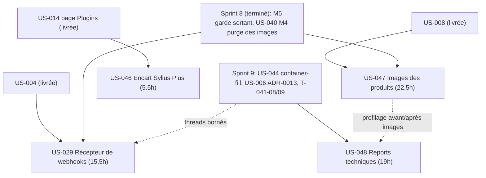
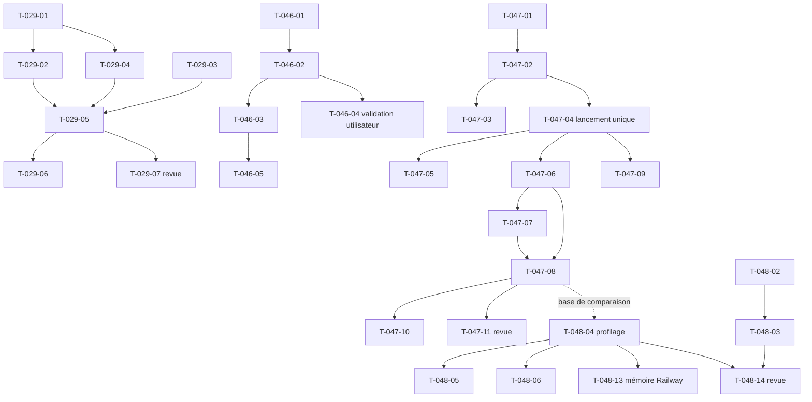

# Dépendances — Sprint 010 (Vitrine et reports)

## Entre stories et avec les sprints précédents

## Entre tâches (vue transversale)

## Chemin critique

US-047 : T-047-01 → T-047-02 → T-047-04 → T-047-06 → T-047-07 → T-047-08 → T-047-11 (≈ 17,5 h). US-029 : T-029-01 → T-029-02 → T-029-05 → T-029-07 (≈ 10 h). US-046 est bloquée avant merge par T-046-04 (validation de l'utilisateur). US-048 est largement indépendante : T-048-01 à T-048-04 et les mineurs T-048-07 à T-048-10 se parallélisent.

## Ressources partagées

- Disque local ~3 Go : téléchargements bruts d'US-047 en répertoire temporaire hors dépôt, un seul lancement du script, aucun rebuild Docker local.
- `src/Demo/Http/DemoGateListener.php` : modifié par US-029 seulement.
- Fixtures du reset (`src/DataFixtures/`, importeur CSV) : US-047 (T-047-06) et US-048 (T-048-05, T-048-06, T-048-08, T-048-09) modifient des fichiers voisins ; sérialiser les fusions et mesurer le reset après chaque changement.
- Page Plugins et traductions : US-046 seulement. Page À propos : T-047-09 seulement.
- Accès Railway et GO utilisateur : T-047-04 (lancement), T-048-11 à T-048-13, T-046-04.
