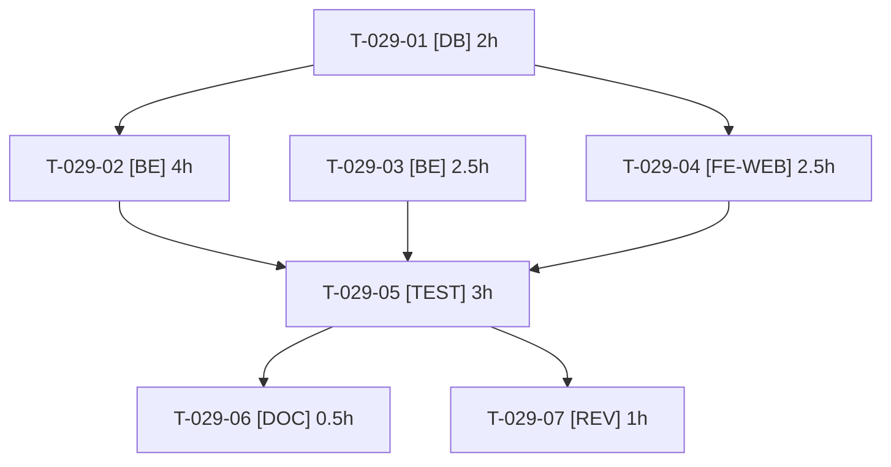

# Tâches — US-029 : Récepteur de webhooks de démo

## Informations US

- **Epic** : EPIC-07
- **Persona** : Sophie
- **Story Points** : 3
- **Sprint** : sprint-10-vitrine-et-reports (tâches reprises de sprint-9-reports/tasks/US-029-tasks.md, reportée par arbitrage du 2026-10-16)
- **Dépendances** : US-004 ; garde sortant M5 (sprint 8) ; bornage des threads FrankenPHP (T-006-01, livré au sprint 9, ADR-0013)

## Résumé

En tant que Sophie, je veux voir les webhooks émis par l'outbox, afin de comprendre l'intégration sans appel sortant.

## Vue d'ensemble des tâches

| ID | Type | Tâche | Estimation | Dépend de | Statut |
|----|------|-------|------------|-----------|--------|
| T-029-01 | [DB] | Entité `ReceivedWebhook` (date, type, charge utile tronquée, signature vérifiée) et migration | 2h | — | 🔲 |
| T-029-02 | [BE] | Endpoint récepteur interne joignable par le garde sortant : hors barrière de démo, sans redirection, hôte approuvé, vérification de la signature, limite de débit, taille maximale, stockage | 4h | T-029-01 | 🔲 |
| T-029-03 | [BE] | Abonnement de démo prérempli (URL de boucle locale du récepteur) et refus de toute autre URL (validateur, protection SSRF) | 2.5h | — | 🔲 |
| T-029-04 | [FE-WEB] | Page « Webhooks reçus » (liste, détail, indicateur signature vérifiée) FR/EN | 2.5h | T-029-01 | 🔲 |
| T-029-05 | [TEST] | Test fonctionnel : commande passée → webhook signé livré via le transport gardé et visible ; URL externe refusée ; redirection non suivie ; signature invalide rejetée | 3h | T-029-02, T-029-03, T-029-04 | 🔲 |
| T-029-06 | [DOC] | Documentation de la page et du fonctionnement de l'outbox | 0.5h | T-029-05 | 🔲 |
| T-029-07 | [REV] | Revue (SSRF, signature, rétention) | 1h | T-029-05 | 🔲 |

**Total estimé : 15.5h** (7 tâches ; 14h au sprint 8, +1.5h pour la compatibilité avec le garde sortant ; reprises à l’identique au sprint 10)

> **Mise à jour au Planning Part 2 du sprint 9 (commit e86a683, M5), reprise au sprint 10.** En mode démo, `App\Demo\Http\OutboundGuardHttpClient` décore `http_client`, `http_client.transport` **et** `tmonier_webhook.http_client.transport` (`config/packages/demo_hardening.yaml`, service `demo.outbound_guard.webhook`). Conséquences pour cette story :
> - l'URL d'abonnement doit viser un hôte de `HostAllowList` : `localhost`, `127.0.0.1`, `::1`, `*.railway.internal` ou `DEMO_OUTBOUND_ALLOWED_HOSTS`. Choix : `http://127.0.0.1:${PORT}/…` (route interne de la démo, même conteneur) ; aucun hôte supplémentaire à autoriser ;
> - les redirections ne sont **pas suivies** (`max_redirects = 0`, un 3xx est rendu tel quel) : le récepteur répond directement 2xx, sans redirection de locale, de barre oblique finale ni de barrière d'accès ;
> - l'appel sortant arrive comme une requête anonyme : il doit traverser `DemoGateListener` (barrière basic auth, exemptée seulement par jeton interne `InternalRequestToken` ou chemins comme `/healthz`), `UntrustedHostListener` (l'hôte `127.0.0.1` doit être dans `TRUSTED_HOSTS`) et `RateLimitSubscriber`. Le récepteur est exempté de la barrière par son chemin exact, la signature Standard Webhooks tenant lieu d'authentification ;
> - le validateur d'URL est plus strict que `HostAllowList` : seulement ce récepteur (boucle locale, chemin exact), pas `*.railway.internal` ni les hôtes additionnels ;
> - le récepteur et `tmonier:webhook:dispatch` (supercronic, chaque minute) tournent dans le même conteneur : prévoir au moins un thread FrankenPHP libre (threads bornés 8/16 par T-006-01, voir [ADR-0013](../../../../docs/adr/0013-mode-worker-frankenphp.md)).

---

## Détail des tâches

### T-029-01 — Entité `ReceivedWebhook` (date, type, charge utile tronquée, signature vérifiée) et migration

- **Type** : [DB]
- **Estimation** : 2h
- **Dépend de** : —

**Description** :
Rétention bornée ; purgée au reset.

**Fichiers (indicatifs)** :
- `src/Entity/ReceivedWebhook.php`
- `migrations/`

**Critères de validation** :
- [ ] Migration réversible
- [ ] Mapping valide

---

### T-029-02 — Endpoint récepteur interne : vérification de la signature, limite de débit, taille maximale, stockage

- **Type** : [BE]
- **Estimation** : 4h
- **Dépend de** : T-029-01

**Description** :
Rejet des signatures invalides (aucun stockage), idempotence sur l'identifiant d'événement. Route exemptée de la barrière de démo (`DemoGateListener`) par son chemin exact, hôte `127.0.0.1` accepté par `UntrustedHostListener`, réponse 2xx directe sans redirection (le garde sortant ne suit pas les redirections), non soumise au limiteur du visiteur mais avec son propre limiteur. Le secret de signature de l'abonnement de démo n'est pas versionné (généré au chargement ou lu d'une variable).

**Fichiers (indicatifs)** :
- `src/Webhook/ReceiverController.php`
- `config/routes/`
- `src/Demo/Http/DemoGateListener.php` (exemption du chemin)

**Critères de validation** :
- [ ] Signature valide stockée
- [ ] Signature invalide : 401, rien de stocké
- [ ] Rejeu dédupliqué
- [ ] Appel anonyme depuis `127.0.0.1` accepté malgré la barrière de démo active
- [ ] Réponse sans redirection

---

### T-029-03 — Abonnement de démo prérempli et refus de toute URL externe (validateur, protection SSRF)

- **Type** : [BE]
- **Estimation** : 2.5h
- **Dépend de** : —

**Description** :
Seul l'endpoint local est acceptable ; échec de validation côté admin et côté émission. L'abonnement préchargé pointe vers `http://127.0.0.1:${PORT}/…` (hôte autorisé par `HostAllowList`) ; l'émission passe de toute façon par `demo.outbound_guard.webhook`, qui refuse tout autre hôte (défense en profondeur). Cas à refuser : hôte externe, `localhost.evil.example`, IP interne hors boucle locale, schéma non http(s), URL avec identifiants, redirection.

**Fichiers (indicatifs)** :
- `src/Webhook/SubscriptionUrlValidator.php`
- `src/Demo/Http/HostAllowList.php` (lecture, pas de duplication de la liste)
- `src/DataFixtures/`

**Critères de validation** :
- [ ] URL externe, redirection ou IP interne refusées
- [ ] Endpoint local accepté
- [ ] Compatible avec `OutboundGuardHttpClient` en mode démo

---

### T-029-04 — Page « Webhooks reçus » (liste, détail, indicateur signature vérifiée) FR/EN

- **Type** : [FE-WEB]
- **Estimation** : 2.5h
- **Dépend de** : T-029-01

**Description** :
Accessible aux comptes de démo concernés ; charge utile échappée.

**Fichiers (indicatifs)** :
- `templates/demo/webhooks.html.twig`
- `src/Controller/Demo/`
- `translations/`

**Critères de validation** :
- [ ] Contenu échappé (XSS)
- [ ] Libellés FR/EN

---

### T-029-05 — Test fonctionnel : commande passée → webhook signé visible ; URL externe refusée ; signature invalide rejetée

- **Type** : [TEST]
- **Estimation** : 3h
- **Dépend de** : T-029-02, T-029-03, T-029-04

**Description** :
Livraison réelle par le transport gardé (méthode de `tests/Functional/Demo/McpOutboundGuardTest.php`, serveur local et routeur de redirection `tests/Functional/Demo/Fixtures/redirect-router.php`) : le webhook signé arrive sur le récepteur, un hôte externe est refusé avant toute connexion, une redirection n'est pas suivie.

**Fichiers (indicatifs)** :
- `tests/Functional/WebhookReceiverTest.php`

**Critères de validation** :
- [ ] Scénario Gherkin d'US-029 vert
- [ ] Hôte externe refusé, redirection non suivie, signature invalide 401

---

### T-029-06 — Documentation de la page et du fonctionnement de l'outbox

- **Type** : [DOC]
- **Estimation** : 0.5h
- **Dépend de** : T-029-05

**Description** :
Voir critères de validation.

**Fichiers (indicatifs)** :
- `docs/`

**Critères de validation** :
- [ ] Page documentée

---

### T-029-07 — Revue (SSRF, signature, rétention)

- **Type** : [REV]
- **Estimation** : 1h
- **Dépend de** : T-029-05

**Description** :
Revue SSRF (validateur et garde), signature, rétention, exemption de la barrière par chemin exact (aucune route voisine exemptée).

**Fichiers (indicatifs)** :
- sans objet

**Critères de validation** :
- [ ] Aucun constat bloquant

---

## Graphe de dépendances

## Résumé

| Couche | Nb tâches | Heures |
|--------|-----------|--------|
| [DB] | 1 | 2h |
| [BE] | 2 | 6.5h |
| [FE-WEB] | 1 | 2.5h |
| [TEST] | 1 | 3h |
| [DOC] | 1 | 0.5h |
| [REV] | 1 | 1h |
| **TOTAL** | **7** | **15.5h** |
