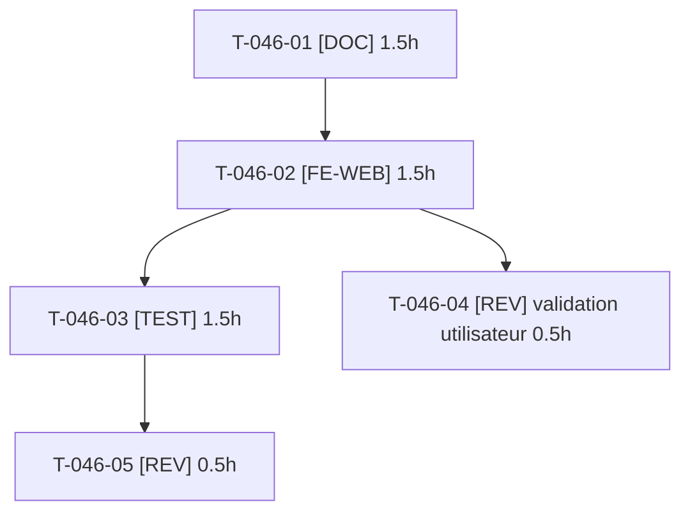

# Tâches — US-046 : Encart Sylius Plus sur la page Plugins

## Informations US

- **Epic** : EPIC-03
- **Persona** : Nadia
- **Story Points** : 2
- **Sprint** : sprint-10-vitrine-et-reports
- **Dépendances** : US-014 (page Plugins, `config/demo/plugins.yaml`)

## Résumé

En tant que Nadia, je veux qu'un encart de la page Plugins rappelle l'existence de Sylius Plus, afin de savoir que ses fonctions B2B peuvent compléter les plugins présentés.

## Contraintes (décision utilisateur du 2026-10-17)

- Texte rédigé **d'après la documentation officielle de Sylius Plus**, relue au moment de la rédaction ; aucune liste de fonctions citée de mémoire.
- **Aucune promesse de compatibilité** : formulation « complémentaires », avec « compatibilité à vérifier selon votre projet ».
- Pas de « gratuit » face à « payant », pas de comparaison de prix ni de fonctions, pas de logo ni de charte Sylius Plus.
- Politique de communication : pas de promotion des plugins qui recouvrent Sylius Plus (comptes d'entreprise, listes d'achat, approbation) ; l'encart met en avant Sylius Plus, l'offre officielle.
- **Le texte est soumis à validation de l'utilisateur avant merge** : T-046-04 est une tâche [REV] bloquante.

## Vue d'ensemble des tâches

| ID | Type | Tâche | Estimation | Dépend de | Statut |
|----|------|-------|------------|-----------|--------|
| T-046-01 | [DOC] | Relire la documentation officielle de Sylius Plus et rédiger le texte FR/EN (proposition) | 1.5h | — | 🔲 |
| T-046-02 | [FE-WEB] | Encart sur la page Plugins : gabarit, traductions FR/EN, lien externe sûr | 1.5h | T-046-01 | 🔲 |
| T-046-03 | [TEST] | Test fonctionnel : encart FR/EN, lien `noopener noreferrer`, CSP, termes interdits absents | 1.5h | T-046-02 | 🔲 |
| T-046-04 | [REV] | **Validation du texte par l'utilisateur (bloquante avant merge)** | 0.5h | T-046-02 | 🔲 |
| T-046-05 | [REV] | Revue technique et conformité à la politique de communication | 0.5h | T-046-03 | 🔲 |

**Total estimé : 5.5h** (5 tâches)

---

## Détail des tâches

### T-046-01 — Relire la documentation officielle de Sylius Plus et rédiger le texte FR/EN

- **Type** : [DOC]
- **Estimation** : 1.5h
- **Dépend de** : —

**Description** :
Lire la documentation officielle et la page produit de Sylius Plus (sources consignées dans la proposition avec la date de lecture). Rédiger 2 à 3 phrases FR et EN : Sylius Plus est l'édition commerciale de Sylius ; ses fonctions B2B peuvent s'ajouter aux plugins présentés ; compatibilité à vérifier selon le projet ; lien vers la page officielle. Relire `memory/sylius-plus-communication-policy`. Le texte est une **proposition** : il n'est pas figé avant T-046-04.

**Fichiers (indicatifs)** :
- `docs/` ou description de PR (proposition de texte et sources)

**Critères de validation** :
- [ ] Chaque affirmation est rattachée à une source officielle datée
- [ ] Aucune promesse de compatibilité, aucun « gratuit », aucune comparaison

---

### T-046-02 — Encart sur la page Plugins : gabarit, traductions FR/EN, lien externe sûr

- **Type** : [FE-WEB]
- **Estimation** : 1.5h
- **Dépend de** : T-046-01

**Description** :
Encart additif sur `/{_locale}/plugins` (Twig hook du thème B2B, ADR-0004). Libellés dans les fichiers de traduction FR et EN, lien externe avec `rel="noopener noreferrer"` et `target="_blank"`, sans ressource externe (CSP de la démo inchangée). Aucun logo.

**Fichiers (indicatifs)** :
- `themes/` ou `templates/` de la page Plugins
- `translations/`

**Critères de validation** :
- [ ] Encart visible en FR et en EN
- [ ] Lien sûr, CSP respectée

---

### T-046-03 — Test fonctionnel de l'encart

- **Type** : [TEST]
- **Estimation** : 1.5h
- **Dépend de** : T-046-02

**Description** :
Scénarios Gherkin d'US-046 : encart affiché en FR et EN avec lien officiel, `rel="noopener noreferrer"`, aucun terme de la liste interdite (« gratuit », « free », « alternative », « compatible avec », « remplace ») dans le texte rendu.

**Fichiers (indicatifs)** :
- `tests/Functional/PluginsPageSyliusPlusTest.php` (nom à ajuster aux conventions du dépôt)

**Critères de validation** :
- [ ] Trois scénarios d'US-046 verts
- [ ] Le test échoue si un terme interdit est ajouté

---

### T-046-04 — Validation du texte par l'utilisateur (bloquante)

- **Type** : [REV]
- **Estimation** : 0.5h
- **Dépend de** : T-046-02

**Description** :
Présenter à l'utilisateur le texte FR/EN exact tel qu'il sera rendu, avec ses sources. **Aucun merge et aucun déploiement tant que l'utilisateur n'a pas validé** ; toute modification repasse par T-046-02 et T-046-03. L'accord est consigné (date et formulation) dans la PR.

**Fichiers (indicatifs)** :
- sans objet

**Critères de validation** :
- [ ] Validation explicite de l'utilisateur consignée
- [ ] Texte validé identique au texte rendu

---

### T-046-05 — Revue technique et conformité à la politique

- **Type** : [REV]
- **Estimation** : 0.5h
- **Dépend de** : T-046-03

**Description** :
Vérifier le lien externe, la CSP, les traductions, l'absence de promotion des plugins qui recouvrent Sylius Plus, et qu'aucune annonce de l'encart n'est faite hors de la démo.

**Fichiers (indicatifs)** :
- sans objet

**Critères de validation** :
- [ ] Aucun constat bloquant

---

## Graphe de dépendances

## Résumé

| Couche | Nb tâches | Heures |
|--------|-----------|--------|
| [FE-WEB] | 1 | 1.5h |
| [TEST] | 1 | 1.5h |
| [DOC] | 1 | 1.5h |
| [REV] | 2 | 1h |
| **TOTAL** | **5** | **5.5h** |
