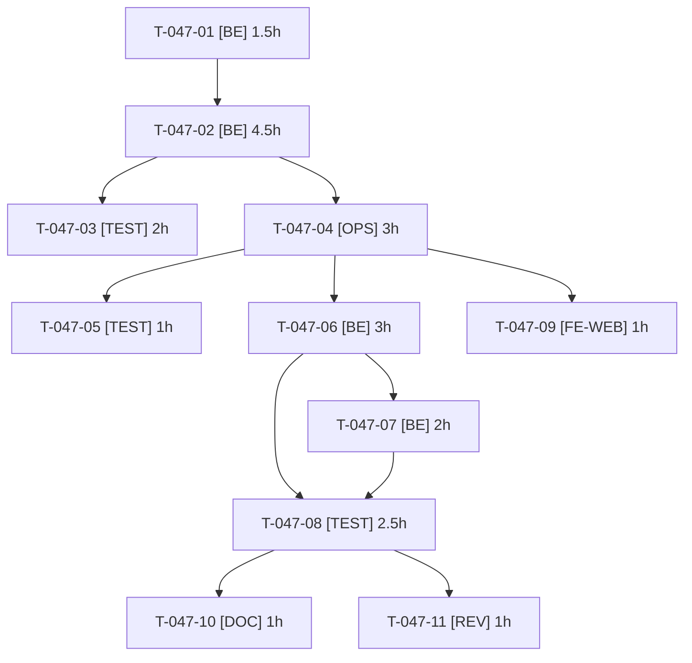

# Tâches — US-047 : Images des produits de démo

## Informations US

- **Epic** : EPIC-02
- **Persona** : Nadia
- **Story Points** : 5
- **Sprint** : sprint-10-vitrine-et-reports
- **Dépendances** : US-008 (CSV), US-040 (M4, purge des images orphelines)

## Résumé

En tant que Nadia, je veux que les 210 produits de démo aient une image qui les représente, afin que le catalogue ressemble à une vraie boutique.

## Décisions de l'utilisateur (2026-10-17)

- Source : **Openverse** (API sans clé). Licence : **CC0 uniquement** (filtre `license=cc0` côté API, revérifié sur chaque résultat).
- Script **manuel, lancé une seule fois** par un développeur ; images **versionnées** dans `fixtures/images/` ; **manifeste** des licences `fixtures/images/manifest.csv` (SKU, fichier, source, auteur, URL d'origine, licence, date de récupération).
- **Jamais d'appel à la banque d'images** au runtime, pendant les fixtures, le reset, le build Docker ou la CI.
- **Taille du dépôt surveillée** : images redimensionnées (800 px de grand côté) et compressées (WebP, qualité fixée), budget fixé au spike (T-047-01) ; hypothèse de départ : ≤ 80 Ko par image, ≤ 15 Mo au total pour 210 produits (une image par famille si les résultats sont rares).
- Disque local limité (~3 Go) : téléchargements bruts dans le répertoire temporaire hors dépôt ; seules les images finales entrent dans `fixtures/images/`.

## Vue d'ensemble des tâches

| ID | Type | Tâche | Estimation | Dépend de | Statut |
|----|------|-------|------------|-----------|--------|
| T-047-01 | [BE] | Spike court : Openverse CC0 sur des requêtes de produits industriels, conditions de l'API, budget de taille | 1.5h | — | ✅ |
| T-047-02 | [BE] | Script manuel de récupération : limite de débit, User-Agent, filtre CC0, reprise, redimensionnement/compression, manifeste | 4.5h | T-047-01 | ✅ |
| T-047-03 | [TEST] | Tests unitaires du script avec client HTTP simulé : licence refusée, reprise sans doublon, manifeste complet | 2h | T-047-02 | ✅ |
| T-047-04 | [OPS] | Lancement unique du script sur les 210 produits et contrôle visuel (pertinence, pas de personne ni de marque) | 3h | T-047-02 | ✅ |
| T-047-05 | [TEST] | Garde de budget : taille totale et par image, licences du manifeste toutes CC0, une image par SKU ou famille | 1h | T-047-04 | ✅ |
| T-047-06 | [BE] | Association image-produit dans l'importeur CSV (par SKU via le manifeste), idempotente | 3h | T-047-04 | ✅ |
| T-047-07 | [BE] | Purge M4 qui conserve les images des fixtures ; régénération du cache LiipImagine après le reset | 2h | T-047-06 | 🔄 |
| T-047-08 | [TEST] | Catalogue illustré après `app:demo:reset`, aucune requête réseau vers la banque, purge sur de vraies images | 2.5h | T-047-06, T-047-07 | ✅ |
| T-047-09 | [FE-WEB] | Section de crédits des images (source, auteur, licence) dans la page À propos (sacrifiable) | 1h | T-047-04 | ⏭️ Sacrifiée (ordre n°3, décision utilisateur 2026-10-17) |
| T-047-10 | [DOC] | Documentation : relancer le script, ajouter une image, budget de taille, interdiction d'appel au runtime | 1h | T-047-08 | ✅ |
| T-047-11 | [REV] | Revue (licences, absence d'appel réseau, taille du dépôt, secrets) | 1h | T-047-08 | 🔲 |

**Total estimé : 22.5h** (11 tâches)

---

## Détail des tâches

### T-047-01 — Spike court : Openverse CC0 et budget de taille

- **Type** : [BE]
- **Estimation** : 1.5h
- **Dépend de** : —

**Description** :
Tester l'API Openverse (sans clé) sur 10 produits représentatifs (gants, vis, chevilles, signalétique, ruban adhésif…) avec le filtre CC0 : pertinence, nombre de résultats, conditions d'API (débit, User-Agent, stockage local, hotlinking). Comparer au besoin une seconde source CC0 (Wikimedia Commons) pour les familles vides. Fixer le budget (par image et total), le format (WebP ou JPEG) et la règle de repli par famille. Conclusion écrite.

**Fichiers (indicatifs)** :
- `docs/images-produits.md` (section décision)

**Critères de validation** :
- [ ] Taux de résultats pertinents mesuré sur l'échantillon
- [ ] Conditions d'API compatibles avec le stockage local
- [ ] Budget de taille chiffré

---

### T-047-02 — Script manuel de récupération

- **Type** : [BE]
- **Estimation** : 4.5h
- **Dépend de** : T-047-01

**Description** :
Commande ou script manuel (jamais appelé par le reset, le build ni la CI) : une requête par produit (ou famille), débit limité, User-Agent identifiable avec contact, filtre CC0 revérifié sur le champ de licence de chaque résultat, téléchargement en répertoire temporaire, redimensionnement (800 px) et compression, écriture de l'image dans `fixtures/images/` et d'une ligne du manifeste. **Reprise** : une image déjà présente (et présente au manifeste) n'est pas retéléchargée. Aucune clé ni secret.

**Fichiers (indicatifs)** :
- `bin/fetch-product-images` ou `src/Demo/Images/`
- `fixtures/images/manifest.csv`

**Critères de validation** :
- [ ] Débit limité, User-Agent identifiable
- [ ] Résultat non CC0 rejeté
- [ ] Relance sans doublon

---

### T-047-03 — Tests unitaires du script

- **Type** : [TEST]
- **Estimation** : 2h
- **Dépend de** : T-047-02

**Description** :
Client HTTP simulé : résultat sous licence autre que CC0 refusé, interruption après N images puis relance qui ne télécharge que les manquantes, manifeste complet (source, auteur, licence, URL), aucune connexion réseau réelle. Écrits avant le code lorsque possible (TDD).

**Fichiers (indicatifs)** :
- `tests/Unit/Demo/Images/`

**Critères de validation** :
- [ ] Scénario « récupération reprise sans doublon » vert
- [ ] Scénario « licences tracées » couvert côté script

---

### T-047-04 — Lancement unique et contrôle visuel

- **Type** : [OPS]
- **Estimation** : 3h
- **Dépend de** : T-047-02

**Description** :
Lancer le script une fois sur les 210 produits (action manuelle d'un développeur, réseau nécessaire, GO de l'utilisateur pour le lancement). Contrôle visuel : image pertinente, aucune personne identifiable, aucune marque ou logo visible ; remplacer ou mutualiser par famille les cas douteux. Conserver dans le dépôt les seules images finales.

**Fichiers (indicatifs)** :
- `fixtures/images/*`
- `fixtures/images/manifest.csv`

**Critères de validation** :
- [ ] 210 produits couverts (image propre ou image de famille)
- [ ] Contrôle visuel fait et consigné

---

### T-047-05 — Garde de budget et de licences

- **Type** : [TEST]
- **Estimation** : 1h
- **Dépend de** : T-047-04

**Description** :
Test qui échoue si la taille totale de `fixtures/images/` ou d'une image dépasse le budget, si une ligne du manifeste n'est pas CC0 ou manque de champ, si un SKU des CSV n'a pas d'image (propre ou de famille) ou si un fichier du dossier n'est pas au manifeste.

**Fichiers (indicatifs)** :
- `tests/Unit/Demo/Images/ImageBudgetTest.php`

**Critères de validation** :
- [ ] Budget, licences et couverture contrôlés
- [ ] Échoue si une image est ajoutée sans ligne de manifeste

---

### T-047-06 — Association image-produit dans l'importeur CSV

- **Type** : [BE]
- **Estimation** : 3h
- **Dépend de** : T-047-04

**Description** :
L'importeur CSV associe à chaque produit son image locale par SKU via le manifeste (ou colonne `image`), de façon idempotente : deux chargements ne créent pas de doublon d'image. Lecture locale seulement ; aucun client HTTP injecté dans l'importeur. Impact sur la durée du reset à mesurer (210 images).

**Fichiers (indicatifs)** :
- `src/DataFixtures/` (importeur du catalogue)
- `fixtures/csv/SCHEMA.md`

**Critères de validation** :
- [ ] Chaque produit a son image après chargement
- [ ] Deux chargements successifs : même nombre d'images

---

### T-047-07 — Purge M4 et cache LiipImagine

- **Type** : [BE]
- **Estimation** : 2h
- **Dépend de** : T-047-06

**Description** :
La purge des images orphelines (US-040 M4) conserve les images des fixtures et supprime celle téléversée par un visiteur. Le cache LiipImagine est régénéré (ou purgé puis réchauffé) après le reset pour que les vignettes correspondent aux images rechargées.

**Fichiers (indicatifs)** :
- `src/Demo/Reset/` (purge, étape finale du reset)
- `config/packages/liip_imagine.yaml`

**Critères de validation** :
- [ ] Image de fixture conservée, image de visiteur supprimée
- [ ] Vignettes présentes après reset

---

### T-047-08 — Tests : catalogue illustré, aucune requête réseau, purge réelle

- **Type** : [TEST]
- **Estimation** : 2.5h
- **Dépend de** : T-047-06, T-047-07

**Description** :
Scénarios Gherkin d'US-047 : catalogue illustré après `app:demo:reset`, aucune requête réseau vers la banque (client HTTP de test qui échoue à toute requête pendant fixtures, reset et build) et purge sur de vraies images. Contrôle statique : aucune référence à Openverse hors du script manuel.

**Fichiers (indicatifs)** :
- `tests/Functional/ProductImagesTest.php`

**Critères de validation** :
- [ ] Cinq scénarios d'US-047 verts
- [ ] Zéro appel réseau pendant le reset

---

### T-047-09 — Crédits des images (sacrifiable)

- **Type** : [FE-WEB]
- **Estimation** : 1h
- **Dépend de** : T-047-04

**Description** :
CC0 n'impose pas d'attribution : section facultative de la page À propos qui renvoie au manifeste (source, licence), FR/EN. Sacrifiable sans effet sur le critère d'acceptation (le manifeste suffit).

**Fichiers (indicatifs)** :
- `templates/` (page À propos), `translations/`

**Critères de validation** :
- [ ] Libellés FR/EN
- [ ] Renvoi vers le manifeste

---

### T-047-10 — Documentation

- **Type** : [DOC]
- **Estimation** : 1h
- **Dépend de** : T-047-08

**Description** :
Comment relancer le script, ajouter une image, budget de taille, règle « jamais d'appel à la banque au runtime », origine et licences.

**Fichiers (indicatifs)** :
- `docs/images-produits.md`, `fixtures/README.md`

**Critères de validation** :
- [ ] Procédure complète et budget documentés

---

### T-047-11 — Revue

- **Type** : [REV]
- **Estimation** : 1h
- **Dépend de** : T-047-08

**Description** :
Licences du manifeste, absence d'appel réseau hors du script, taille réelle du dépôt, aucun secret, image sans marque ni personne.

**Fichiers (indicatifs)** :
- sans objet

**Critères de validation** :
- [ ] Aucun constat bloquant

---

## Graphe de dépendances

## Résumé

| Couche | Nb tâches | Heures |
|--------|-----------|--------|
| [BE] | 4 | 11h |
| [TEST] | 3 | 5.5h |
| [OPS] | 1 | 3h |
| [FE-WEB] | 1 | 1h |
| [DOC] | 1 | 1h |
| [REV] | 1 | 1h |
| **TOTAL** | **11** | **22.5h** |
