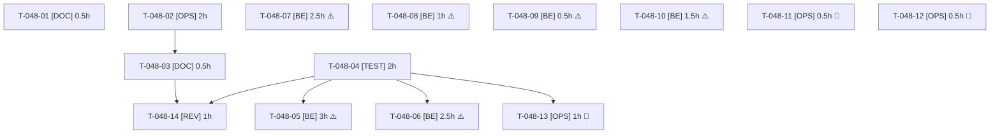

# Tâches — US-048 : Reports techniques du sprint 9

## Informations US

- **Epic** : EPIC-08
- **Persona** : Thibaut
- **Story Points** : 3
- **Sprint** : sprint-10-vitrine-et-reports
- **Dépendances** : US-041, US-044, US-006 (sprint 9) ; sources : [sprint-retro.md](../../sprint-9-reports/sprint-retro.md) (actions 1 à 5) et [sprint-review.md](../../sprint-9-reports/sprint-review.md) (points ouverts)

## Résumé

En tant que Thibaut, je veux solder les reports techniques du sprint 9, afin que les workers rendent un état final vérifiable, que la base de test se prépare en une commande, que le reset soit profilé avant d'être optimisé et que les vérifications Railway soient faites.

## Règles

- Chaque correctif (T-048-05 à T-048-10) commence par un **test qui échoue avant correction** (DoD de l'action 5).
- Tâches **sacrifiables** marquées ⚠️ ; ordre de sacrifice dans [README.md](./README.md).
- Les tâches [OPS] Railway (T-048-11 à T-048-13) nécessitent l'utilisateur (GO et accès au compte) : calendaires, hors chemin critique, jamais closes sur une estimation.
- Objectifs de performance : **aucun chiffre avant T-048-04**. Les valeurs de départ (`demo_orders` ≈ 2000 requêtes ; `demo_container_fill` 776 SELECT + 776 INSERT ; reset total 9063 requêtes ; pic ≈ 1,08 Go) sont des mesures du sprint 9 à reconfirmer.

## Vue d'ensemble des tâches

| ID | Type | Action | Tâche | Estimation | Dépend de | Statut |
|----|------|--------|-------|------------|-----------|--------|
| T-048-01 | [DOC] | 1 | Contrat de fin de worker : bloc de rapport obligatoire dans `tasks/README.md`, vérifié à chaque clôture | 0.5h | — | ✅ |
| T-048-02 | [OPS] | 2 | Commande unique de préparation de la base de test locale (`memory_limit=-1`, faux `WKHTMLTOPDF_BINARY`, base dédiée, migrations, fixtures) | 2h | — | ✅ |
| T-048-03 | [DOC] | 2 | Procédure dans `docs/` ; assertion Factur-X d'`OrderHistorySmokeTest` passante en local ou exclue avec sa raison | 0.5h | T-048-02 | ✅ |
| T-048-04 | [TEST] | 4 | Profilage du reset par fixture, tableau committé et objectifs chiffrés par poste | 2h | — | ✅ |
| T-048-05 | [BE] | 4 | ⚠️ Réduire les requêtes de `demo_orders` (≈ 2000) vers la cible de T-048-04 | 3h | T-048-04 | ✅ |
| T-048-06 | [BE] | 4 | ⚠️ Grouper les SELECT et INSERT de `demo_container_fill` (776 + 776) vers la cible de T-048-04 | 2.5h | T-048-04 | ✅ |
| T-048-07 | [BE] | 5 | ⚠️ N+1 de la Wishlist sur les listes (28 requêtes à 50 produits) : constant en 5, 20, 50 | 2.5h | — | ✅ |
| T-048-08 | [BE] | 5 | ⚠️ `VariantLogisticsSeeder` : supprimer la capacité périmée quand la quantité est < 1 | 1h | — | ✅ |
| T-048-09 | [BE] | 5 | ⚠️ `PackagingUnitParser` : normalisation NFC | 0.5h | — | ✅ |
| T-048-10 | [BE] | 5 | ⚠️ Entrypoint : recharger les fixtures après un premier chargement interrompu | 1.5h | — | ✅ |
| T-048-11 | [OPS] | 3 | 📅 Relevé complet du coût Railway (T-041-15), GO utilisateur | 0.5h | — | 📅 Relevé partiel du 2026-10-17 consigné (4,75 $ estimés), relevé complet après le 2026-10-23 |
| T-048-12 | [OPS] | 3 | 📅 Vérifier `/api/v2/shop/*` (404 en local) sur Railway | 0.5h | — | ✅ Done : 404 confirmé sur Railway, cause = API désactivée hors dev (sylius_api.yaml), maintenue désactivée (décision utilisateur 2026-10-17) |
| T-048-13 | [OPS] | 3 | 📅 Pic mémoire du reset (≈ 1,08 Go) contre la limite du service Railway | 1h | T-048-04 | ✅ Done : pic conteneur ≈ 1,05 Go pour 8 Go (2026-10-17) ; a révélé le réchauffage du cache à court de mémoire (limite PHP 512 Mo), corrigé par `-d memory_limit=1G` |
| T-048-14 | [REV] | — | Revue | 1h | T-048-03, T-048-04 | 🔲 |

**Total estimé : 19h** (14 tâches), dont 2h calendaires (T-048-11 à T-048-13) hors charge continue et 11h sacrifiables (T-048-05 à T-048-10).

---

## Détail des tâches

### T-048-01 — Contrat de fin de worker

- **Type** : [DOC]
- **Estimation** : 0.5h
- **Dépend de** : —

**Description** :
Le bloc de rapport obligatoire est posé dans [README.md](./README.md) (section « Contrat de fin de worker ») à la décomposition. Reste à l'appliquer : le Scrum Master colle le bloc dans chaque consigne de worker et refuse de clore une tâche sans lui. Mesure en fin de sprint : 100 % des workers ont rendu le bloc, 0 relance faute de rapport.

**Fichiers (indicatifs)** :
- `project-management/sprints/sprint-10-vitrine-et-reports/tasks/README.md`

**Critères de validation** :
- [x] Bloc présent dans README.md
- [ ] Compte des blocs rendus consigné à la revue de sprint

---

### T-048-02 — Commande unique de préparation de la base de test locale

- **Type** : [OPS]
- **Estimation** : 2h
- **Dépend de** : —

**Description** :
Script ou cible (par exemple `bin/prepare-test-db`) lancé via Docker : création de la base de test dédiée, migrations, fixtures avec `php -d memory_limit=-1`, `WKHTMLTOPDF_BINARY` pointant vers un faux binaire versionné (script de test, pas de wkhtmltopdf réel). Idempotent, ne touche jamais la base de développement. Vérifié sur un clone propre.

**Fichiers (indicatifs)** :
- `bin/prepare-test-db`
- `tests/Fixtures/bin/fake-wkhtmltopdf` (nom à ajuster)

**Critères de validation** :
- [ ] Une commande suffit sur un clone propre (vérifiée sur une base neuve, pas sur un clone)
- [x] Relance sans erreur

---

### T-048-03 — Procédure dans `docs/` et cas Factur-X

- **Type** : [DOC]
- **Estimation** : 0.5h
- **Dépend de** : T-048-02

**Description** :
Documenter la commande, ses prérequis et le piège de la mémoire. Statuer sur l'assertion Factur-X d'`OrderHistorySmokeTest` : passante avec le faux binaire, ou exclue avec sa raison écrite.

**Fichiers (indicatifs)** :
- `docs/tests-locaux.md`

**Critères de validation** :
- [x] Procédure datée dans `docs/`
- [x] Sort de l'assertion Factur-X décidé et écrit

---

### T-048-04 — Profilage du reset par fixture et objectifs chiffrés

- **Type** : [TEST]
- **Estimation** : 2h
- **Dépend de** : —

**Description** :
Mesurer, en au moins 3 passes avec écart, le nombre de requêtes (SELECT/INSERT/UPDATE) et la durée de chaque fixture du reset, y compris `demo_orders`, `demo_container_fill`, l'import produits et, si US-047 est livrée, l'association des images. Committer le tableau de répartition et un script de mesure reproductible. Fixer ensuite un objectif **par poste** (valeur cible chiffrée) pour T-048-05 et T-048-06, et reconfirmer le pic mémoire local.

**Fichiers (indicatifs)** :
- `docs/remise-a-zero-demo.md` (tableau)
- `bin/profile-reset`

**Critères de validation** :
- [x] Tableau par fixture committé, 3 passes minimum
- [x] Objectif chiffré par poste écrit avant toute optimisation

---

### T-048-05 — ⚠️ Réduire les requêtes de `demo_orders`

- **Type** : [BE]
- **Estimation** : 3h
- **Dépend de** : T-048-04

**Description** :
Viser la cible de T-048-04 (≈ 2000 requêtes au départ) : chargement groupé des références, flush par lots, aucune perte de données. Test de non-régression avant correction : données identiques, nombre de requêtes sous la cible.

**Fichiers (indicatifs)** :
- `src/DataFixtures/` (`demo_orders`)
- `tests/Functional/`

**Critères de validation** :
- [x] Cible chiffrée atteinte ou écart publié tel quel
- [x] Mêmes commandes et totaux qu'avant

---

### T-048-06 — ⚠️ Grouper les requêtes de `demo_container_fill`

- **Type** : [BE]
- **Estimation** : 2.5h
- **Dépend de** : T-048-04

**Description** :
776 SELECT et 776 INSERT : précharger les variantes par lot et insérer par lots. Test avant correction : mêmes données logistiques, requêtes sous la cible.

**Fichiers (indicatifs)** :
- `src/DataFixtures/` (`demo_container_fill`)

**Critères de validation** :
- [x] Cible chiffrée atteinte ou écart publié tel quel
- [x] Mêmes capacités et règles qu'avant

---

### T-048-07 — ⚠️ N+1 de la Wishlist sur les listes

- **Type** : [BE]
- **Estimation** : 2.5h
- **Dépend de** : —

**Description** :
Test d'abord : compter les requêtes d'une liste de 5, 20 et 50 produits pour un client avec liste d'achat (28 requêtes à 50 produits aujourd'hui). Charger l'appartenance à la liste en une requête par page.

**Fichiers (indicatifs)** :
- `src/` (extension Twig / composant Wishlist des listes)
- `tests/Functional/ProductListQueryCountTest.php` (existant, à étendre)

**Critères de validation** :
- [x] Même nombre de requêtes pour 5, 20 et 50 produits
- [x] Test rouge avant correction

---

### T-048-08 — ⚠️ Capacité périmée dans `VariantLogisticsSeeder`

- **Type** : [BE]
- **Estimation** : 1h
- **Dépend de** : —

**Description** :
Quand la quantité d'une variante passe sous 1, la capacité créée précédemment n'est pas supprimée. Test d'abord, puis suppression.

**Fichiers (indicatifs)** :
- `src/DataFixtures/` (`VariantLogisticsSeeder`)

**Critères de validation** :
- [x] Capacité supprimée si quantité < 1
- [x] Test rouge avant correction

---

### T-048-09 — ⚠️ Normalisation NFC dans `PackagingUnitParser`

- **Type** : [BE]
- **Estimation** : 0.5h
- **Dépend de** : —

**Description** :
Normaliser les libellés d'unité en NFC avant comparaison (`Normalizer::normalize`). Test avec une forme NFD d'abord.

**Fichiers (indicatifs)** :
- `src/` (`PackagingUnitParser`)

**Critères de validation** :
- [x] Forme NFD reconnue
- [x] Test rouge avant correction

---

### T-048-10 — ⚠️ Entrypoint : rechargement des fixtures après un chargement interrompu

- **Type** : [BE]
- **Estimation** : 1.5h
- **Dépend de** : —

**Description** :
Un premier chargement interrompu laisse une base partielle que l'entrypoint considère comme chargée. Écrire un marqueur de fin de chargement (écrit en dernier) ou détecter l'état partiel, puis recharger. Test d'abord sur l'état partiel simulé.

**Fichiers (indicatifs)** :
- `docker/entrypoint.sh` ou équivalent
- `tests/`

**Critères de validation** :
- [x] État partiel détecté et rechargé sans doublon
- [x] Chargement complet inchangé

---

### T-048-11 — 📅 Relevé complet du coût Railway (T-041-15)

- **Type** : [OPS]
- **Estimation** : 0.5h
- **Dépend de** : —

**Description** :
Relevé du coût depuis le déploiement du 2026-10-16 (pas avant le 2026-10-23), avec **GO et accès de l'utilisateur**. Consigner le coût et la comparaison au budget dans `docs/`. Sans accès : la tâche reste ouverte, aucune estimation.

**Fichiers (indicatifs)** :
- `docs/deploiement-railway.md`

**Critères de validation** :
- [ ] Coût relevé (ou tâche explicitement ouverte)

---

### T-048-12 — 📅 `/api/v2/shop/*` sur Railway

- **Type** : [OPS]
- **Estimation** : 0.5h
- **Dépend de** : —

**Description** :
Contrôler le statut HTTP de `/api/v2/shop/*` sur le déploiement (404 en local, peut affecter les outils MCP). Avec GO utilisateur. Ticket si 404.

**Fichiers (indicatifs)** :
- `docs/mcp.md`

**Critères de validation** :
- [ ] Statut HTTP consigné (ou tâche ouverte)

---

### T-048-13 — 📅 Pic mémoire du reset contre la limite Railway

- **Type** : [OPS]
- **Estimation** : 1h
- **Dépend de** : T-048-04

**Description** :
Relever le pic mémoire du reset sur Railway et le comparer à la limite du service (≈ 1,08 Go en local). Avec GO utilisateur. Ticket si la limite est dépassée.

**Fichiers (indicatifs)** :
- `docs/remise-a-zero-demo.md`

**Critères de validation** :
- [ ] Pic en Go et limite consignés (ou tâche ouverte)

---

### T-048-14 — Revue

- **Type** : [REV]
- **Estimation** : 1h
- **Dépend de** : T-048-03, T-048-04

**Description** :
Relire script, procédure, tableau de profilage et correctifs ; vérifier que chaque correctif a un test rouge avant correction et qu'aucun objectif n'a été fixé sans mesure.

**Fichiers (indicatifs)** :
- sans objet

**Critères de validation** :
- [ ] Aucun constat bloquant

---

## Graphe de dépendances

## Résumé

| Couche | Nb tâches | Heures |
|--------|-----------|--------|
| [BE] | 6 | 11h |
| [TEST] | 1 | 2h |
| [OPS] | 4 | 4h |
| [DOC] | 2 | 1h |
| [REV] | 1 | 1h |
| **TOTAL** | **14** | **19h** |

## Suivi (worker du 2026-10-17)

- **T-048-01** : le bloc « Rapport de fin » est dans [README.md](./README.md) ; le compte des blocs rendus reste à consigner à la revue de sprint.
- **T-048-02 / 03** : `bin/prepare-test-db`, faux binaire versionné `tests/Fixtures/bin/fake-wkhtmltopdf` (+ `blank.pdf`), procédure dans `docs/tests-locaux.md`. L'assertion Factur-X d'`OrderHistorySmokeTest` **passe** en local (elle n'est pas exclue). Vérifié sur une base neuve (création, migrations, fixtures) et en relance ; non vérifié sur un clone propre ni dans Docker (pas de reconstruction d'image).
- **T-048-04** : `bin/profile-reset` ; tableau, objectifs et mesures dans `docs/remise-a-zero-demo.md`. Relevé du 2026-10-17 (base `ff1dd86`, avant les images de la US-047).
- **T-048-05** : `demo_orders` 822 à 770 `SELECT`, total 1 963 à 1 911. Objectif (≤ 600 / ≤ 1 750) **non atteint** : le reste est le cœur de Sylius et les plugins (zones, promotions, membres), voir le détail dans `docs/remise-a-zero-demo.md`.
- **T-048-06** : `demo_container_fill` 2 205 à 31 requêtes (objectifs ≤ 40 `SELECT`, ≤ 60 `INSERT` atteints : 18 et 12). Données identiques (empreintes).
- **T-048-07** : cause trouvée : sans cookie de liste d'achat, le résolveur du plugin renvoie un jeton aléatoire à chaque appel et le cache par jeton de ses fonctions Twig ne sert jamais. Le jeton est maintenant stable dans la requête (`App\Wishlist\RequestStableWishlistTokenResolver`) ; le test compte désormais les requêtes `sylius_wishlist` (rouge avant : 27, 42, 49 ; vert après).
- **T-048-08** : suppression de la capacité périmée dans `VariantLogisticsSeeder` (test `VariantLogisticsSeederTest`, rouge avant).
- **T-048-09** : normalisation NFC dans `PackagingUnitParser` (cas NFD ajoutés, rouge avant).
- **T-048-10** : marqueur de fin de chargement (table `app_demo_load_marker`, écouteur de suite) lu par `app:demo:fixtures-loaded` ; l'entrypoint recharge sur le code 3, s'arrête sur tout autre code non nul. Migration `Version20261017120000` (marque comme chargée une base qui contient déjà des canaux). Testé : état partiel simulé (`FixturesLoadStateTest`) et logique de l'entrypoint avec un faux `php` ; pas de démarrage de conteneur (aucune reconstruction d'image).
- **T-048-11 à 13** : ouvertes, en attente du GO et de l'accès Railway de l'utilisateur ; aucune valeur estimée.
