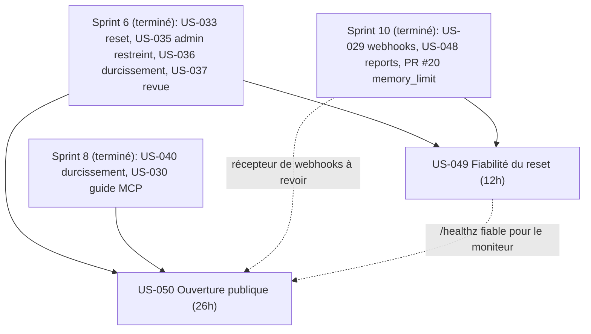
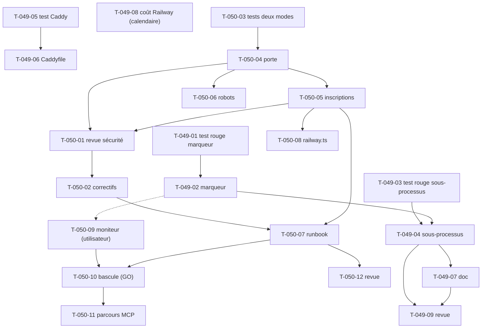

# Dépendances — Sprint 011 (Fiabilité et ouverture)

## Entre stories et avec les sprints précédents

## Entre tâches (vue transversale)

## Chemin critique

US-050 : T-050-03 → T-050-04 → T-050-05 → T-050-01 → T-050-02 → T-050-07 → T-050-12 (≈ 20,5 h). US-049 : T-049-01 → T-049-02 → T-049-04 → T-049-09 (≈ 7,5 h), parallèle. La bascule (T-050-10) dépend du GO de l'utilisateur et peut sortir du sprint.

## Ressources partagées

- `src/Demo/Command/DemoResetCommand.php`, `src/Demo/Command/ResetStatus.php` : US-049 seulement (T-049-02 puis T-049-04, sérialisés).
- `src/Demo/Http/` (porte, inscriptions), guide MCP, preflight : US-050 seulement (T-050-04 puis T-050-05 et T-050-06, sérialisés).
- `docker/Caddyfile` : T-049-06 ; `public/robots.txt` et en-têtes : T-050-06 ; les deux touchent la couche HTTP, ne pas les mener en parallèle sur un même fichier.
- Docs : `docs/remise-a-zero-demo.md` (US-049), `docs/ouverture-publique.md` (US-050), `docs/deploiement-railway.md` (T-049-08 et T-050-07 : sérialiser).
- Comptes et GO de l'utilisateur : T-049-08, T-050-09, T-050-10, T-050-11.
