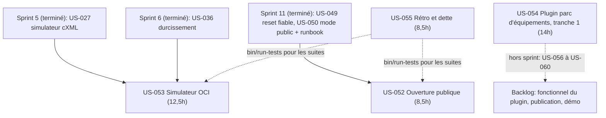
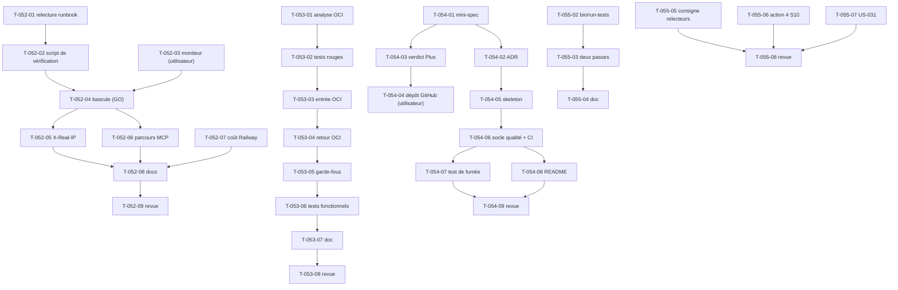

# Dépendances — Sprint 012 (Ouverture et plugins)

## Entre stories et avec les sprints précédents

## Entre tâches (vue transversale)

## Chemin critique

US-053 : T-053-01 → T-053-02 → T-053-03 → T-053-04 → T-053-05 → T-053-06 → T-053-07 → T-053-08 (≈ 12,5 h). US-054 : T-054-01 → T-054-02 → T-054-05 → T-054-06 → T-054-07 → T-054-09 (≈ 11 h), parallèle. US-052 : la bascule T-052-04 dépend du GO de l'utilisateur et peut sortir du sprint. US-055 : T-055-02 → T-055-03 en première semaine (≈ 4 h).

## Ressources partagées

- `src/Demo/Controller/PunchOutSimulatorController.php`, `src/Demo/PunchOutSimulator/` : US-053 seulement (T-053-03 → T-053-05 sérialisés).
- `config/packages/demo_hardening.yaml` (limiteurs) : US-053 (T-053-05) ; ne pas modifier pendant la bascule d'US-052.
- `.railway/railway.ts`, `docs/ouverture-publique.md`, `docs/deploiement-railway.md`, `docs/mcp.md` : US-052 seulement ; la bascule est exécutée par l'utilisateur.
- `bin/prepare-test-db`, `bin/run-tests`, `docs/tests-locaux.md` : US-055 seulement ; les autres stories attendent T-055-02 pour leurs suites complètes.
- `composer.json` / `composer.lock` de la démo : US-055 (T-055-07) seulement.
- `/Users/tmonier/Projects/sylius_plugins/sylius-customer-asset-management-plugin` : US-054 seulement, dépôt séparé.
- `.bmad/sprint-status.yaml` : orchestrateur seulement (écrivain unique).
- Comptes et GO de l'utilisateur : T-052-03 à T-052-07, T-054-04.
