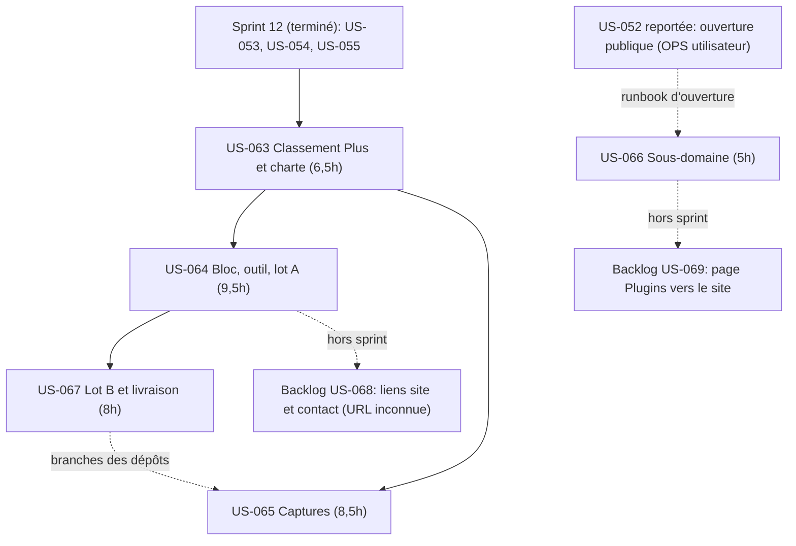
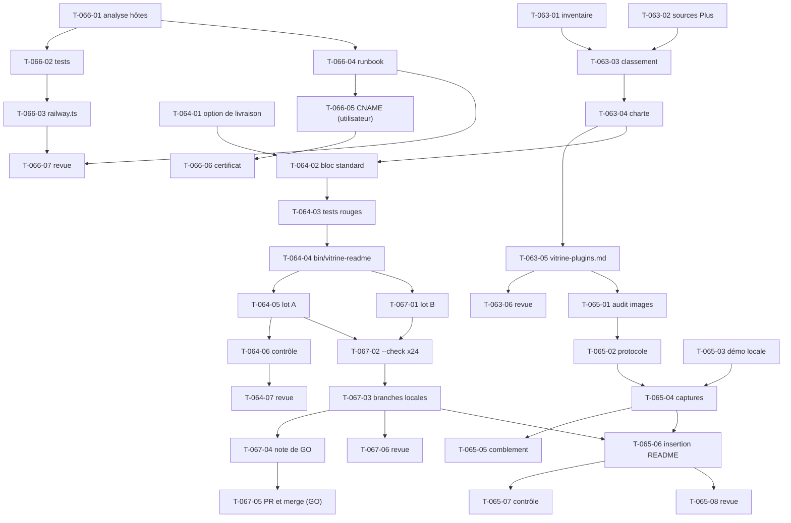

# Dépendances — Sprint 013 (Vitrine des plugins)

## Entre stories et avec les sprints précédents

## Entre tâches (vue transversale)

## Chemin critique

US-063 → US-064 → US-067 : T-063-01 → T-063-03 → T-063-04 → T-064-02 → T-064-03 → T-064-04 → T-067-01 → T-067-02 → T-067-03 (≈ 15 h), puis T-065-06 → T-065-08 (1,5 h). US-065 (captures) et US-066 sont parallèles. T-067-05, T-066-05 et T-066-06 dépendent de l'utilisateur et peuvent sortir du sprint.

## Ressources partagées

- Les 24 dépôts `sylius-*-plugin` : US-064 (T-064-01 en lecture seule), US-067 (branches, `README*.md`) et US-065 (`docs/images/`, sections Screenshots) ; ordre sérialisé par dépôt : US-067 (T-067-03) avant T-065-06. `customer-asset-management` : bloc seulement.
- `bin/vitrine-readme` et ses tests (démo) : US-064 (T-064-03, T-064-04), consommés ensuite par US-067.
- `docs/vitrine-plugins.md` : US-063 (créé), US-065 (état des images).
- `compose.yaml` et la démo locale : US-065 (T-065-03, T-065-04) ; pas d'autre usage simultané des ports.
- `.railway/railway.ts`, `docs/ouverture-publique.md`, `docs/deploiement-railway.md`, `docs/mcp.md` : US-066 seulement ; ne pas modifier pendant la bascule d'US-052.
- `.bmad/sprint-status.yaml` : orchestrateur seulement (écrivain unique).
- Comptes, GO et nom du sous-domaine de l'utilisateur : T-067-05, T-066-05, T-052-03 à T-052-07.
