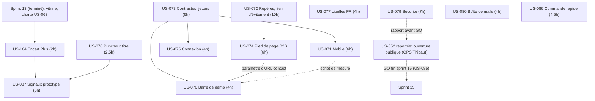

# Dépendances : Sprint 014 (Bloquants d'ouverture)

## Entre stories et avec les sprints précédents

## Entre tâches (vue transversale)

```mermaid
graph TD
    T07304["T-073-04 contrastes corrigés"] --> T07102["T-071-02 débordements"]
    T07304 --> T07502["T-075-02 connexion"]
    T07304 --> T07602["T-076-02 barre"]
    T07202["T-072-02 layout"] --> T07403["T-074-03 pied de page"]
    T07402["T-074-02 paramètres d'URL"] --> T07603["T-076-03 lien contact"]
    T07101["T-071-01 script de mesure"] --> T07604["T-076-04 mesure barre"]
    T10403["T-104-03 encart remplacé"] --> T08703["T-087-03 statut des plugins"]
    T07002["T-070-02 clé ui.buyers"] --> T08706["T-087-06 rendu des clés brutes"]
    T07002 --> T07004["T-070-04 PR et release (GO)"]
    T08603["T-086-03 plugin quick-order"] --> T08604["T-086-04 démo"]
    T08603 --> T08606["T-086-06 PR et release (GO)"]
    T07901["T-079-01 jobs CI"] --> T07902["T-079-02 protection de main"]
    T07901 --> T07903["T-079-03 script de contrôle"]
    T07904["T-079-04 checklist"] --> T07905["T-079-05 exposition (Thibaut)"]
    T07904 --> T07906["T-079-06 configuration (Thibaut)"]
    T07902 --> T07907["T-079-07 rapport"]
    T07905 --> T07907
    T07906 --> T07907
```

## Chemin critique

US-073 (jetons, T-073-01 → T-073-04, 5 h) → US-071 (T-071-02, T-071-03) en parallèle de US-072 (T-072-01 → T-072-02, 4 h) → US-074 (T-074-03) → US-076 (T-076-03, T-076-04). Environ 22 h en série ; le reste est parallélisable par worker si les fichiers de style ne se recoupent pas. Les tâches de Thibaut (T-079-05, T-079-06) et les PR de plugins (T-070-04, T-086-06) peuvent sortir du sprint sans bloquer le reste.

## Ressources partagées

- `assets/shop/styles` et les jetons CSS : US-073 (créateur), puis US-071, US-075, US-076, US-074 ; un seul worker à la fois.
- Layout de la boutique (`templates/bundles/SyliusShopBundle`, `templates/shop`) : US-072 puis US-074, US-076 (`top_bar`) ; ordre sérialisé.
- Page Plugins (`templates/shop/plugins`, `translations/plugins_plus.*`, `config/demo/plugins.yaml`) : US-104 puis US-087.
- Dépôts de plugins : `sylius-punchout-cxml-plugin` (US-070), `sylius-quick-order-plugin` (US-086) ; une branche locale et une PR chacun, après `git fetch` et vérification de la branche.
- `src/Demo/Mail/*` et `tests/Smoke/DemoMailbox*` : US-080 seulement.
- `.github/workflows/ci.yaml` (lecture seule) et réglages GitHub du dépôt : US-079 seulement.
- `.bmad/sprint-status.yaml` : orchestrateur seulement (écrivain unique).
- Comptes, GO et actions de Thibaut : T-079-05, T-079-06, T-070-04, T-086-06, T-052-03 à T-052-07.
