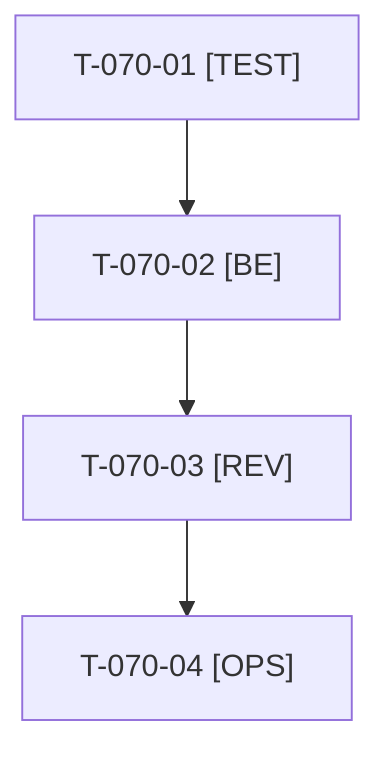

# Tâches : US-070 : Plugin punchout : traduire le titre et le fil d'Ariane des acheteurs PunchOut

## Informations US

- **Epic** : EPIC-11
- **Persona** : Thibaut
- **Story Points** : 1 (Should)
- **Sprint** : sprint-14-bloquants-ouverture
- **Story** : [US-070](../../../backlog/user-stories/US-070.md)

## Résumé de la US

**En tant que** Thibaut
**Je veux** que le titre et le fil d'Ariane de la liste des acheteurs PunchOut soient traduits
**Afin de** ne plus voir la clé brute `tmonier_punchout.ui.buyers` dans l'admin

## Règles

- Dépôt : `/Users/tmonier/Projects/sylius_plugins/sylius-punchout-cxml-plugin` (D4). `git fetch`, branche vérifiée, partir de `main` à jour. Le menu a déjà `ui.menu.buyers` ; il manque `ui.buyers` (titre et fil d'Ariane générés par Sylius).
- Une PR sur le dépôt du plugin, livrée avec la démo ; release de patch ensuite (T-070-04). Pas de nouveau paquet : le tag se met à jour seul sur Packagist.
- Sacrifice n° 1 (Should) : si sacrifiée, la clé brute reste visible dans l'admin (voir US-087, T-087-06).
- Rappels du sprint (D5) : rendu réel vérifié ; `TEST_DB_NAME=<db> WKHTMLTOPDF_BINARY="$PWD/tests/Fixtures/bin/fake-wkhtmltopdf" bin/run-tests …` ; ECS sur `src tests`. Contrat de fin de worker : voir [README.md](./README.md).

## Vue d'ensemble des tâches

| ID | Type | Tâche | Estimation | Dépend de | Statut |
|----|------|-------|------------|-----------|--------|
| T-070-01 | [TEST] | Test rouge : les clés `tmonier_punchout.ui.buyers` existent dans les 7 langues du plugin et la page liste affiche le titre traduit (FR et EN) | 0,5h | - | 🔲 |
| T-070-02 | [BE] | Ajouter `ui.buyers` aux 7 fichiers `translations/messages.*.yaml` ; vérifier le rendu réel de la liste et du fil d'Ariane dans l'admin de la démo | 1h | T-070-01 | 🔲 |
| T-070-03 | [REV] | Revue (ECS et PHPStan du plugin, rendu admin FR et EN) | 0,5h | T-070-02 | 🔲 |
| T-070-04 | [OPS] | 📅 Ouverture de la PR du plugin avec la démo, merge puis release de patch (GO de Thibaut) ; montée de version dans la démo | 0,5h | T-070-03 | 🔲 |

**Total estimé : 2,5 h** (4 tâches), dont 0,5 h calendaire(s) (📅).

## Dépendances

