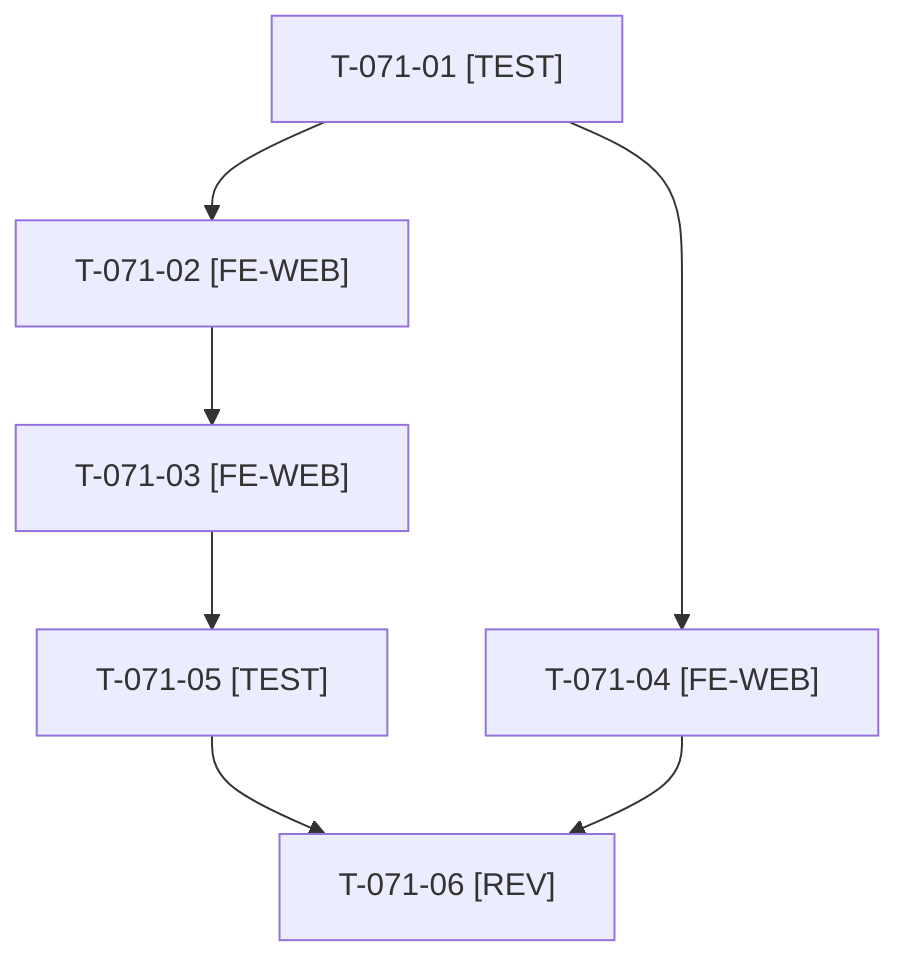

# Tâches : US-071 : Mise en page mobile sans débordement ni cible trop petite

## Informations US

- **Epic** : EPIC-10
- **Persona** : Nadia
- **Story Points** : 3 (Must)
- **Sprint** : sprint-14-bloquants-ouverture
- **Story** : [US-071](../../../backlog/user-stories/US-071.md)

## Résumé de la US

**En tant que** Nadia
**Je veux** consulter la démo sur mon téléphone sans défilement horizontal et avec des cibles faciles à toucher
**Afin de** l'évaluer en déplacement

## Règles

- Mesure en émulation réelle (D5) : Puppeteer, `setViewport` avec `isMobile`, `scrollWidth` du document à 375 et à 320 px. Chrome headless seul ne descend pas sous ≈ 500 px.
- Pages : connexion, accueil, catégorie, fiche produit, panier, devis, Plugins. Thème surchargé par ajouts, jamais en modifiant le cœur.
- Dépend d'US-073 (jetons de couleur) pour ne pas se marcher sur les mêmes feuilles de style.
- Rappels du sprint (D5) : rendu réel vérifié ; `TEST_DB_NAME=<db> WKHTMLTOPDF_BINARY="$PWD/tests/Fixtures/bin/fake-wkhtmltopdf" bin/run-tests …` ; ECS sur `src tests`. Contrat de fin de worker : voir [README.md](./README.md).

## Vue d'ensemble des tâches

| ID | Type | Tâche | Estimation | Dépend de | Statut |
|----|------|-------|------------|-----------|--------|
| T-071-01 | [TEST] | Script `bin/measure-mobile` (Puppeteer `isMobile`, 375 et 320 px, 7 pages, sortie nommant la page fautive) et test de régression structurel (pages et seuil)  | 2h | - | 🔲 |
| T-071-02 | [FE-WEB] | Corriger les débordements : connexion (418 px), pagination des catégories, tableaux ; texte long à la ligne (`overflow-wrap`) | 1,5h | T-071-01 | 🔲 |
| T-071-03 | [FE-WEB] | Cibles tactiles ≥ 44 x 44 px : boutons, pagination, favoris, champs | 1h | T-071-02 | 🔲 |
| T-071-04 | [FE-WEB] | Libellé explicite du champ de recherche de catégorie (FR et EN) | 0,5h | T-071-01 | 🔲 |
| T-071-05 | [TEST] | ⚠️ Contenu long (nom de produit, numéro de commande) à 320 px, rendu réel | 0,5h | T-071-03 | 🔲 |
| T-071-06 | [REV] | Revue (mesure à 375 et 320 px sur les 7 pages, copie du résultat) | 0,5h | T-071-05, T-071-04 | 🔲 |

**Total estimé : 6 h** (6 tâches), sacrifiable(s) ⚠️ : T-071-05.

## Dépendances

