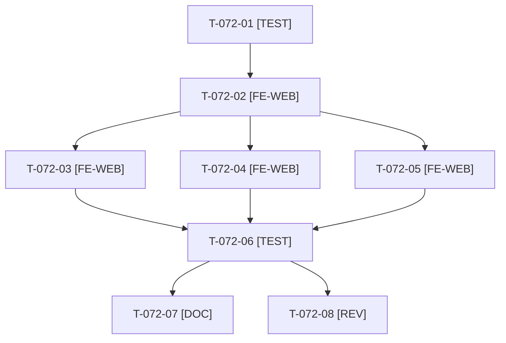

# Tâches : US-072 : Structure sémantique du thème : repères, lien d'évitement et annonces

## Informations US

- **Epic** : EPIC-10
- **Persona** : Nadia
- **Story Points** : 5 (Must)
- **Sprint** : sprint-14-bloquants-ouverture
- **Story** : [US-072](../../../backlog/user-stories/US-072.md)

## Résumé de la US

**En tant que** Nadia (clavier ou lecteur d'écran)
**Je veux** des repères de page, un lien d'évitement et des annonces des changements dynamiques
**Afin de** atteindre le contenu sans parcourir tout l'en-tête

## Règles

- Surcharge du layout Sylius dans le thème de la démo (ajouts uniquement) ; boutique seulement, pas l'admin.
- À faire avant US-074 (le pied de page vit dans le même layout).
- Vérifier au clavier réel (Tab) et au rendu, pas seulement dans le gabarit.
- Rappels du sprint (D5) : rendu réel vérifié ; `TEST_DB_NAME=<db> WKHTMLTOPDF_BINARY="$PWD/tests/Fixtures/bin/fake-wkhtmltopdf" bin/run-tests …` ; ECS sur `src tests`. Contrat de fin de worker : voir [README.md](./README.md).

## Vue d'ensemble des tâches

| ID | Type | Tâche | Estimation | Dépend de | Statut |
|----|------|-------|------------|-----------|--------|
| T-072-01 | [TEST] | Tests rouges d'audit : un `header`, un `main`, un `footer` uniques, un seul `h1`, lien d'évitement premier focalisable, échec si deux `main` | 2h | - | ✅ |
| T-072-02 | [FE-WEB] | Surcharge du layout : `header`, `main` (`id`, `tabindex="-1"`), `footer` | 2h | T-072-01 | ✅ |
| T-072-03 | [FE-WEB] | Lien « Aller au contenu » visible au focus (FR et EN) | 1h | T-072-02 | ✅ |
| T-072-04 | [FE-WEB] | Région `aria-live` polie pour les confirmations (panier, liste d'achat) | 1,5h | T-072-02 | ✅ |
| T-072-05 | [FE-WEB] | Un seul `h1` par page : connexion, pages d'erreur 403 et 404 avec mêmes repères | 1,5h | T-072-02 | ✅ |
| T-072-06 | [TEST] | Audit des repères et du lien d'évitement ajouté à la CI ; vérification Tab réelle sur 5 pages | 1h | T-072-03, T-072-04, T-072-05 | ✅ |
| T-072-07 | [DOC] | ⚠️ Documentation du layout et de l'audit | 0,5h | T-072-06 | ✅ |
| T-072-08 | [REV] | Revue | 0,5h | T-072-06 | 🔲 |

**Total estimé : 10 h** (8 tâches), sacrifiable(s) ⚠️ : T-072-07.

## Dépendances

