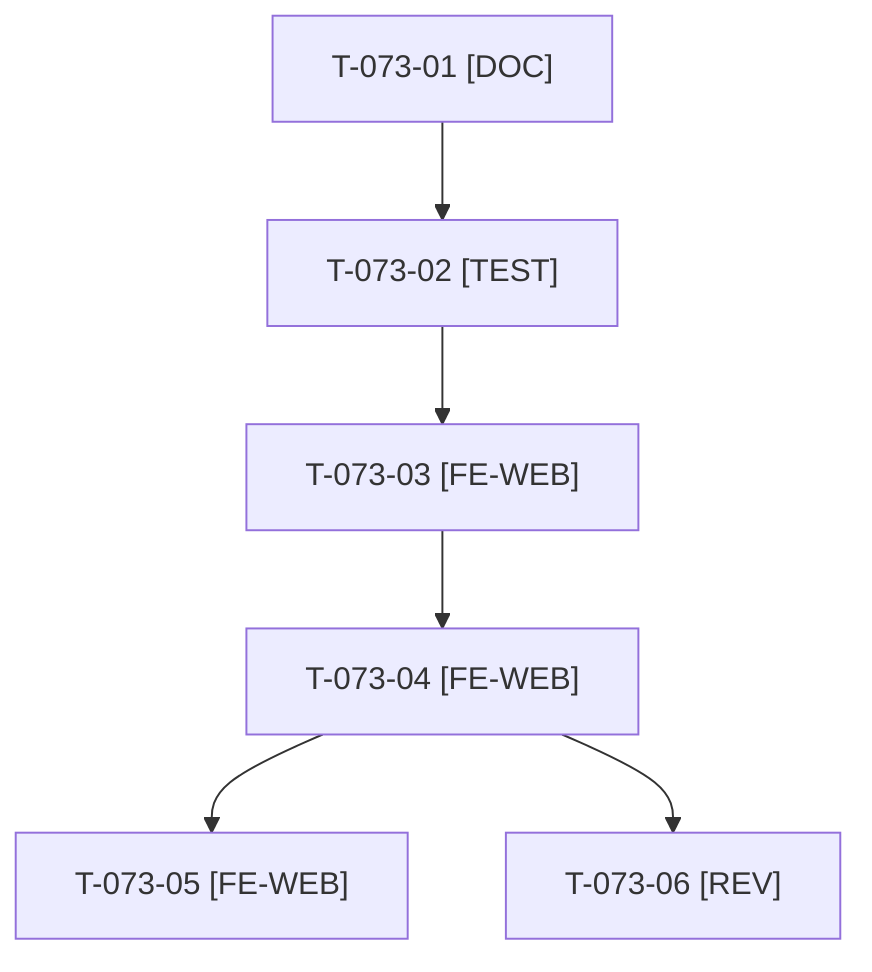

# Tâches : US-073 : Contrastes AAA et jetons de couleur uniques

## Informations US

- **Epic** : EPIC-10
- **Persona** : Nadia
- **Story Points** : 3 (Must)
- **Sprint** : sprint-14-bloquants-ouverture
- **Story** : [US-073](../../../backlog/user-stories/US-073.md)

## Résumé de la US

**En tant que** Nadia
**Je veux** des textes et composants lisibles (7:1 au moins pour le texte)
**Afin de** lire la démo sans effort quelle que soit ma vue

## Règles

- Premier à passer parmi les stories de style (jetons CSS partagés avec US-071, 075, 076).
- Les deux bruns #963d00 et #9a3f00 fusionnent en un jeton unique. Mesure sur le rendu réel (accueil, connexion, catégorie, fiche, panier, Plugins).
- Rappels du sprint (D5) : rendu réel vérifié ; `TEST_DB_NAME=<db> WKHTMLTOPDF_BINARY="$PWD/tests/Fixtures/bin/fake-wkhtmltopdf" bin/run-tests …` ; ECS sur `src tests`. Contrat de fin de worker : voir [README.md](./README.md).

## Vue d'ensemble des tâches

| ID | Type | Tâche | Estimation | Dépend de | Statut |
|----|------|-------|------------|-----------|--------|
| T-073-01 | [DOC] | Mesure des contrastes actuels (pagination 2,07:1, identifiants 4,5:1, favoris 4,69:1, textes grisés) et liste des couleurs en dur | 1h | - | 🔲 |
| T-073-02 | [TEST] | Contrôle des contrastes (7:1 texte, 3:1 composants) et contrôle de style signalant toute couleur en dur | 1,5h | T-073-01 | 🔲 |
| T-073-03 | [FE-WEB] | Jeton CSS unique pour le brun ; suppression des deux valeurs d'origine | 1h | T-073-02 | 🔲 |
| T-073-04 | [FE-WEB] | Corriger pagination, code des identifiants de démo, boutons favoris, textes grisés | 1,5h | T-073-03 | 🔲 |
| T-073-05 | [FE-WEB] | ⚠️ Contraste élevé (`prefers-contrast`, `forced-colors`) lisible | 0,5h | T-073-04 | 🔲 |
| T-073-06 | [REV] | Revue (contrôle sur le rendu réel des 6 pages) | 0,5h | T-073-04 | 🔲 |

**Total estimé : 6 h** (6 tâches), sacrifiable(s) ⚠️ : T-073-05.

## Dépendances

