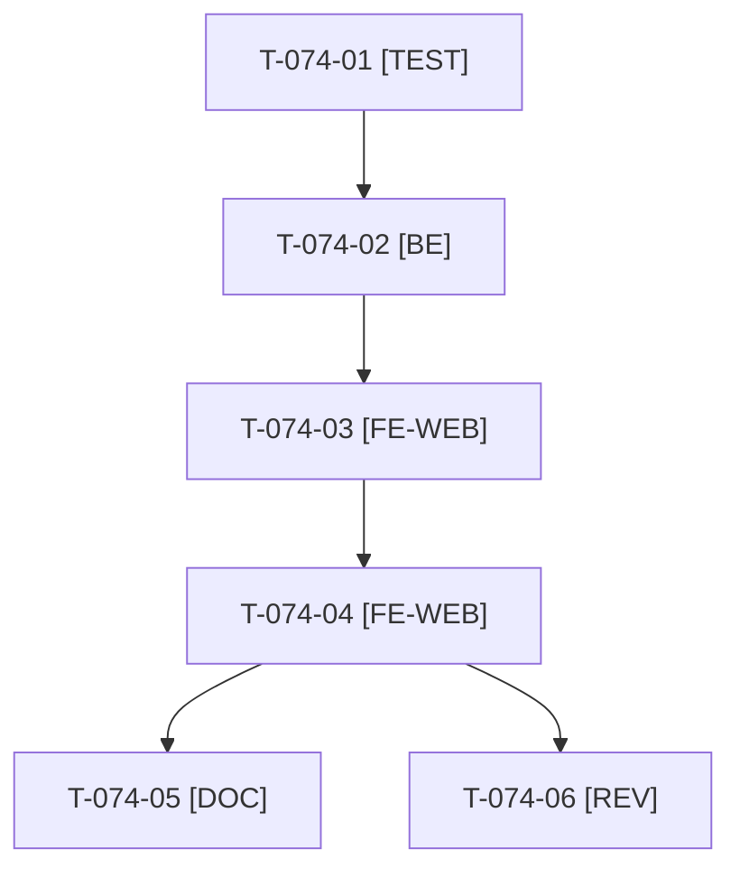

# Tâches : US-074 : Pied de page dédié à la démo B2B

## Informations US

- **Epic** : EPIC-10
- **Persona** : Nadia
- **Story Points** : 3 (Must)
- **Sprint** : sprint-14-bloquants-ouverture
- **Story** : [US-074](../../../backlog/user-stories/US-074.md)

## Résumé de la US

**En tant que** Nadia
**Je veux** un pied de page qui parle de la démo B2B (à propos, plugins, parcours, contact)
**Afin de** ne plus voir une newsletter -20 % ni des partenaires de paiement génériques

## Règles

- Dépend d'US-072 (layout). Ton selon la charte d'US-063, aucune comparaison avec Sylius Plus.
- URL du site et du contact en paramètres de configuration, https seulement ; sinon texte simple et lien masqué (US-068 et US-069 restent au backlog).
- Rappels du sprint (D5) : rendu réel vérifié ; `TEST_DB_NAME=<db> WKHTMLTOPDF_BINARY="$PWD/tests/Fixtures/bin/fake-wkhtmltopdf" bin/run-tests …` ; ECS sur `src tests`. Contrat de fin de worker : voir [README.md](./README.md).

## Vue d'ensemble des tâches

| ID | Type | Tâche | Estimation | Dépend de | Statut |
|----|------|-------|------------|-----------|--------|
| T-074-01 | [TEST] | Tests rouges : pied B2B sans newsletter ni partenaires, URL https cliquable, absence d'URL sans erreur, URL http refusée | 1,5h | - | 🔲 |
| T-074-02 | [BE] | Paramètres `site_url` et `contact_url` validés (https) et exposés à Twig ; invalide = masqué | 1,5h | T-074-01 | 🔲 |
| T-074-03 | [FE-WEB] | Surcharge du pied de page : colonne « Cette démo », mention « réalisé par Thibaut Monier » | 1,5h | T-074-02, T-072-02 | 🔲 |
| T-074-04 | [FE-WEB] | Traductions FR et EN, vérification du rendu à 375 et 1280 px | 0,5h | T-074-03 | 🔲 |
| T-074-05 | [DOC] | ⚠️ Documentation des deux paramètres d'URL | 0,5h | T-074-04 | 🔲 |
| T-074-06 | [REV] | Revue | 0,5h | T-074-04 | 🔲 |

**Total estimé : 6 h** (6 tâches), sacrifiable(s) ⚠️ : T-074-05.

## Dépendances

