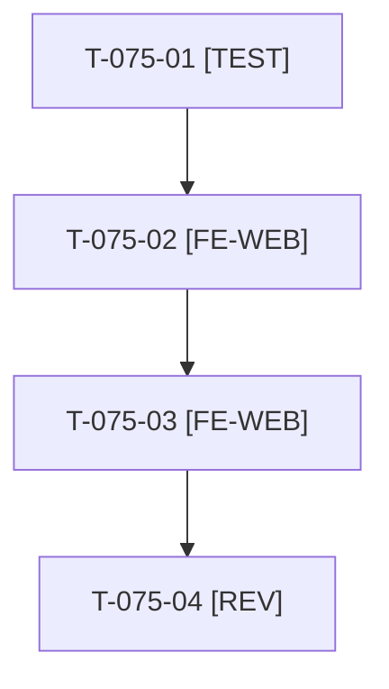

# Tâches : US-075 : Connexion : comptes de démo en premier, groupés par société

## Informations US

- **Epic** : EPIC-10
- **Persona** : Nadia
- **Story Points** : 2 (Should)
- **Sprint** : sprint-14-bloquants-ouverture
- **Story** : [US-075](../../../backlog/user-stories/US-075.md)

## Résumé de la US

**En tant que** Nadia
**Je veux** voir les comptes de démo en premier sur la page de connexion, groupés par société
**Afin de** entrer dans la démo en un clic sans lire une notice

## Règles

- Sacrifice n° 4 (Should). Dépend d'US-073 (lisibilité du code des identifiants). Sociétés : Acme Industries, BigCorp, marchand.
- Rappels du sprint (D5) : rendu réel vérifié ; `TEST_DB_NAME=<db> WKHTMLTOPDF_BINARY="$PWD/tests/Fixtures/bin/fake-wkhtmltopdf" bin/run-tests …` ; ECS sur `src tests`. Contrat de fin de worker : voir [README.md](./README.md).

## Vue d'ensemble des tâches

| ID | Type | Tâche | Estimation | Dépend de | Statut |
|----|------|-------|------------|-----------|--------|
| T-075-01 | [TEST] | Tests rouges : comptes en tête, groupés par société avec rôle ; aucun compte hors mode démo | 1h | - | 🔲 |
| T-075-02 | [FE-WEB] | Réordonner la page de connexion : comptes groupés d'abord, formulaire classique dessous | 2h | T-075-01 | 🔲 |
| T-075-03 | [FE-WEB] | Libellés FR et EN, connexion en un clic avec le rôle annoncé | 0,5h | T-075-02 | 🔲 |
| T-075-04 | [REV] | Revue (rendu réel en mode démo et hors démo) | 0,5h | T-075-03 | 🔲 |

**Total estimé : 4 h** (4 tâches).

## Dépendances

