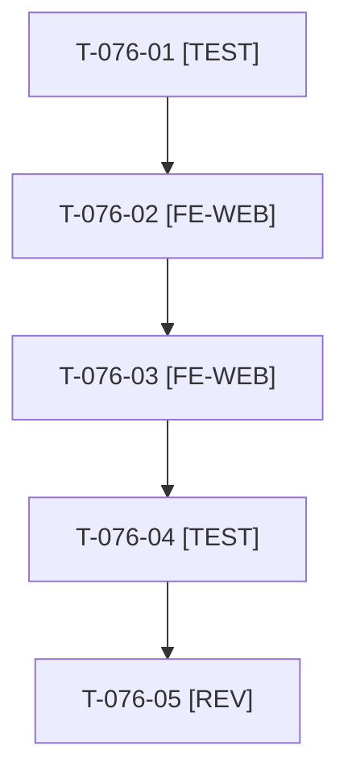

# Tâches : US-076 : Barre de démo sur une ligne, dans la langue du visiteur

## Informations US

- **Epic** : EPIC-10
- **Persona** : Nadia
- **Story Points** : 2 (Should)
- **Sprint** : sprint-14-bloquants-ouverture
- **Story** : [US-076](../../../backlog/user-stories/US-076.md)

## Résumé de la US

**En tant que** Nadia
**Je veux** une barre de démo sur une seule ligne et dans ma langue
**Afin de** ne pas perdre de place en haut d'écran

## Règles

- Sacrifice n° 3 (Should). Réutilise le paramètre d'URL contact d'US-074 et le script de mesure d'US-071.
- Lien « Un projet B2B ? Parlons-en » masqué si l'URL est vide ou non https.
- Rappels du sprint (D5) : rendu réel vérifié ; `TEST_DB_NAME=<db> WKHTMLTOPDF_BINARY="$PWD/tests/Fixtures/bin/fake-wkhtmltopdf" bin/run-tests …` ; ECS sur `src tests`. Contrat de fin de worker : voir [README.md](./README.md).

## Vue d'ensemble des tâches

| ID | Type | Tâche | Estimation | Dépend de | Statut |
|----|------|-------|------------|-----------|--------|
| T-076-01 | [TEST] | Tests rouges : une langue à la fois, lien contact présent ou masqué (vide, http) | 1h | - | 🔲 |
| T-076-02 | [FE-WEB] | Barre sur une ligne dans la langue courante (`top_bar`) | 1,5h | T-076-01 | 🔲 |
| T-076-03 | [FE-WEB] | Lien contact depuis la configuration (US-074) | 0,5h | T-076-02, T-074-02 | 🔲 |
| T-076-04 | [TEST] | Mesure réelle : une ligne à 375 px et à 1280 px, FR et EN | 0,5h | T-076-03, T-071-01 | 🔲 |
| T-076-05 | [REV] | Revue | 0,5h | T-076-04 | 🔲 |

**Total estimé : 4 h** (5 tâches).

## Dépendances

