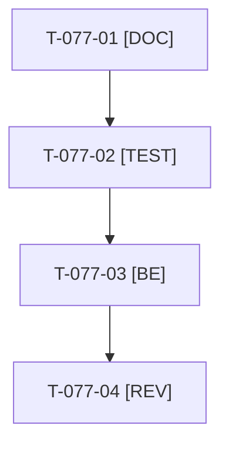

# Tâches : US-077 : Libellés accessibles du cœur en français

## Informations US

- **Epic** : EPIC-10
- **Persona** : Nadia
- **Story Points** : 2 (Should)
- **Sprint** : sprint-14-bloquants-ouverture
- **Story** : [US-077](../../../backlog/user-stories/US-077.md)

## Résumé de la US

**En tant que** Nadia
**Je veux** que les libellés accessibles (annonces d'un lecteur d'écran) soient en français
**Afin de** utiliser la démo avec une aide technique sans mélange de langues

## Règles

- Sacrifice n° 2 (Should). Traductions dans les fichiers de la démo, sans toucher au cœur.
- Rappels du sprint (D5) : rendu réel vérifié ; `TEST_DB_NAME=<db> WKHTMLTOPDF_BINARY="$PWD/tests/Fixtures/bin/fake-wkhtmltopdf" bin/run-tests …` ; ECS sur `src tests`. Contrat de fin de worker : voir [README.md](./README.md).

## Vue d'ensemble des tâches

| ID | Type | Tâche | Estimation | Dépend de | Statut |
|----|------|-------|------------|-----------|--------|
| T-077-01 | [DOC] | Inventaire des libellés accessibles restés en anglais (rendu FR des pages clés) | 1h | - | ✅ |
| T-077-02 | [TEST] | Test de traduction : échoue en nommant toute clé sans traduction ; libellés EN conservés | 1h | T-077-01 | ✅ |
| T-077-03 | [BE] | Traductions FR (et EN conservées) dans `translations/` de la démo | 1,5h | T-077-02 | ✅ |
| T-077-04 | [REV] | Revue (audit des libellés en FR et en EN) | 0,5h | T-077-03 | 🔲 |

**Total estimé : 4 h** (4 tâches).

## Dépendances

