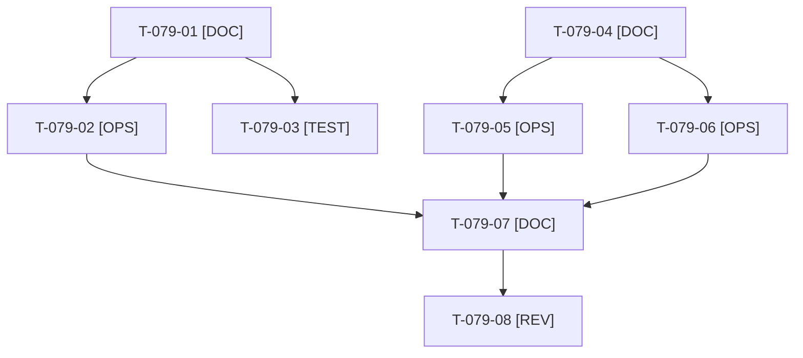

# Tâches : US-079 : Sécurité avant ouverture : exposition, configuration versionnée, branche protégée

## Informations US

- **Epic** : EPIC-10
- **Persona** : Thibaut
- **Story Points** : 3 (Must)
- **Sprint** : sprint-14-bloquants-ouverture
- **Story** : [US-079](../../../backlog/user-stories/US-079.md)

## Résumé de la US

**En tant que** Thibaut
**Je veux** confirmer que les services internes ne sont pas exposés, que la configuration versionnée est factice et que `main` est protégée
**Afin de** ouvrir la démo sans faille connue

## Règles

- Dépôt public : aucun détail exploitable dans la tâche, la PR ni le rapport (ni nom de service, ni valeur, ni chemin sensible). Conclusions seulement : conforme ou action corrective.
- Décision D3 : protection de `main` par Claude via `gh api` (PR obligatoire, contrôles « Quality and smoke tests » et « Docker image », pas de revue tierce obligatoire, pas de force-push). Noms vérifiés dans `.github/workflows/ci.yaml` (`name:` des jobs). Confirmation de Thibaut au moment d'écrire (action externe).
- Vérification de l'exposition Railway et relecture de la configuration versionnée : tâches [OPS] de Thibaut, Claude prépare une checklist générique.
- Rappels du sprint (D5) : rendu réel vérifié ; `TEST_DB_NAME=<db> WKHTMLTOPDF_BINARY="$PWD/tests/Fixtures/bin/fake-wkhtmltopdf" bin/run-tests …` ; ECS sur `src tests`. Contrat de fin de worker : voir [README.md](./README.md).

## Vue d'ensemble des tâches

| ID | Type | Tâche | Estimation | Dépend de | Statut |
|----|------|-------|------------|-----------|--------|
| T-079-01 | [DOC] | Noms exacts des jobs de `ci.yaml` et lecture de l'état actuel de la protection (`gh api` en lecture seule) | 0,5h | - | 🔲 |
| T-079-02 | [OPS] | Appliquer la protection de `main` via `gh api` (après confirmation) et relire le résultat | 1h | T-079-01 | 🔲 |
| T-079-03 | [TEST] | Script de contrôle en lecture seule `bin/check-branch-protection` : échoue et demande l'activation à Thibaut si la protection manque | 1,5h | T-079-01 | 🔲 |
| T-079-04 | [DOC] | Checklist [OPS] de Thibaut (exposition, configuration versionnée, clé de chiffrement propre à l'environnement) sans détail exploitable | 1h | - | 🔲 |
| T-079-05 | [OPS] | 📅 Thibaut : vérifier l'exposition des services de l'hébergement | 1h | T-079-04 | 🔲 |
| T-079-06 | [OPS] | 📅 Thibaut : relire les fichiers de configuration versionnés et confirmer la clé de production | 1h | T-079-04 | 🔲 |
| T-079-07 | [DOC] | Rapport de vérification : conclusion par vérification, actions de Thibaut, sans valeur sensible | 0,5h | T-079-02, T-079-05, T-079-06 | 🔲 |
| T-079-08 | [REV] | Revue (relecture « aucun détail exploitable » de tous les documents) | 0,5h | T-079-07 | 🔲 |

**Total estimé : 7 h** (8 tâches), dont 2 h calendaire(s) (📅).

## Dépendances

