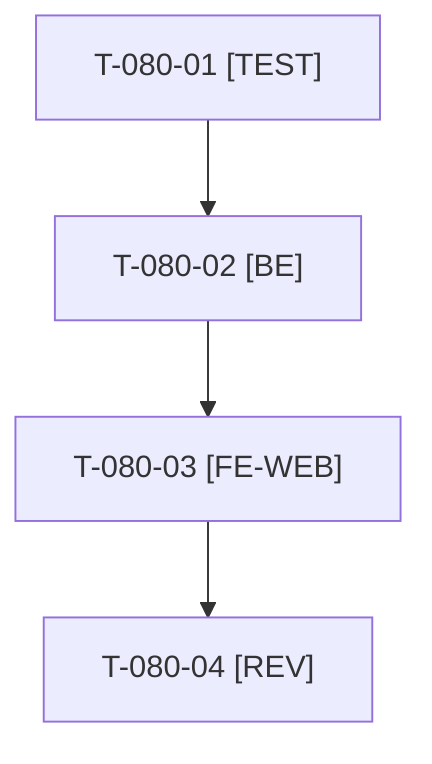

# Tâches : US-080 : Boîte de courriels de démo limitée aux mails des fixtures

## Informations US

- **Epic** : EPIC-10
- **Persona** : Thibaut
- **Story Points** : 2 (Must)
- **Sprint** : sprint-14-bloquants-ouverture
- **Story** : [US-080](../../../backlog/user-stories/US-080.md)

## Résumé de la US

**En tant que** Thibaut
**Je veux** que la page publique des mails de démo n'affiche que les mails des données de démonstration
**Afin de** qu'aucun mail propre aux comptes d'administration ne soit visible du public

## Règles

- Liste blanche (destinataires et types de mails des fixtures) à la place du filtre actuel (`src/Demo/Mail/DemoMailbox.php`, `SensitiveMailFilter.php`). Tests existants : `DemoMailboxTest`, `DemoMailboxMaskingTest`.
- Accès direct à un mail exclu : 404 sans détail. Nouveau type de mail : non publié tant qu'il n'est pas listé.
- Rappels du sprint (D5) : rendu réel vérifié ; `TEST_DB_NAME=<db> WKHTMLTOPDF_BINARY="$PWD/tests/Fixtures/bin/fake-wkhtmltopdf" bin/run-tests …` ; ECS sur `src tests`. Contrat de fin de worker : voir [README.md](./README.md).

## Vue d'ensemble des tâches

| ID | Type | Tâche | Estimation | Dépend de | Statut |
|----|------|-------|------------|-----------|--------|
| T-080-01 | [TEST] | Tests d'intégration rouges : seuls les mails des fixtures, boîte vide, 404 sur mail exclu, nouveau type non publié | 1,5h | - | ✅ |
| T-080-02 | [BE] | Filtre par liste blanche dans `DemoMailbox` (liste et accès direct) ; adapter `SensitiveMailFilter` | 1,5h | T-080-01 | ✅ |
| T-080-03 | [FE-WEB] | Message « aucun mail » FR et EN, rendu réel de la page | 0,5h | T-080-02 | ✅ |
| T-080-04 | [REV] | Revue (aucun mail d'administration visible en anonyme) | 0,5h | T-080-03 | ✅ |

**Total estimé : 4 h** (4 tâches).

## Dépendances

