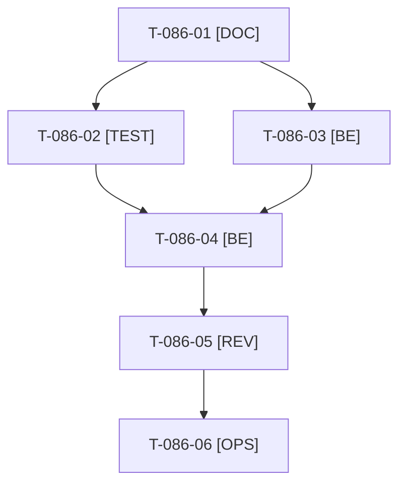

# Tâches : US-086 : Exemple de commande rapide avec de vraies références

## Informations US

- **Epic** : EPIC-11
- **Persona** : Claire
- **Story Points** : 2 (Must)
- **Sprint** : sprint-14-bloquants-ouverture
- **Story** : [US-086](../../../backlog/user-stories/US-086.md)

## Résumé de la US

**En tant que** Claire
**Je veux** que l'exemple de la commande rapide corresponde à de vraies références
**Afin de** copier-coller l'exemple et obtenir un aperçu valide

## Règles

- Deux dépôts (D4). Plugin `/Users/tmonier/Projects/sylius_plugins/sylius-quick-order-plugin` : le placeholder `SKU-001;2…` de `templates/shop/quick_order/_form.html.twig` (ligne 9) devient une option de configuration à défaut neutre (traduction). Démo : valeur par paramètre avec des références réelles (VISS-001, etc., à vérifier dans les fixtures).
- Une PR par dépôt de plugin, livrée avec la démo, puis release de patch (T-086-06). Si la release n'est pas sortie quand la démo est prête, surcharge temporaire du gabarit dans la démo, retirée à la montée de version.
- Rappels du sprint (D5) : rendu réel vérifié ; `TEST_DB_NAME=<db> WKHTMLTOPDF_BINARY="$PWD/tests/Fixtures/bin/fake-wkhtmltopdf" bin/run-tests …` ; ECS sur `src tests`. Contrat de fin de worker : voir [README.md](./README.md).

## Vue d'ensemble des tâches

| ID | Type | Tâche | Estimation | Dépend de | Statut |
|----|------|-------|------------|-----------|--------|
| T-086-01 | [DOC] | Arbitrer et consigner : option de configuration + traduction neutre (plugin), références réelles (démo) ; relever 2 références valides du catalogue | 0,5h | - | 🔲 |
| T-086-02 | [TEST] | Test de fumée de la démo : coller l'exemple, aperçu à deux lignes valides ; échec nommant la référence retirée | 1h | T-086-01 | 🔲 |
| T-086-03 | [BE] | Plugin quick-order : option `placeholder` et défaut neutre, tests et README ; branche `main` à jour | 1,5h | T-086-01 | 🔲 |
| T-086-04 | [BE] | Démo : paramètre des références d'exemple (ou surcharge temporaire du gabarit) | 0,5h | T-086-02, T-086-03 | 🔲 |
| T-086-05 | [REV] | Revue des deux dépôts (rendu réel de la page de commande rapide FR et EN) | 0,5h | T-086-04 | 🔲 |
| T-086-06 | [OPS] | 📅 PR du plugin avec la démo, merge puis release de patch (GO de Thibaut) ; montée de version dans la démo | 0,5h | T-086-05 | 🔲 |

**Total estimé : 4,5 h** (6 tâches), dont 0,5 h calendaire(s) (📅).

## Dépendances

