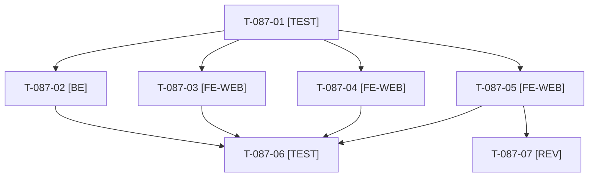

# Tâches : US-087 : Signaux « prototype » : 23/24 plugins, clés brutes, libellés anglais

## Informations US

- **Epic** : EPIC-11
- **Persona** : Nadia
- **Story Points** : 3 (Must)
- **Sprint** : sprint-14-bloquants-ouverture
- **Story** : [US-087](../../../backlog/user-stories/US-087.md)

## Résumé de la US

**En tant que** Nadia
**Je veux** ne voir aucune clé de traduction brute, aucun libellé anglais résiduel ni chiffre incohérent
**Afin de** croire à un produit fini

## Règles

- Nombre de plugins calculé depuis la source unique `config/demo/plugins.yaml` (24). Le titre punchout reste dans US-070.
- Après US-104 pour la page Plugins (mêmes gabarits). Smoke « aucune clé brute » étendu à l'admin.
- Rappels du sprint (D5) : rendu réel vérifié ; `TEST_DB_NAME=<db> WKHTMLTOPDF_BINARY="$PWD/tests/Fixtures/bin/fake-wkhtmltopdf" bin/run-tests …` ; ECS sur `src tests`. Contrat de fin de worker : voir [README.md](./README.md).

## Vue d'ensemble des tâches

| ID | Type | Tâche | Estimation | Dépend de | Statut |
|----|------|-------|------------|-----------|--------|
| T-087-01 | [TEST] | Tests rouges : nombre calculé = 24 (accueil, À propos), statut des plugins, devis vide, smoke « clé brute » boutique et admin | 1,5h | - | ✅ |
| T-087-02 | [BE] | Nombre de plugins calculé depuis `config/demo/plugins.yaml` (accueil et À propos) | 1h | T-087-01 | ✅ |
| T-087-03 | [FE-WEB] | Mention « en cours » ou « à venir » pour chaque plugin non publié | 0,5h | T-087-01, T-104-03 | ✅ |
| T-087-04 | [FE-WEB] | Devis vide : message FR et EN à la place de la clé `sylius.ui.continue_shopping` | 0,5h | T-087-01 | ✅ |
| T-087-05 | [FE-WEB] | Admin en français : tableau de bord (« Sales », « Paid orders count ») et noms de produits du journal d'audit | 1,5h | T-087-01 | 🔲 |
| T-087-06 | [TEST] | ⚠️ Parcours de rendu réel des pages clés (boutique et admin) FR et EN contre les clés brutes | 0,5h | T-087-02, T-087-03, T-087-04, T-087-05, T-070-02 | 🔲 |
| T-087-07 | [REV] | Revue | 0,5h | T-087-05 | 🔲 |

**Total estimé : 6 h** (7 tâches), sacrifiable(s) ⚠️ : T-087-06.

## Dépendances

