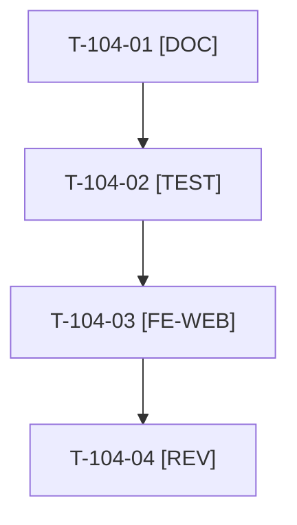

# Tâches : US-104 : Retirer l'encart « Sylius Plus » de la page Plugins

## Informations US

- **Epic** : EPIC-12
- **Persona** : Thibaut
- **Story Points** : 1 (Must)
- **Sprint** : sprint-14-bloquants-ouverture
- **Story** : [US-104](../../../backlog/user-stories/US-104.md)

## Résumé de la US

**En tant que** Thibaut
**Je veux** remplacer l'encart final « Sylius Plus » par la phrase factuelle « Ces plugins s'installent sur Sylius 2.3 »
**Afin de** ne jamais ouvrir de comparaison avec l'offre officielle

## Règles

- Décision D2 de Thibaut (2026-10-18), à consigner dans la story avant toute modification. FR : « Ces plugins s'installent sur Sylius 2.3. » ; EN : « These plugins install on Sylius 2.3. » Aucune comparaison.
- Fichiers : `translations/plugins_plus.fr.yaml` et `translations/plugins_plus.en.yaml` (US-046) et le gabarit de `templates/shop/plugins`. Relire les autres mentions comparatives de la démo (charte d'US-063).
- Rappels du sprint (D5) : rendu réel vérifié ; `TEST_DB_NAME=<db> WKHTMLTOPDF_BINARY="$PWD/tests/Fixtures/bin/fake-wkhtmltopdf" bin/run-tests …` ; ECS sur `src tests`. Contrat de fin de worker : voir [README.md](./README.md).

## Vue d'ensemble des tâches

| ID | Type | Tâche | Estimation | Dépend de | Statut |
|----|------|-------|------------|-----------|--------|
| T-104-01 | [DOC] | Consigner la décision D2 et sa date dans `US-104.md` ; inventaire des mentions de Sylius Plus dans la démo | 0,5h | - | 🔲 |
| T-104-02 | [TEST] | Tests rouges : phrase factuelle FR et EN, plus d'encart ; contrôle de charte signalant tout passage comparatif | 0,5h | T-104-01 | 🔲 |
| T-104-03 | [FE-WEB] | Remplacer l'encart et les traductions `plugins_plus.*` | 0,5h | T-104-02 | 🔲 |
| T-104-04 | [REV] | Revue (rendu réel de la page Plugins FR et EN, mentions résiduelles) | 0,5h | T-104-03 | 🔲 |

**Total estimé : 2 h** (4 tâches).

## Dépendances

