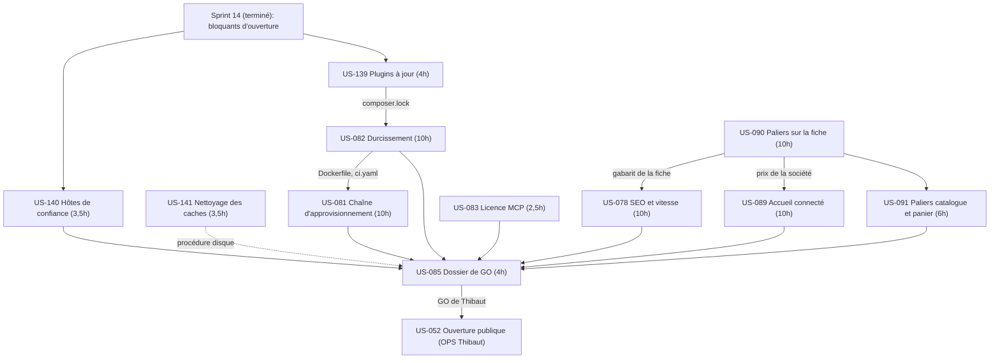
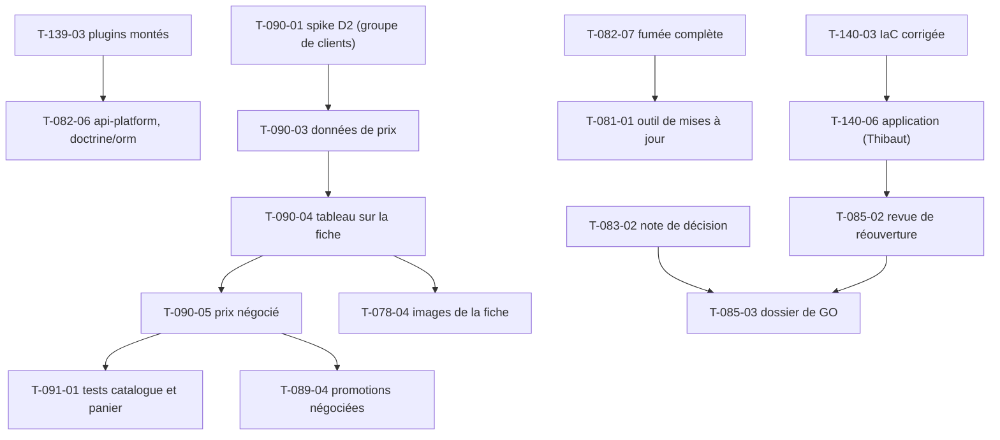

# Dépendances : Sprint 015 (Dossier de GO)

## Entre stories et avec les sprints précédents

## Entre tâches (vue transversale)

## Chemin critique

US-090 (T-090-01, T-090-03, T-090-04, T-090-05, 6,5 h) → US-091 (T-091-01, T-091-02, T-091-04, 4 h) en parallèle d'US-089 (T-089-04 à T-089-06, 4 h) → US-085 (T-085-03, T-085-04, 1,5 h). Environ 12 h en série ; le reste est parallélisable si les fichiers ne se recoupent pas. Les tâches de Thibaut (T-140-06, T-083-04, T-085-05) et la bascule d'US-052 sortent du chemin critique de développement.

## Ressources partagées

- `composer.json`, `composer.lock` : US-139 puis US-082 (T-082-06) ; un worker à la fois.
- Serveur web (en-têtes, fichiers servis) : US-082 ; `Dockerfile` et `.github/workflows/ci.yaml` : US-082 puis US-081.
- `.railway/railway.ts`, `docs/sous-domaine-demo.md`, `docs/deploiement-railway.md` : US-140 seulement.
- Gabarits de la fiche produit : US-090 puis US-078 ; liste, panier et devis : US-091 ; accueil : US-089 ; fixtures de prix et groupe de la société de démo : US-090 (T-090-03).
- `bin/`, `docs/tests-locaux.md` : US-141 (script et documentation de `bin/measure-mobile`).
- `docs/dossier-de-go.md` : US-085 seulement ; `docs/licence-plugin-mcp.md` : US-083 seulement.
- `.bmad/sprint-status.yaml` : orchestrateur seulement (écrivain unique).
- Comptes, GO et actions de Thibaut : T-140-06, T-083-04, T-085-05, T-052-03 à T-052-07.
