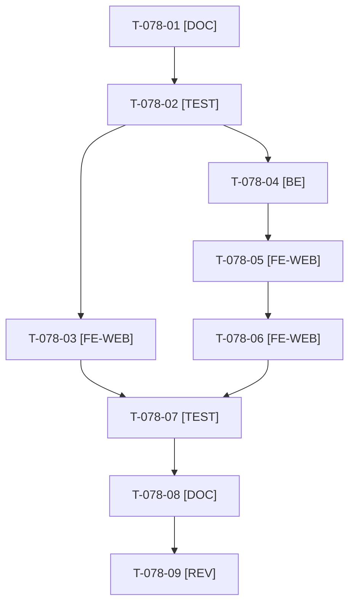

# Tâches : US-078 : SEO de base et vitesse d'affichage mobile

## Informations US

- **Epic** : EPIC-10
- **Persona** : Nadia
- **Story Points** : 5 (Should)
- **Sprint** : sprint-15-dossier-de-go
- **Story** : [US-078](../../../backlog/user-stories/US-078.md)

## Résumé de la US

**En tant que** Nadia
**Je veux** que les pages s'affichent vite sur mobile et que la démo se présente bien dans un aperçu de lien
**Afin de** que le partage d'un lien donne une bonne première impression

## Règles

- Le `noindex` reste en place (démo non indexée) ; on ajoute meta description et métadonnées de partage (titre, description, image), et on réduit le poids des images (dimensions explicites, tailles adaptées, chargement différé hors écran, première image prioritaire).
- Mesure Lighthouse avant et après consignée (LCP mobile ≤ 2,5 s sur fiche et catégorie, CLS < 0,1). Le domaine du site (D3) sert aux URL d'aperçu quand `CANONICAL_IS_PUBLIC_HOST` est actif.
- La fiche produit est aussi modifiée par US-090 : sérialiser (US-078 sur les images et l'en-tête, US-090 sur le contenu).
- Rappels du sprint (D4) : rendu réel vérifié ; `TEST_DB_NAME=<db> WKHTMLTOPDF_BINARY="$PWD/tests/Fixtures/bin/fake-wkhtmltopdf" bin/run-tests …` (le seuil `MIN_FREE_GB` n'est jamais abaissé) ; ECS sur `src tests` ; aucun détail exploitable dans les documents (dépôt public). Contrat de fin de worker (≤ 100 mots) : voir [README.md](./README.md).

## Vue d'ensemble des tâches

| ID | Type | Tâche | Estimation | Dépend de | Statut |
|----|------|-------|------------|-----------|--------|
| T-078-01 | [DOC] | Mesure Lighthouse avant (mobile : LCP fiche et catégorie, CLS, SEO) consignée | 1h | - | ✅ |
| T-078-02 | [TEST] | Tests rouges : meta description et métadonnées de partage, `noindex` conservé, dimensions des images, chargement différé, première image prioritaire, visuel de repli | 1,5h | T-078-01 | ✅ |
| T-078-03 | [FE-WEB] | Meta description et métadonnées de partage (titre, description, image), `noindex` conservé | 1,5h | T-078-02 | ✅ |
| T-078-04 | [BE] | Images produit adaptées : tailles générées, `srcset`, format léger, sans appel externe au runtime | 2h | T-078-02 | ✅ |
| T-078-05 | [FE-WEB] | Dimensions explicites, chargement différé hors écran, première image prioritaire (LCP, CLS) | 1,5h | T-078-04 | ✅ |
| T-078-06 | [FE-WEB] | Visuel de repli quand l'image est absente, sans erreur | 0,5h | T-078-05 | ✅ |
| T-078-07 | [TEST] | Mesure Lighthouse après : LCP ≤ 2,5 s fiche et catégorie, CLS < 0,1 ; consignée | 1h | T-078-03, T-078-06 | ✅ |
| T-078-08 | [DOC] | Documentation (`docs/images-produits.md`) et avant/après | 0,5h | T-078-07 | ✅ |
| T-078-09 | [REV] | Revue (rendu réel FR et EN, aperçu de lien) | 0,5h | T-078-08 | 🔲 |

**Total estimé : 10 h** (9 tâches).

## Dépendances

